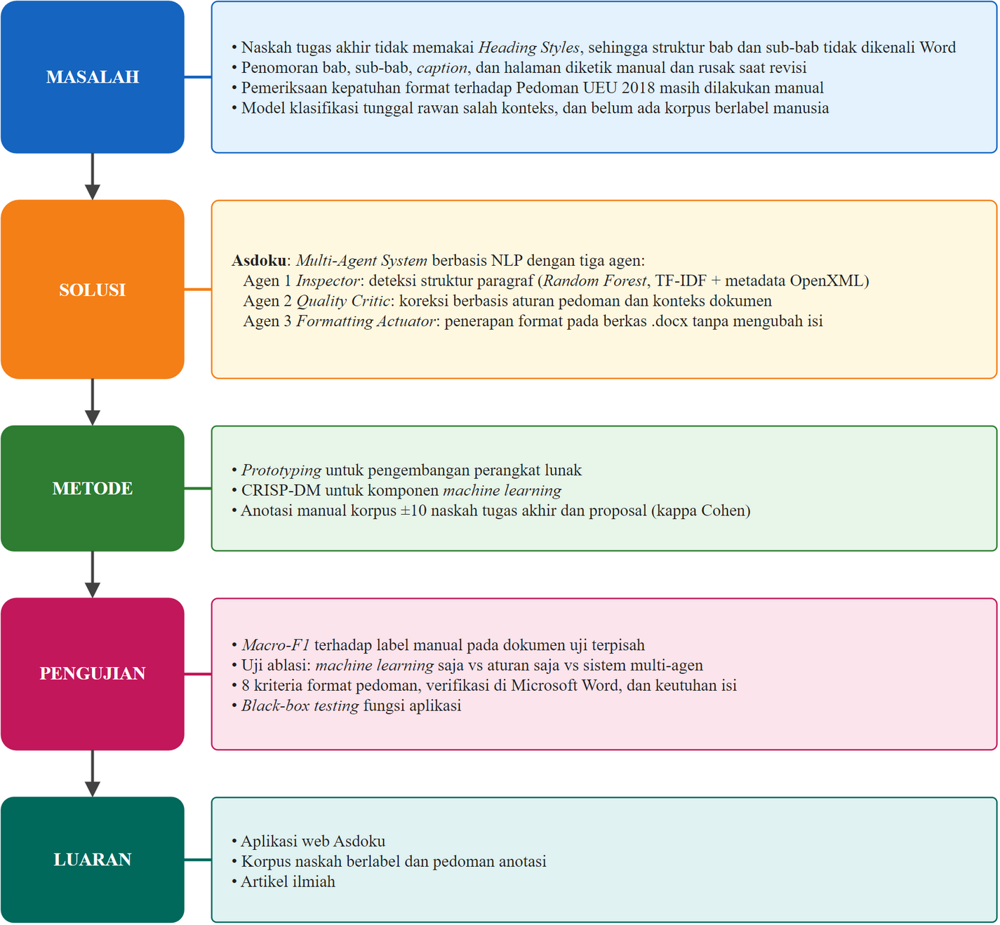
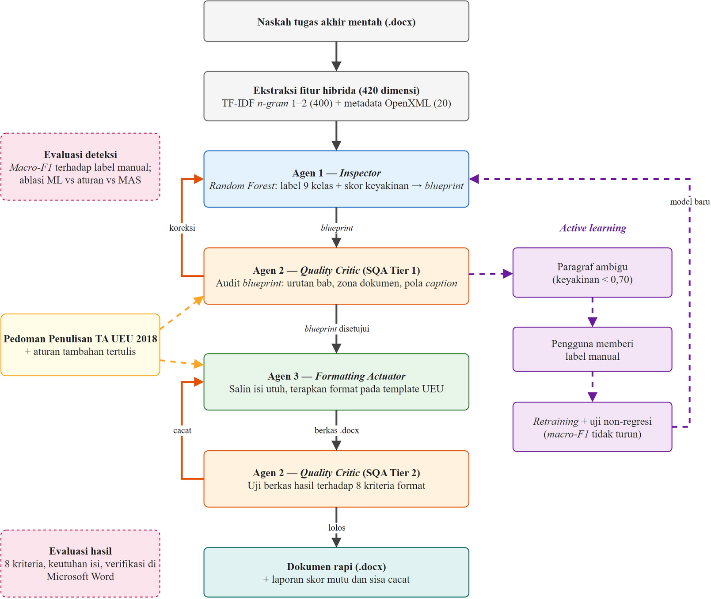
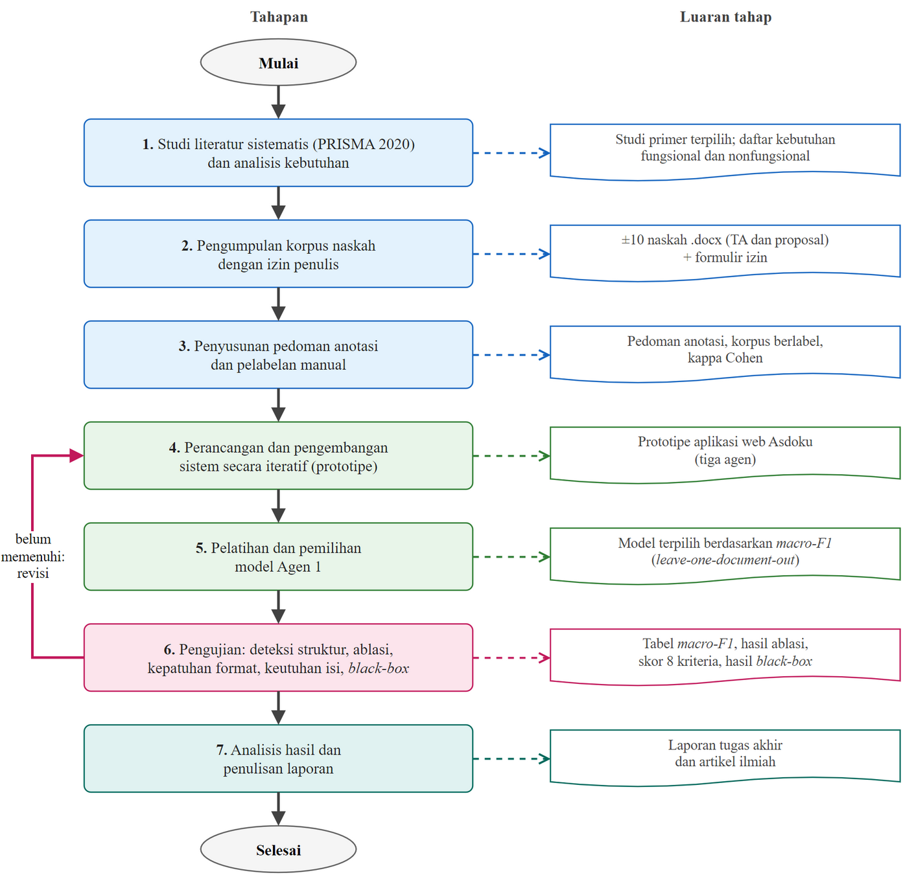

# DRAF PROPOSAL TUGAS AKHIR

> **Status:** Draf v0.1 (5 November 2026). Struktur mengikuti *Ringkasan Perbedaan Proposal TA dan Laporan TA Final* Fakultas Ilmu Komputer; format bab mengikuti Pedoman Penulisan Skripsi UEU 2018 (SK Rektor No. 5 Tahun 2018).
>
> **Penanda di dalam draf:**
> - `[ISI: ...]` = data yang harus diisi sendiri (nama dosen, jadwal, data lapangan).
> - `[PERLU SUMBER]` = klaim yang butuh rujukan atau data sebelum diajukan.
> - `[KONFIRMASI DOSPEM]` = keputusan metodologis yang sebaiknya disetujui pembimbing.
> - Semua entri Daftar Referensi wajib dicek ulang di Mendeley (volume, halaman, DOI).

---

## HALAMAN JUDUL

**PROPOSAL TUGAS AKHIR**

**RANCANG BANGUN MULTI-AGENT SYSTEM BERBASIS NATURAL LANGUAGE PROCESSING UNTUK OTOMATISASI DETEKSI STRUKTUR DAN FORMATTING DOKUMEN TUGAS AKHIR (STUDI KASUS: FAKULTAS ILMU KOMPUTER UNIVERSITAS ESA UNGGUL)**

Disusun oleh:
Arditya Adjie Rosandi
20230801274
Teknik Informatika

PROGRAM STUDI TEKNIK INFORMATIKA
FAKULTAS ILMU KOMPUTER
UNIVERSITAS ESA UNGGUL
JAKARTA
2026

---

## LEMBAR PENGESAHAN PROPOSAL TUGAS AKHIR

| | |
|---|---|
| Judul Proposal | Rancang Bangun Multi-Agent System Berbasis Natural Language Processing untuk Otomatisasi Deteksi Struktur dan Formatting Dokumen Tugas Akhir (Studi Kasus: Fakultas Ilmu Komputer Universitas Esa Unggul) |
| Nama Mahasiswa | Arditya Adjie Rosandi |
| NIM | 20230801274 |
| Program Studi | Teknik Informatika |

Menyetujui,

| Dosen Pembimbing I, | Dosen Pembimbing II, |
|---|---|
| `[ISI: Nama & Gelar]` | `[ISI: Nama & Gelar, jika ada]` |
| NIDN: `[ISI]` | NIDN: `[ISI]` |

Mengetahui,
Ketua Program Studi Teknik Informatika,
`[ISI: Nama & Gelar]`
NIDN: `[ISI]`

---

## ABSTRAK

*Opsional untuk proposal. Hapus bagian ini jika pedoman/pembimbing tidak meminta. Jika diminta, susun pola IMRAD dengan Result berisi rencana hasil.*

---

## KATA PENGANTAR

Puji dan syukur penulis panjatkan ke hadirat Allah SWT atas rahmat dan karunia-Nya, sehingga penulis dapat menyelesaikan Proposal Tugas Akhir yang berjudul "Rancang Bangun Multi-Agent System Berbasis Natural Language Processing untuk Otomatisasi Deteksi Struktur dan Formatting Dokumen Tugas Akhir (Studi Kasus: Fakultas Ilmu Komputer Universitas Esa Unggul)".

Proposal ini disusun sebagai salah satu syarat untuk melaksanakan Tugas Akhir pada Program Studi Teknik Informatika, Fakultas Ilmu Komputer, Universitas Esa Unggul. Gagasan penelitian ini berangkat dari pengalaman penulis sendiri dan rekan-rekan mahasiswa yang menghabiskan banyak waktu merapikan format naskah agar sesuai dengan pedoman penulisan, sehingga waktu untuk mengerjakan substansi penelitian menjadi berkurang. Melalui penelitian ini, penulis berharap dapat menghadirkan alat bantu yang mengotomatisasi pekerjaan tersebut tanpa mengubah isi tulisan.

Dalam penyusunan proposal ini, penulis mendapat banyak bantuan, bimbingan, dan dukungan dari berbagai pihak. Oleh karena itu, penulis menyampaikan terima kasih kepada:

1. Kedua orang tua dan keluarga tercinta atas doa, dukungan moral maupun materiil, dan semangat yang tiada henti selama masa perkuliahan.
2. Bapak Dr. Ir. Arief Kusuma A.P., S.T., MBA., IPU, ASEAN Eng., selaku Rektor Universitas Esa Unggul. `[CEK: nama dan gelar masih sesuai]`
3. Bapak Dr. Gerry Firmansyah, S.T., M.Kom., selaku Dekan Fakultas Ilmu Komputer Universitas Esa Unggul. `[CEK: nama dan gelar masih sesuai]`
4. `[ISI: Nama & Gelar]`, selaku Ketua Program Studi Teknik Informatika, atas persetujuan topik dan arahan akademik.
5. `[ISI: Nama & Gelar]`, selaku Dosen Pembimbing, yang telah meluangkan waktu untuk memberikan arahan, koreksi, dan saran dalam penyusunan proposal ini.
6. `[ISI: Nama & Gelar]`, selaku dosen pengampu mata kuliah Kapita Selekta, yang telah membimbing tahap awal perumusan topik dan tinjauan literatur penelitian ini. `[Opsional: hapus bila tidak relevan]`
7. Rekan-rekan mahasiswa Fakultas Ilmu Komputer yang bersedia meminjamkan naskahnya sebagai data penelitian dan mengisi kuesioner studi pendahuluan.
8. Seluruh dosen dan staf Fakultas Ilmu Komputer Universitas Esa Unggul atas ilmu dan layanan yang diberikan selama masa perkuliahan.

Penulis menyadari bahwa proposal ini masih memiliki kekurangan. Oleh karena itu, kritik dan saran yang membangun sangat penulis harapkan demi penyempurnaan penelitian ini. Akhir kata, semoga proposal ini dapat menjadi landasan yang baik bagi pelaksanaan Tugas Akhir dan bermanfaat bagi pengembangan ilmu pengetahuan di bidang Ilmu Komputer.

Jakarta, `[ISI: Tanggal]`

Arditya Adjie Rosandi

---

## DAFTAR ISI / DAFTAR TABEL / DAFTAR GAMBAR / DAFTAR LAMPIRAN

*Dibuat otomatis di Microsoft Word (field TOC) setelah naskah dipindahkan ke .docx.*

---

## BAB I PENDAHULUAN

### 1.1 Latar Belakang

Penyusunan tugas akhir di perguruan tinggi tidak hanya menuntut kualitas substansi, tetapi juga kepatuhan terhadap ketentuan tata tulis institusi. Di Universitas Esa Unggul, ketentuan tersebut diatur dalam Pedoman Penulisan Skripsi yang ditetapkan melalui Surat Keputusan Rektor Nomor 5 Tahun 2018, yang mengatur antara lain ukuran kertas dan margin, jenis serta ukuran huruf, penomoran bab dan sub-bab, penomoran halaman bagian awal dan isi, format judul tabel dan gambar, serta penulisan daftar pustaka (Universitas Esa Unggul, 2018).

Dalam praktiknya, sebagian besar mahasiswa menyusun naskah di Microsoft Word tanpa memanfaatkan fitur struktural yang disediakan, seperti *Heading Styles*, *multilevel list*, *section break*, dan *field* penomoran otomatis. Judul bab dan sub-bab sering hanya dibuat tebal secara manual, nomor sub-bab dan nomor *caption* diketik langsung, dan penomoran halaman Romawi untuk bagian awal dipisahkan dari penomoran Arab dengan cara yang tidak konsisten. Akibatnya, *Navigation Pane* kosong, Daftar Isi harus disusun manual, dan penomoran menjadi rusak setiap kali naskah direvisi. Masalah ini tidak selalu tertangkap dalam proses bimbingan: Putra et al. (2026) menemukan pelanggaran format pada 15,9% pasangan dokumen–aturan di 17 skripsi yang telah disetujui pembimbing dan penguji. `[ISI: hasil kuesioner studi pendahuluan — lihat Kuesioner_Studi_Pendahuluan.md. Contoh kalimat: "Studi pendahuluan terhadap N mahasiswa Fakultas Ilmu Komputer UEU (bulan tahun) menunjukkan X% responden mengetik nomor sub-bab secara manual dan Y% memperkirakan menghabiskan lebih dari 3 jam untuk merapikan format."]`

Pemeriksaan kepatuhan format tersebut hingga kini dilakukan secara manual oleh mahasiswa dan dosen pembimbing. Template Word resmi hanya membantu bila digunakan sejak awal penulisan dan tidak dapat memperbaiki naskah yang telah ditulis dengan format bebas. Untuk memperbaiki naskah secara otomatis, sebuah sistem perlu terlebih dahulu **memahami struktur** naskah, yaitu menentukan apakah suatu paragraf merupakan judul bab, sub-bab, paragraf isi, *caption*, atau entri daftar pustaka, dan kemudian **menerapkan format** yang sesuai tanpa mengubah isi tulisan.

Penentuan struktur dari teks tidak terstruktur merupakan persoalan *Natural Language Processing* (NLP). Kajian sistematis menunjukkan bahwa teknik NLP dan model klasifikasi efektif untuk mengekstraksi struktur dari teks tidak terstruktur (Roldan-Baluis et al., 2022), dan algoritma *machine learning* klasik tetap kompetitif sebagai pendekatan yang ringan dan dapat dijelaskan (Ali et al., 2024). Namun, klasifikasi per paragraf saja tidak cukup, karena makna struktural suatu paragraf sering bergantung pada konteks dokumen: baris "1. Latar Belakang" dapat berupa sub-bab atau butir daftar tergantung letaknya. Literatur sistem multi-agen terkini menunjukkan bahwa model tunggal yang monolitik rentan gagal pada kasus seperti ini, dan merekomendasikan arsitektur hibrida yang memadukan model berbasis data dengan kontrol simbolik serta pembagian peran antar-agen (La Malfa et al., 2025; Gabauer, 2026; Muwa et al., 2026; Petridis et al., 2025).

Di sisi lain, korpus naskah ilmiah terstruktur yang tersedia untuk riset NLP sebagian besar berbahasa Inggris atau Mandarin (Saier et al., 2023; Li et al., 2022). Belum tersedia korpus naskah tugas akhir berbahasa Indonesia yang dilabeli struktur paragrafnya oleh manusia, sehingga kinerja sistem semacam ini belum dapat diukur secara valid.

Berdasarkan uraian tersebut, penelitian ini merancang bangun sebuah *Multi-Agent System* bernama **Asdoku** (Asisten Dokumenku) yang terdiri atas tiga agen: agen pendeteksi struktur berbasis *machine learning* dengan fitur teks NLP dan metadata OpenXML, agen pengendali mutu berbasis aturan pedoman UEU, dan agen pelaksana *formatting* yang merekonstruksi berkas `.docx` tanpa menghilangkan isi. Kinerja sistem akan dievaluasi pada korpus naskah tugas akhir dan proposal mahasiswa Fakultas Ilmu Komputer Universitas Esa Unggul yang dilabeli secara manual.

### 1.2 Identifikasi Masalah

1. Naskah tugas akhir mahasiswa umumnya tidak menggunakan *Heading Styles* Microsoft Word, sehingga struktur bab dan sub-bab tidak dikenali oleh Word dan Daftar Isi harus dibuat secara manual.
2. Penomoran sub-bab, *caption* tabel dan gambar, serta halaman Romawi dan Arab sering diketik manual sehingga rusak ketika naskah direvisi.
3. Pemeriksaan kepatuhan format terhadap Pedoman Penulisan Skripsi UEU 2018 masih dilakukan secara manual oleh mahasiswa dan dosen pembimbing.
4. Template Word resmi tidak dapat memperbaiki naskah yang telah ditulis dengan format bebas.
5. Klasifikasi struktur per paragraf dengan satu model tunggal rentan salah karena tidak mempertimbangkan konteks dokumen.
6. Belum tersedia korpus naskah tugas akhir berbahasa Indonesia dengan label struktur hasil anotasi manusia untuk mengukur kinerja deteksi struktur secara valid.

### 1.3 Rumusan Masalah

1. Bagaimana merancang representasi fitur berbasis *Natural Language Processing* yang dipadukan dengan metadata OpenXML untuk mengklasifikasikan elemen struktur dokumen tugas akhir?
2. Bagaimana merancang bangun arsitektur *Multi-Agent System* yang terdiri atas agen deteksi, agen pengendali mutu, dan agen *formatting* untuk mengotomatisasi deteksi struktur dan *formatting* dokumen tugas akhir sesuai Pedoman Penulisan Skripsi UEU 2018?
3. Bagaimana kinerja deteksi struktur sistem, diukur dengan *macro-F1* terhadap label manual, pada naskah yang tidak digunakan dalam pelatihan, dan apakah kolaborasi agen meningkatkan kinerja dibandingkan model *machine learning* saja?
4. Bagaimana tingkat kepatuhan format dan keutuhan isi dokumen hasil sistem terhadap kriteria Pedoman Penulisan Skripsi UEU 2018 ketika diperiksa di Microsoft Word?

### 1.4 Tujuan Penelitian

1. Merancang representasi fitur hibrida (fitur teks TF-IDF dan fitur metadata OpenXML) untuk klasifikasi elemen struktur dokumen tugas akhir.
2. Merancang dan membangun *Multi-Agent System* Asdoku yang mengotomatisasi deteksi struktur dan *formatting* dokumen tugas akhir.
3. Mengukur kinerja deteksi struktur pada dokumen uji yang terpisah dari data latih serta membandingkan kinerja model *machine learning* saja dengan kinerja sistem multi-agen.
4. Mengukur tingkat kepatuhan format dan keutuhan isi dokumen hasil sistem terhadap kriteria pedoman.

### 1.5 Batasan Masalah

1. Dokumen yang diproses adalah naskah tugas akhir dan proposal tugas akhir mahasiswa Fakultas Ilmu Komputer Universitas Esa Unggul dalam format Microsoft Word (`.docx`) berbahasa Indonesia. Laporan magang/MBKM, berkas PDF, dan hasil pindaian tidak termasuk.
2. Acuan format adalah Pedoman Penulisan Skripsi UEU 2018 (SK Rektor No. 5 Tahun 2018). Ketentuan yang tidak diatur pedoman ditetapkan sebagai asumsi tertulis dan dicantumkan pada Lampiran.
3. Struktur dokumen diklasifikasikan ke dalam sembilan kelas: metadata sampul, judul halaman awal, judul bab, sub-bab, paragraf isi, *caption* gambar, *caption* tabel, entri daftar pustaka, dan lainnya.
4. Sistem memeriksa dan memperbaiki **format**, bukan substansi isi, tata bahasa, kebenaran sitasi, maupun plagiarisme.
5. Agen deteksi menggunakan algoritma *machine learning* klasik (Random Forest sebagai model utama, dengan Logistic Regression dan XGBoost sebagai pembanding). Model bahasa besar (LLM) tidak digunakan.
6. Korpus penelitian terdiri atas sekitar 10 naskah (±5 naskah tugas akhir dan ±5 proposal) dari penulis berbeda yang diperoleh dengan izin. `[KONFIRMASI DOSPEM: jumlah minimal naskah]`
7. Verifikasi tampilan hasil dilakukan pada Microsoft Word versi desktop untuk Windows.
8. Sistem dibangun sebagai aplikasi web (FastAPI) yang dijalankan secara lokal. Integrasi dengan sistem informasi akademik kampus tidak termasuk.

### 1.6 Manfaat Penelitian

#### 1.6.1 Manfaat Teoretis

1. Memberikan bukti empiris mengenai kontribusi kolaborasi agen hibrida (model statistik dan kontrol aturan) dibandingkan model tunggal pada tugas deteksi struktur dokumen.
2. Menghasilkan korpus naskah tugas akhir berbahasa Indonesia berlabel struktur beserta pedoman anotasinya sebagai acuan bagi penelitian sejenis.

#### 1.6.2 Manfaat Praktis

1. Bagi mahasiswa: mengurangi waktu yang dihabiskan untuk merapikan format naskah secara manual.
2. Bagi dosen pembimbing: memungkinkan waktu bimbingan lebih terfokus pada substansi.
3. Bagi Fakultas Ilmu Komputer: menyediakan alat bantu pemeriksaan kepatuhan format yang selaras dengan pedoman institusi.

### 1.7 Kerangka Berpikir Ringkas

Kerangka berpikir penelitian ini ditunjukkan pada Gambar 1.1.

{width=14cm}

**Gambar 1.1 Kerangka Berpikir Ringkas**

### 1.8 Metodologi Ringkas

- **Pendekatan:** Penelitian rancang bangun (*research and development*) dengan evaluasi kuantitatif eksperimental.
- **Metode pengembangan:** *Prototyping* untuk perangkat lunak; tahapan CRISP-DM untuk komponen *machine learning*. `[KONFIRMASI DOSPEM]`
- **Pengumpulan data:** Studi literatur sistematis (PRISMA), dokumentasi (pengumpulan naskah dengan izin), anotasi manual, dan eksperimen.
- **Analisis:** *Confusion matrix*, *precision*, *recall*, *macro-F1*, uji ablasi, pemeriksaan 8 kriteria format, pemeriksaan keutuhan isi, dan *black-box testing*.

---

## BAB II STUDI TEORITIS

### 2.1 Penelitian Terdahulu

**Tabel 2.1 Penelitian Terdahulu**

| No | Peneliti (Tahun) | Judul | Metode | Hasil | Perbedaan dengan Penelitian Ini |
|---|---|---|---|---|---|
| 1 | La Malfa et al. (2025) | Large Language Models Miss the Multi-Agent Mark | Kajian kritis sistem multi-agen berbasis LLM | Banyak sistem "multi-agen" berbasis LLM tidak memenuhi karakteristik multi-agen sejati karena desain statis dan terlalu disederhanakan | Penelitian ini membangun agen dengan peran dan kewenangan terpisah tanpa LLM |
| 2 | Gabauer (2026) | LLM-based agent systems: a systematic literature review and position on hybrid architectures and evaluation frameworks | *Systematic literature review* | Merekomendasikan arsitektur hibrida (model + kontrol simbolik) dan kerangka evaluasi terpadu | Penelitian ini menerapkan arsitektur hibrida pada domain format dokumen akademik |
| 3 | Petridis et al. (2025) | Assessing Agentic AI & AI Agents Concepts and Platforms Through the Lens of Traditional Multi-Agent Systems Principles | Evaluasi konseptual | Prinsip otonomi, pembagian peran, dan koordinasi tetap relevan untuk sistem agen modern | Penelitian ini menerapkan pembagian peran deteksi–pengendalian mutu–eksekusi |
| 4 | Muwa et al. (2026) | Hybrid Neuro-Symbolic Planning Frameworks: A Systematic Review (2023–2025) | *Systematic review* | Kombinasi model berbasis data dan penalaran simbolik menghasilkan keputusan lebih andal dan dapat dijelaskan | Penelitian ini menggabungkan klasifikasi Random Forest dengan aturan pedoman UEU |
| 5 | Ali et al. (2024) | An Exhaustive Comparative Study of Machine Learning Algorithms for NLP Applications | Studi komparatif algoritma ML | Algoritma ML klasik efektif sebagai *baseline* dan untuk lingkungan sumber daya terbatas | Penelitian ini membandingkan Random Forest, Logistic Regression, dan XGBoost untuk klasifikasi struktur paragraf |
| 6 | Roldan-Baluis et al. (2022) | The Effect of NLP on the Analysis of Unstructured Text: A Systematic Review | *Systematic review* | NLP efektif untuk mengekstraksi struktur dari teks tidak terstruktur | Penelitian ini menambahkan fitur metadata OpenXML ke fitur teks |
| 7 | Saier et al. (2023) | unarXive 2022: All arXiv Publications Pre-Processed for NLP | Pembangunan korpus | Korpus teks ilmiah terstruktur skala besar (bahasa Inggris) | Penelitian ini membangun korpus naskah tugas akhir berbahasa Indonesia berlabel manual |
| 8 | Li et al. (2022) | CSL: A Large-scale Chinese Scientific Literature Dataset | Pembangunan korpus | Korpus literatur ilmiah bahasa non-Inggris untuk tugas NLP | Sama seperti di atas, untuk bahasa Indonesia dan domain format |
| 9 | Blagec et al. (2022) | A global analysis of metrics used for measuring performance in NLP | Analisis metrik | Pemetaan metrik evaluasi NLP dan keterbatasannya | Penelitian ini memakai *macro-F1* karena distribusi kelas tidak seimbang |
| 10 | Chou (2026) | AI-as-a-Judge for software quality assessment | Eksperimen penilai berbasis AI | Penilai berbasis LLM tidak konsisten | Penelitian ini memakai pengendali mutu berbasis aturan yang deterministik |
| 11 | Liu et al. (2026) | Mosaic: A Multi-Level Framework for Observing and Evaluating Performance of Multi-Agent Systems | Kerangka evaluasi | Evaluasi MAS perlu bertingkat dan berorientasi proses | Penelitian ini mengevaluasi per agen (deteksi) dan per artefak (berkas `.docx`) |
| 12 | Putro (2019) | Pendeteksi Kesesuaian Format Laporan Skripsi dengan Panduan Penulisan menggunakan Machine Learning | *Machine learning* | Pemodelan *machine learning* dapat dipakai untuk mendeteksi kesesuaian format laporan skripsi terhadap panduan | Penelitian ini tidak hanya mendeteksi, tetapi juga mengklasifikasikan struktur per paragraf dan memperbaiki format secara otomatis |
| 13 | Castrena et al. (2021) | Pengembangan Perangkat Lunak untuk Otomatisasi Pengecekan Format Penulisan Dokumen Jurnal Skripsi menggunakan Fitur Tag pada XML | *String matching* pada XML dokumen terhadap aturan template | Kesalahan font, ukuran, gaya huruf, dan margin dilaporkan dalam ringkasan PDF; perbaikan dilakukan manual oleh penulis | Penelitian ini memperbaiki dokumen secara otomatis dan menangani struktur (bab, sub-bab, *caption*), bukan hanya properti huruf |
| 14 | Kolinu et al. (2025) | Rancang Bangun Aplikasi Pendeteksi Kesalahan Struktur, Format dan Ejaan Kata Naskah Skripsi | *Prototype*; *exact string matching*, Flask, python-docx, regex | Aplikasi web CekNulis mendeteksi kesalahan struktur, format, dan ejaan pada naskah `.docx` | Penelitian ini mengenali struktur dengan model *machine learning* (bukan pencocokan string eksak) dan memperbaiki format |
| 15 | Aulia & Haviana (2026) | Sistem Pengecekan Format Tugas Akhir Menggunakan Rule-Based System dan Similarity Judul | *Rule-based system*; TF-IDF dan *cosine similarity* judul bab terhadap template | Akurasi 92,86%, *precision* 100%, *recall* 92,65%; memberi rekomendasi perbaikan | Penelitian ini memakai TF-IDF sebagai ciri model klasifikasi per paragraf dan menerapkan perbaikan langsung ke dokumen |
| 16 | Putra et al. (2026) | Resolver Properti Efektif untuk Pemeriksaan Format Skripsi Berbasis Aturan dengan Evaluasi Injeksi Kesalahan | *Rule-based*, 44 aturan dalam 9 kategori, *resolver* pewarisan format OOXML; evaluasi injeksi kesalahan (164 dokumen mutan) dan 17 skripsi | F1 0,985 pada injeksi kesalahan; *precision* 1,000 pada skripsi nyata; pelanggaran tersisa pada 15,9% pasangan dokumen–aturan di skripsi yang sudah lolos pembimbing dan penguji | Penelitian ini memperbaiki, bukan hanya memeriksa, dan menambahkan deteksi struktur berbasis *machine learning* untuk naskah yang tidak memakai *style* |

`[ISI: Pembanding terdekat yang belum masuk tabel: skripsi "DocuForge" Universitas Muhammadiyah Makassar (FastAPI + python-docx, rule-based IF-THEN, mendeteksi 150 masalah format dan mengoreksi otomatis). Abstrak: https://digilibadmin.unismuh.ac.id/upload/50679-Abstrak.pdf — nama penulis dan tahun tidak tercantum di abstrak; cari di repositori UNISMUH lalu tambahkan sebagai baris 17.]`

Penelitian terdahulu di Indonesia tentang format skripsi (Tabel 2.1 nomor 12–16) sebagian besar berupa **pemeriksa** berbasis aturan atau pencocokan string. Sistem tersebut melaporkan kesalahan, sedangkan perbaikannya tetap dilakukan manual (Castrena et al., 2021; Kolinu et al., 2025; Aulia & Haviana, 2026; Putra et al., 2026). Pendekatan berbasis aturan murni juga mengandalkan *style* atau pola teks untuk mengenali bab dan sub-bab, sehingga kesulitan pada naskah yang judulnya hanya dibuat tebal secara manual. Putra et al. (2026) juga menunjukkan bahwa masalah ini nyata: pelanggaran format masih ditemukan pada 15,9% pasangan dokumen–aturan di skripsi yang sudah lolos pembimbing dan penguji. Satu-satunya penelitian yang memakai *machine learning* (Putro, 2019) baru sebatas mendeteksi kesesuaian format, belum memperbaikinya.

Dengan demikian, penelitian terdahulu menunjukkan tiga celah. Pertama, belum ada penerapan arsitektur multi-agen hibrida yang sekaligus mendeteksi struktur dan merekonstruksi berkas `.docx` tanpa menghilangkan isi. Kedua, belum tersedia korpus naskah tugas akhir berbahasa Indonesia dengan label struktur hasil anotasi manusia. Ketiga, evaluasi sistem sejenis umumnya berhenti pada metrik klasifikasi dan belum memeriksa kepatuhan berkas akhir di aplikasi pengolah kata yang sebenarnya. Penelitian ini mengisi ketiga celah tersebut.

### 2.2 Landasan Teori

#### 2.2.1 Pedoman Penulisan Tugas Akhir Universitas Esa Unggul

Pedoman Penulisan Tugas Akhir Universitas Esa Unggul ditetapkan melalui Surat Keputusan Rektor Nomor 5 Tahun 2018 sebagai acuan bagi seluruh mahasiswa dan dosen pembimbing dalam menyusun tugas akhir (Universitas Esa Unggul, 2018). Pedoman ini mengatur dua hal: **susunan** naskah (bagian awal, bagian isi, dan bagian akhir) dan **tata tulis** naskah (kertas, margin, huruf, spasi, dan penomoran). Ketentuan tata tulis inilah yang menjadi aturan yang diotomatisasi dalam penelitian ini. Ringkasannya disajikan pada Tabel 2.2.

**Tabel 2.2 Ketentuan Tata Tulis Pedoman Penulisan Tugas Akhir UEU 2018**

| Aspek | Ketentuan | Rujukan Pedoman |
|---|---|---|
| Kertas | A4 (21 × 29,7 cm), HVS 70 gram, dicetak satu sisi | Bab IV butir A, hlm. 9 |
| Margin | Kiri 4 cm (termasuk 1 cm penjilidan), kanan 3 cm, atas 3 cm, bawah 3 cm | Bab IV butir D, hlm. 10 |
| Huruf dan spasi naskah | Times New Roman 12 pt, spasi 1,15 dengan spasi sebelum dan sesudah 0 pt, rata kiri-kanan | Bab IV butir E, hlm. 10 |
| *Header* | Tulisan "Universitas Esa Unggul", Arial 10 pt tebal, kanan atas, mulai abstrak sampai daftar referensi | Bab IV butir E, hlm. 10 |
| Nomor halaman | Halaman judul tidak bernomor tetapi dihitung; bagian awal angka Romawi kecil (i, ii, iii); bagian isi dan akhir angka Arab (1, 2, 3); tengah bawah, 2 cm dari tepi kertas | Bab IV butir F, hlm. 10 |
| Judul bab | Setiap bab dimulai di halaman baru; huruf kapital seluruhnya, tebal, rata tengah; penomoran Romawi besar (BAB I, BAB II) | Bab III butir B, hlm. 7 |
| Sub-bab | Penomoran angka Arab (1.1, 1.1.1, 1.1.1.1), paling dalam sampai derajat ketiga | Bab III butir A.7, hlm. 7 |
| Tabel, gambar, rumus | Penomoran angka Arab (1.1, 1.2) dan dimuat dalam daftar tabel/gambar/rumus | Bab III butir A.8, hlm. 7 |
| Daftar referensi | Format APA, MLA, Vancouver, atau sesuai arahan fakultas, konsisten dalam satu fakultas | Bab III butir C.1, hlm. 8 |

`[KONFIRMASI DOSPEM: apakah pedoman 2018 masih berlaku atau Fasilkom punya template/pedoman lebih baru. Asdoku saat ini memakai spasi sesudah 6 pt (isi) dan 12/6 pt (sub-bab), sedangkan pedoman 2018 menetapkan 0/0 pt. Sesuaikan tabel ini, Lampiran 2, dan kode setelah ada jawaban.]`

Pedoman tidak mengatur sejumlah detail yang tetap dibutuhkan untuk menghasilkan dokumen yang konsisten, misalnya posisi *caption* tabel dan gambar, jarak antara judul sub-bab dan paragraf, indentasi daftar bernomor, serta bentuk garis tabel. Untuk detail tersebut, penelitian ini menetapkan aturan tambahan yang dicantumkan secara terbuka pada Lampiran 5, sehingga dapat dibedakan antara ketentuan pedoman dan asumsi peneliti.

Pedoman juga membagi bagian isi tugas akhir menjadi enam bab (pendahuluan, tinjauan pustaka, metode, hasil, pembahasan, dan penutup), sedangkan panduan Fakultas Ilmu Komputer menggunakan lima bab dengan hasil dan pembahasan digabung. Oleh karena itu, sistem tidak mengunci jumlah dan nama bab, melainkan mengenali judul bab dari pola penomoran dan posisinya dalam dokumen.

#### 2.2.2 Struktur Dokumen Office Open XML (OOXML)

Berkas `.docx` merupakan paket ZIP yang berisi sekumpulan berkas XML sesuai standar *Office Open XML* (ECMA-376) (Ecma International, 2021). Berbeda dengan teks biasa, isi dokumen Word tersimpan sebagai pohon elemen yang memisahkan **isi** dari **format**. Bagian-bagian yang relevan bagi penelitian ini adalah sebagai berikut.

1. **`word/document.xml`** memuat isi dokumen. Setiap paragraf disimpan sebagai elemen `w:p` yang terdiri atas satu atau lebih *run* (`w:r`), yaitu potongan teks dengan format karakter yang sama. Format paragraf (perataan, spasi, indentasi) disimpan pada `w:pPr`, sedangkan format karakter (jenis huruf, ukuran, tebal, miring) pada `w:rPr`.
2. **`word/styles.xml`** memuat definisi *style*. *Heading Styles* (Heading 1, 2, 3) memiliki tingkat kerangka (`w:outlineLvl`) yang membuat Word mengenali paragraf tersebut sebagai judul, sehingga muncul pada *Navigation Pane* dan dapat dihimpun oleh Daftar Isi otomatis.
3. **`word/numbering.xml`** memuat definisi penomoran bertingkat (*multilevel list*). Satu definisi abstrak (`w:abstractNum`) berisi pengaturan setiap tingkat (`w:lvl`), misalnya format "BAB %1" untuk tingkat pertama dan "%1.%2" untuk tingkat kedua. Dengan cara ini nomor sub-bab dihitung oleh Word, bukan diketik manual.
4. **Properti *section*** (`w:sectPr`) mengatur ukuran kertas (`w:pgSz`), margin (`w:pgMar`), format nomor halaman (`w:pgNumType`, misalnya Romawi kecil atau desimal), serta rujukan *header* dan *footer*. Dokumen yang memerlukan nomor halaman Romawi dan Arab harus dibagi menjadi beberapa *section*.
5. ***Field*** adalah instruksi yang hasilnya dihitung Word, seperti `TOC` (daftar isi), `SEQ` (nomor urut *caption*), dan `PAGE` (nomor halaman). ***Content control*** (`w:sdt`) adalah blok terlindung yang antara lain dipakai oleh Mendeley Cite untuk menyimpan sitasi.

Struktur ini memiliki dua konsekuensi bagi sistem. Pertama, *formatting* yang benar berarti mengubah properti `w:pPr`, `w:rPr`, *style*, dan *section* tanpa menyentuh teks pada `w:r`, sehingga isi naskah tetap utuh. Kedua, Microsoft Word dapat mengabaikan elemen yang urutan atau nilainya tidak sesuai skema tanpa menampilkan pesan galat. Hal ini ditemukan pada tahap prototipe, ketika nomor sub-bab tidak tampil di Word padahal berkas XML-nya tampak benar. Karena itu, hasil sistem harus diverifikasi di Microsoft Word, tidak cukup dengan memeriksa XML.

#### 2.2.3 Natural Language Processing dan Representasi TF-IDF

*Natural Language Processing* (NLP) adalah bidang ilmu komputer yang mempelajari pemrosesan bahasa manusia oleh komputer. Salah satu tugasnya adalah klasifikasi teks, yaitu menetapkan kategori pada suatu potongan teks berdasarkan isinya. Kajian sistematis Roldan-Baluis et al. (2022) menunjukkan bahwa teknik NLP efektif untuk mengekstraksi struktur dan informasi dari teks tidak terstruktur. Dalam penelitian ini, potongan teks yang diklasifikasikan adalah paragraf, dan kategorinya adalah peran struktural paragraf tersebut (judul bab, sub-bab, paragraf isi, dan seterusnya).

Agar dapat diproses oleh algoritma *machine learning*, teks harus diubah menjadi vektor angka. Penelitian ini menggunakan pembobotan *Term Frequency–Inverse Document Frequency* (TF-IDF), yang memberi bobot tinggi pada kata yang sering muncul di suatu paragraf tetapi jarang muncul di paragraf lain (Salton & Buckley, 1988; Manning et al., 2008). Bobot term *t* pada paragraf *d* dihitung sebagai:

> tfidf(*t*, *d*) = tf(*t*, *d*) × idf(*t*)   … (2.1)
>
> idf(*t*) = ln[(1 + *n*) / (1 + df(*t*))] + 1   … (2.2)

dengan tf(*t*, *d*) adalah frekuensi term *t* pada paragraf *d*, *n* adalah jumlah paragraf, dan df(*t*) adalah jumlah paragraf yang memuat term *t*. Persamaan (2.2) merupakan bentuk IDF dengan penghalusan yang digunakan pustaka scikit-learn (Pedregosa et al., 2011). Vektor setiap paragraf kemudian dinormalisasi dengan norma L2.

Term yang digunakan berupa *unigram* dan *bigram* (*n-gram* 1–2), sehingga frasa khas seperti "latar belakang", "daftar pustaka", atau "tabel 2" tertangkap sebagai satu ciri. Jumlah ciri dibatasi pada 400 term dengan frekuensi tertinggi.

Namun, teks saja tidak cukup untuk membedakan beberapa kelas. Kalimat "Rumusan Masalah" dapat berupa judul sub-bab atau kalimat biasa di dalam paragraf. Pembedanya ada pada tampilan: judul cenderung pendek, tebal, dan berukuran lebih besar. Karena itu, vektor TF-IDF digabungkan dengan **20 ciri metadata** yang dibaca dari OOXML, yaitu panjang karakter, jumlah kata, rasio huruf kapital, ukuran huruf, status tebal dan miring, keberadaan penomoran, gambar, dan pemisah halaman, spasi sebelum dan sesudah, jarak baris, indentasi baris pertama dan kiri, posisi relatif paragraf dalam dokumen, serta perataan (lima kategori *one-hot*). Gabungan ini menghasilkan representasi hibrida berdimensi 420.

#### 2.2.4 Klasifikasi dengan Random Forest

*Random Forest* adalah metode ensembel yang membangun banyak pohon keputusan dan menggabungkan hasilnya melalui pemungutan suara (Breiman, 2001). Setiap pohon dilatih pada sampel *bootstrap* dari data latih, dan pada setiap percabangan hanya sebagian ciri yang dipilih secara acak sebagai kandidat pemisah. Kedua sumber keacakan ini membuat pohon-pohon saling berbeda, sehingga kesalahan individual saling meniadakan dan model lebih tahan terhadap *overfitting* dibandingkan satu pohon keputusan.

Untuk paragraf *x*, setiap pohon menghasilkan estimasi probabilitas kelas, dan *Random Forest* merata-ratakannya:

> P(*c* | *x*) = (1 / *T*) Σ*t*=1..*T* P*t*(*c* | *x*)   … (2.3)

dengan *T* adalah jumlah pohon. Kelas prediksi adalah kelas dengan probabilitas tertinggi, dan nilai probabilitas tersebut dipakai sebagai **skor keyakinan**. Paragraf dengan skor keyakinan di bawah 0,70 ditandai sebagai ambigu.

Distribusi kelas pada naskah akademik sangat tidak seimbang: paragraf isi jauh lebih banyak daripada judul bab atau entri daftar pustaka. Untuk mengimbanginya, setiap kelas *c* diberi bobot:

> *w**c* = *n* / (*k* × *n**c*)   … (2.4)

dengan *n* adalah jumlah sampel, *k* adalah jumlah kelas, dan *n**c* adalah jumlah sampel kelas *c* (Pedregosa et al., 2011). Dengan bobot ini, kesalahan pada kelas langka dihitung lebih berat selama pelatihan.

*Random Forest* dipilih sebagai model utama karena (1) bekerja baik pada data tabular yang memadukan ciri teks dan ciri numerik, (2) tidak memerlukan normalisasi skala ciri metadata, dan (3) menghasilkan probabilitas yang dibutuhkan untuk skor keyakinan. Sebagai pembanding, digunakan dua algoritma lain:

1. **Logistic Regression**, model linear yang memodelkan probabilitas kelas dengan fungsi *softmax*, sebagai *baseline* yang sederhana dan cepat.
2. **XGBoost**, metode *gradient boosting* yang membangun pohon secara berurutan, setiap pohon memperbaiki kesalahan pohon sebelumnya (Chen & Guestrin, 2016).

Pemilihan algoritma klasik ini sejalan dengan temuan Ali et al. (2024) bahwa algoritma *machine learning* tradisional tetap efektif untuk aplikasi NLP, khususnya pada data berukuran terbatas.

#### 2.2.5 Multi-Agent System

Agen adalah sistem komputer yang berada dalam suatu lingkungan dan mampu bertindak secara otonom untuk mencapai tujuannya (Wooldridge, 2009). Wooldridge dan Jennings (1995) mencirikan agen dengan empat sifat: **otonomi** (bertindak tanpa campur tangan langsung manusia), **reaktivitas** (menanggapi perubahan lingkungan), **proaktivitas** (berinisiatif mencapai tujuan), dan **kemampuan sosial** (berinteraksi dengan agen lain). *Multi-Agent System* (MAS) adalah sistem yang terdiri atas beberapa agen yang berinteraksi untuk menyelesaikan persoalan yang sulit diselesaikan oleh satu agen.

Literatur terkini menekankan dua prinsip perancangan MAS yang relevan dengan penelitian ini:

1. **Spesialisasi peran.** Membagi tugas ke agen dengan peran berbeda, misalnya pelaksana dan peninjau, meningkatkan kualitas hasil dibandingkan satu agen yang mengerjakan semuanya (Zhang et al., 2024). Prinsip klasik MAS tentang otonomi dan koordinasi tetap menjadi tolok ukur, termasuk untuk sistem agen modern (Petridis et al., 2025). Sebaliknya, banyak sistem yang disebut multi-agen ternyata hanya rangkaian langkah statis tanpa pembagian kewenangan yang jelas (La Malfa et al., 2025).
2. **Arsitektur hibrida.** Menggabungkan komponen berbasis data (statistik) dengan komponen simbolik (aturan) menghasilkan keputusan yang lebih andal dan dapat dijelaskan dibandingkan komponen berbasis data saja (Gabauer, 2026; Muwa et al., 2026). Komponen simbolik juga lebih konsisten sebagai penilai mutu dibandingkan penilai berbasis model generatif (Chou, 2026).

Kedua prinsip tersebut diterapkan pada tiga agen dalam penelitian ini, seperti ditunjukkan Tabel 2.3.

**Tabel 2.3 Peran Agen dalam Sistem Asdoku**

| Agen | Peran | Jenis | Masukan → Keluaran |
|---|---|---|---|
| Agen 1 — *Inspector* | Mendeteksi struktur setiap paragraf | Berbasis data (*Random Forest*) | Naskah `.docx` → rancangan struktur (*blueprint*) dan skor keyakinan |
| Agen 2 — *Quality Critic* | Memeriksa rancangan struktur dan berkas hasil terhadap aturan pedoman dan konteks dokumen | Simbolik (aturan) | *Blueprint* → koreksi; berkas hasil → laporan 8 kriteria |
| Agen 3 — *Formatting Actuator* | Menerapkan format pada salinan dokumen tanpa mengubah isi | Prosedural (manipulasi OOXML) | *Blueprint* disetujui → berkas `.docx` hasil |

Interaksi antar-agen berlangsung dalam dua putaran umpan balik. Pada putaran pertama, Agen 2 mengoreksi *blueprint* Agen 1 hingga tidak ada koreksi baru. Pada putaran kedua, Agen 2 menguji berkas keluaran Agen 3 dan meminta perbaikan bila ditemukan cacat. Evaluasi bertingkat seperti ini, yaitu per agen dan per artefak akhir, sejalan dengan kerangka evaluasi MAS yang diusulkan Liu et al. (2026).

#### 2.2.6 Active Learning

*Active learning* adalah pendekatan *machine learning* di mana model memilih sendiri data mana yang perlu dilabeli manusia, dengan tujuan mencapai kinerja yang baik menggunakan sesedikit mungkin label (Settles, 2009). Pendekatan ini sesuai untuk penelitian ini karena pelabelan paragraf secara manual memakan waktu.

Strategi pemilihan yang digunakan adalah *uncertainty sampling* dengan ukuran *least confidence*. Paragraf yang dipilih adalah paragraf yang prediksinya paling tidak yakin:

> *x*\* = argmax*x* [1 − P(*ŷ* | *x*)]   … (2.5)

dengan *ŷ* adalah kelas yang diprediksi model untuk paragraf *x* (Settles, 2009).

Dalam sistem Asdoku, paragraf ambigu yang tidak dapat dipastikan oleh aturan Agen 2 diurutkan dari keyakinan terendah dan ditanyakan kepada pengguna, paling banyak 20 paragraf per dokumen. Setiap lima label manual baru, model dilatih ulang. Model baru hanya menggantikan model lama apabila *macro-F1*-nya pada data uji tidak lebih rendah. Mekanisme ini disebut **uji non-regresi**, yang mencegah label yang keliru menurunkan kinerja sistem.

#### 2.2.7 Metrik Evaluasi Klasifikasi

Kinerja klasifikasi dievaluasi dengan *confusion matrix*, yaitu tabel yang membandingkan kelas sebenarnya (label manual) dengan kelas prediksi. Untuk setiap kelas *c*, dihitung jumlah *true positive* (TP*c*), *false positive* (FP*c*), dan *false negative* (FN*c*), lalu diturunkan tiga metrik:

> Precision*c* = TP*c* / (TP*c* + FP*c*)   … (2.6)
>
> Recall*c* = TP*c* / (TP*c* + FN*c*)   … (2.7)
>
> F1*c* = 2 × Precision*c* × Recall*c* / (Precision*c* + Recall*c*)   … (2.8)

Metrik utama penelitian ini adalah *macro-F1*, yaitu rata-rata F1 seluruh kelas tanpa pembobotan:

> Macro-F1 = (1 / *k*) Σ*c*=1..*k* F1*c*   … (2.9)

*Accuracy* tidak dipakai sebagai metrik utama karena menyesatkan pada data yang tidak seimbang. Model yang menebak semua paragraf sebagai paragraf isi dapat memperoleh *accuracy* tinggi, padahal gagal total mengenali judul bab dan sub-bab yang justru paling penting untuk *formatting*. *Macro-F1* memberi bobot yang sama pada setiap kelas sehingga kegagalan pada kelas langka tetap terlihat. Pemilihan metrik ini mengikuti analisis Blagec et al. (2022) yang menunjukkan bahwa metrik evaluasi NLP perlu disesuaikan dengan karakteristik tugas dan data.

Agar hasil evaluasi tidak bias, pembagian data latih dan data uji dilakukan **per dokumen**. Paragraf dari dokumen yang sama memiliki gaya penulisan yang mirip, sehingga apabila tersebar di data latih dan data uji, kinerja model akan tampak lebih tinggi daripada kinerja sebenarnya pada naskah baru. Untuk perbandingan model pada data latih, digunakan validasi silang *leave-one-document-out*: setiap putaran menguji model pada satu dokumen yang tidak ikut dilatih.

Keandalan label manual diukur dengan koefisien kappa Cohen (Cohen, 1960), yang menghitung kesepakatan dua anotator setelah dikoreksi oleh kesepakatan yang terjadi secara kebetulan:

> κ = (*p*o − *p*e) / (1 − *p*e)   … (2.10)

dengan *p*o adalah proporsi kesepakatan teramati dan *p*e adalah proporsi kesepakatan yang diharapkan secara kebetulan. Nilai κ di atas 0,80 umumnya ditafsirkan sebagai kesepakatan hampir sempurna (Landis & Koch, 1977).

#### 2.2.8 Teknologi yang Digunakan

**Tabel 2.4 Teknologi yang Digunakan**

| Teknologi | Kegunaan dalam Penelitian |
|---|---|
| Python 3 | Bahasa pemrograman utama seluruh komponen sistem |
| python-docx dan lxml | Membaca dan memanipulasi elemen OOXML berkas `.docx` (Agen 1 dan Agen 3) |
| scikit-learn | Ekstraksi TF-IDF, *Random Forest*, *Logistic Regression*, dan evaluasi (Pedregosa et al., 2011) |
| XGBoost | Model pembanding berbasis *gradient boosting* (Chen & Guestrin, 2016) |
| FastAPI dan Uvicorn | Kerangka dan server aplikasi web untuk unggah, proses, dan unduh dokumen |
| Microsoft Word (desktop, Windows) | Verifikasi tampilan dokumen hasil |

`[ISI: Tambahkan rujukan dokumentasi resmi python-docx, lxml, dan FastAPI dengan tanggal akses jika dosen meminta.]`

### 2.3 Kerangka Pemikiran

Naskah `.docx` mentah diekstraksi menjadi fitur hibrida per paragraf (fitur teks TF-IDF dan fitur metadata OpenXML). Agen 1 (*Inspector*) mengklasifikasikan setiap paragraf dan menghasilkan rancangan struktur (*blueprint*) beserta skor keyakinan. Agen 2 (*Quality Critic*) memeriksa rancangan tersebut terhadap aturan pedoman dan konteks dokumen (misalnya urutan bab, zona halaman awal, dan zona daftar pustaka) lalu mengembalikan koreksi hingga rancangan stabil. Agen 3 (*Formatting Actuator*) menerapkan format pada salinan dokumen. Agen 2 kemudian menguji berkas hasil terhadap 8 kriteria pedoman dan meminta perbaikan bila ditemukan cacat. Paragraf yang tetap ambigu ditanyakan kepada pengguna, dan jawabannya dipakai untuk melatih ulang Agen 1. Kinerja diukur pada dua tingkat: ketepatan deteksi struktur terhadap label manual, dan kepatuhan serta keutuhan berkas akhir. Alur tersebut ditunjukkan pada Gambar 2.1.

{width=14cm}

**Gambar 2.1 Kerangka Pemikiran**

### 2.4 Hipotesis

Penelitian ini merupakan penelitian rancang bangun sehingga tidak merumuskan hipotesis statistik formal. Ekspektasi yang akan diuji melalui eksperimen ablasi: sistem multi-agen (Agen 1 + Agen 2) menghasilkan *macro-F1* lebih tinggi daripada Agen 1 saja pada dokumen uji. `[KONFIRMASI DOSPEM: apakah ekspektasi ini perlu dirumuskan sebagai H0/H1 dengan uji statistik.]`

---

## BAB III METODOLOGI PENELITIAN

### 3.1 Pendekatan dan Jenis Penelitian

Penelitian ini merupakan penelitian rancang bangun (*research and development*) yang menghasilkan artefak perangkat lunak dan mengevaluasinya secara kuantitatif. Pengembangan perangkat lunak menggunakan model *Prototyping* karena kebutuhan format baru dapat dipastikan setelah prototipe diuji pada naskah nyata dan dilihat di Microsoft Word. Komponen *machine learning* mengikuti tahapan CRISP-DM (Wirth & Hipp, 2000): pemahaman masalah, pemahaman data, persiapan data, pemodelan, evaluasi, dan penerapan.

Prototipe awal Asdoku telah dikembangkan pada mata kuliah Kapita Selekta dan diuji secara internal pada lima dokumen. Pengujian tersebut menunjukkan dua keterbatasan yang menjadi dasar penelitian ini: label data latih masih dihasilkan oleh aturan, bukan oleh manusia, dan sebagian dokumen uji juga digunakan dalam pelatihan. Oleh karena itu, evaluasi pada penelitian ini dilakukan ulang dengan korpus baru yang dilabeli manual dan dipisahkan per dokumen.

Tahapan penelitian ditunjukkan pada Gambar 3.1, yaitu:

1. Studi literatur sistematis (PRISMA 2020) dan analisis kebutuhan.
2. Pengumpulan korpus naskah dengan izin penulis.
3. Penyusunan pedoman anotasi dan pelabelan manual.
4. Perancangan dan pengembangan sistem secara iteratif (prototipe).
5. Pelatihan dan pemilihan model Agen 1.
6. Pengujian: deteksi struktur, ablasi, kepatuhan format, keutuhan isi, dan *black-box*.
7. Analisis hasil dan penulisan laporan.

{width=13cm}

**Gambar 3.1 Tahapan Penelitian**

### 3.2 Lokasi dan Waktu Penelitian

Penelitian dilaksanakan di Fakultas Ilmu Komputer Universitas Esa Unggul, Jakarta, pada `[ISI: semester/bulan]`.

**Tabel 3.1 Jadwal Penelitian** `[ISI: sesuaikan bulan]`

| Kegiatan | Bln 1 | Bln 2 | Bln 3 | Bln 4 | Bln 5 | Bln 6 |
|---|:-:|:-:|:-:|:-:|:-:|:-:|
| Studi literatur & analisis kebutuhan | ✓ | | | | | |
| Pengumpulan korpus & perizinan | ✓ | ✓ | | | | |
| Penyusunan pedoman & anotasi manual | | ✓ | ✓ | | | |
| Pengembangan & iterasi prototipe | | ✓ | ✓ | ✓ | | |
| Pelatihan & evaluasi model | | | ✓ | ✓ | | |
| Pengujian sistem | | | | ✓ | ✓ | |
| Analisis & penulisan laporan | | | | | ✓ | ✓ |

### 3.3 Populasi dan Sampel

- **Populasi:** naskah tugas akhir dan proposal tugas akhir mahasiswa Fakultas Ilmu Komputer Universitas Esa Unggul dalam format `.docx`.
- **Sampel:** sekitar 10 naskah (±5 tugas akhir, ±5 proposal) yang dipilih secara *purposive* dengan kriteria: (a) berformat `.docx` asli, bukan hasil konversi PDF; (b) ditulis oleh penulis yang berbeda; (c) penulis memberikan izin tertulis; (d) bukan hasil template yang sama persis, agar variasi format terwakili.
- **Unit analisis:** paragraf. Satu naskah diperkirakan berisi 150–400 paragraf.
- **Pembagian data:** pembagian dilakukan **per dokumen**, bukan per paragraf, agar paragraf dari dokumen yang sama tidak muncul di data latih dan data uji sekaligus. Rencana: ±6 naskah latih dan ±4 naskah uji (2 tugas akhir dan 2 proposal), ditambah validasi silang *leave-one-document-out* pada data latih. `[KONFIRMASI DOSPEM]`
- Lima dokumen uji internal dari tahap prototipe hanya digunakan sebagai uji regresi, bukan sebagai data evaluasi.

### 3.4 Kebutuhan Sistem

#### 3.4.1 Kebutuhan Fungsional

| Kode | Kebutuhan |
|---|---|
| KF-01 | Pengguna dapat mengunggah naskah `.docx` melalui aplikasi web. |
| KF-02 | Sistem mengklasifikasikan setiap paragraf ke dalam 9 kelas struktur beserta skor keyakinan. |
| KF-03 | Sistem mengoreksi hasil klasifikasi berdasarkan aturan pedoman dan konteks dokumen. |
| KF-04 | Sistem menerapkan format sesuai pedoman: margin, huruf, spasi, *Heading Styles* bernomor, penomoran halaman Romawi/Arab, *caption*, tabel, dan daftar pustaka. |
| KF-05 | Sistem membuat Daftar Isi, Daftar Tabel, dan Daftar Gambar otomatis. |
| KF-06 | Sistem menguji berkas hasil terhadap 8 kriteria format dan melaporkan skor serta sisa cacat. |
| KF-07 | Sistem menanyakan paragraf ambigu kepada pengguna dan menyimpan label manual. |
| KF-08 | Sistem melatih ulang model setelah label manual terkumpul dan hanya memakai model baru bila kinerjanya tidak menurun. |
| KF-09 | Pengguna dapat mengunduh dokumen hasil. |

#### 3.4.2 Kebutuhan Nonfungsional

| Kode | Kebutuhan |
|---|---|
| KNF-01 | Keutuhan isi: teks, sitasi Mendeley, catatan kaki, gambar, dan tabel tidak hilang atau berubah. |
| KNF-02 | Dokumen hasil terbuka tanpa galat di Microsoft Word. |
| KNF-03 | Waktu proses satu naskah di bawah `[ISI: target, misalnya 10 detik]` pada komputer standar. |
| KNF-04 | Berkas naskah yang diunggah tidak disimpan permanen tanpa persetujuan pengguna. |

### 3.5 Teknik Pengumpulan Data

1. **Studi literatur:** tinjauan literatur sistematis dengan protokol PRISMA 2020 pada basis data Scopus (2021–2026), yang telah dilaksanakan pada tahap Kapita Selekta.
2. **Dokumentasi:** pengumpulan naskah `.docx` dari mahasiswa dan dosen pembimbing dengan izin tertulis.
3. **Anotasi manual:** pelabelan setiap paragraf ke dalam 9 kelas mengikuti pedoman anotasi. Sistem dapat memberi label awal (pra-label) yang kemudian **diperiksa dan dikoreksi seluruhnya** oleh anotator.
4. **Eksperimen:** menjalankan sistem pada dokumen uji dan merekam hasil deteksi, berkas keluaran, serta waktu proses.

### 3.6 Instrumen Penelitian

1. Pedoman anotasi 9 kelas struktur beserta contoh dan kasus batas (Lampiran 1).
2. Lembar kerja anotasi (Excel dengan pilihan label tertutup).
3. Daftar periksa 8 kriteria format pedoman UEU (Lampiran 2).
4. Skenario *black-box testing* (Lampiran 3).
5. Formulir izin penggunaan naskah (Lampiran 4).

### 3.7 Teknik Analisis Data

1. **Deteksi struktur (rumusan masalah 1 dan 3):** *confusion matrix*, *precision*, *recall*, dan F1 per kelas, dengan *macro-F1* sebagai metrik utama, dihitung terhadap label manual pada dokumen uji.
2. **Perbandingan model:** Random Forest, Logistic Regression, dan XGBoost dibandingkan dengan validasi silang *leave-one-document-out* pada data latih. Model dengan *macro-F1* tertinggi dipilih untuk Agen 1.
3. **Uji ablasi (rumusan masalah 3):** membandingkan (a) Agen 1 saja, (b) aturan Agen 2 saja, dan (c) sistem multi-agen lengkap pada dokumen uji yang sama.
4. **Kepatuhan format (rumusan masalah 4):** persentase kriteria yang terpenuhi dari 8 kriteria per dokumen, diperiksa otomatis oleh Agen 2 dan diverifikasi manual di Microsoft Word.
5. **Keutuhan isi (rumusan masalah 4):** membandingkan jumlah kata, sitasi, catatan kaki, gambar, dan tabel sebelum dan sesudah pemrosesan. Target: tidak ada selisih.
6. **Pengujian fungsional:** *black-box testing* terhadap KF-01 sampai KF-09.

### 3.8 Validitas dan Reliabilitas

1. **Reliabilitas anotasi:** minimal 20% paragraf dianotasi ulang oleh anotator kedua `[ISI: teman/dosen]`. Kesepakatan diukur dengan Cohen's kappa (Cohen, 1960), dan ketidaksepakatan dibahas untuk memperbaiki pedoman anotasi.
2. **Validitas evaluasi:** data uji dipisahkan per dokumen dan tidak pernah digunakan dalam pelatihan maupun penyusunan aturan Agen 2.
3. **Validitas hasil format:** setiap dokumen hasil diperiksa di Microsoft Word asli, karena pengujian struktur XML saja terbukti tidak menangkap elemen yang dibuang Word saat dokumen dibuka.

### 3.9 Etika Penelitian

1. Naskah hanya digunakan setelah penulis memberikan izin tertulis (Lampiran 4).
2. Nama, NIM, dan identitas lain dalam naskah dianonimkan pada korpus dan tidak dicantumkan dalam laporan.
3. Korpus tidak dipublikasikan dan hanya dapat diakses oleh peneliti, dosen pembimbing, dan anotator kedua. Yang dipublikasikan hanya statistik agregat dan pedoman anotasi.
4. Berkas naskah asli dihapus setelah sidang. Lembar label yang telah dianonimkan disimpan paling lama dua tahun setelah sidang untuk penelitian lanjutan dan publikasi, hanya bagi naskah yang penulisnya menyetujui penyimpanan tersebut pada formulir izin.

---

## BAB IV RENCANA HASIL DAN PEMBAHASAN

*Bab ini berisi rencana, bukan hasil final.*

### 4.1 Rencana Hasil

1. **Hasil analisis kebutuhan:** daftar kebutuhan fungsional dan nonfungsional final (pengembangan dari Subbab 3.4).
2. **Korpus berlabel:** tabel statistik korpus berisi jumlah naskah, jumlah paragraf, dan distribusi 9 kelas pada data latih dan data uji, serta nilai Cohen's kappa antar-anotator.
3. **Hasil perancangan:** diagram arsitektur multi-agen, diagram alur pemrosesan, dan rancangan antarmuka web.
4. **Hasil implementasi:** aplikasi web Asdoku beserta tangkapan layar setiap halaman.
5. **Hasil pengujian deteksi struktur:**
   - Tabel perbandingan Random Forest, Logistic Regression, dan XGBoost (*accuracy* dan *macro-F1*, validasi silang per dokumen).
   - *Confusion matrix* dan F1 per kelas pada dokumen uji.
   - Tabel ablasi: Agen 1 saja vs aturan Agen 2 saja vs sistem multi-agen.
6. **Hasil pengujian format:** tabel kepatuhan 8 kriteria per dokumen uji (otomatis dan verifikasi di Word) serta tabel keutuhan isi sebelum dan sesudah pemrosesan.
7. **Hasil *black-box testing*:** tabel skenario, hasil yang diharapkan, hasil aktual, dan status.

**Contoh rancangan tabel ablasi:**

| Konfigurasi | Macro-F1 Dok. Uji | F1 Judul Bab | F1 Sub-bab | F1 Paragraf Isi |
|---|:-:|:-:|:-:|:-:|
| Agen 1 saja (ML) | – | – | – | – |
| Aturan Agen 2 saja | – | – | – | – |
| Multi-agen lengkap | – | – | – | – |

### 4.2 Rencana Pembahasan

1. Kinerja deteksi akan dibandingkan dengan temuan Ali et al. (2024) mengenai algoritma klasik, dan pemilihan metrik dikaitkan dengan Blagec et al. (2022).
2. Hasil ablasi akan dibahas terhadap klaim arsitektur hibrida (Gabauer, 2026; Muwa et al., 2026). Pertanyaannya: apakah kontrol aturan benar-benar menutup kesalahan model, dan pada kelas apa saja.
3. Kesalahan klasifikasi akan dianalisis per kelas, misalnya sub-bab vs butir daftar dan judul bab tanpa kata "BAB", untuk menentukan apakah sumbernya berasal dari fitur, data latih, atau konteks dokumen.
4. Selisih antara kinerja validasi silang dan kinerja pada dokumen uji akan dibahas sebagai ukuran kemampuan generalisasi ke naskah yang beragam.
5. Cacat format yang tersisa akan diklasifikasikan menjadi cacat yang dapat diperbaiki sistem dan cacat yang membutuhkan keputusan penulis.

### 4.3 Rencana Luaran

1. Aplikasi web Asdoku beserta kode sumber.
2. Korpus naskah tugas akhir berlabel (internal, tidak dipublikasikan) dan pedoman anotasi.
3. Artikel ilmiah untuk jurnal nasional terakreditasi SINTA. `[ISI: target jurnal]`
4. Manual pengguna dan dokumentasi teknis.

---

## BAB V PENUTUP

### 5.1 Kesimpulan Proposal

Proposal Tugas Akhir ini telah disusun secara lengkap dan siap dilaksanakan sebagai Tugas Akhir pada semester berikutnya.

### 5.2 Saran dan Pandangan Alternatif untuk TA-2

1. **Metode alternatif:** membandingkan Agen 1 berbasis *machine learning* klasik dengan model bahasa (misalnya IndoBERT atau LLM) dalam hal kinerja, biaya, dan konsistensi.
2. **Perluasan jenis dokumen:** laporan magang/MBKM dan dokumen akademik lain yang tidak termasuk dalam lingkup penelitian ini.
3. **Perluasan sampel:** korpus dari fakultas lain di UEU atau dari perguruan tinggi lain dengan pedoman berbeda, melalui aturan pedoman yang dapat dikonfigurasi.
4. **Integrasi sistem:** *add-in* Microsoft Word agar pemeriksaan dilakukan langsung saat menulis.
5. **Pengujian lanjutan:** uji kegunaan (*System Usability Scale*) dengan mahasiswa dan dosen pembimbing, serta pengukuran penghematan waktu dibandingkan perapian manual.

---

## DAFTAR REFERENSI

*Format APA 7. Semua entri wajib diverifikasi dan dilengkapi (volume, nomor, halaman, DOI) dari Mendeley. Entri yang tidak dikutip dalam naskah final harus dihapus.*

Ali, K. M., Ahmed Khan, T., Ali, S. M., et al. (2024). An exhaustive comparative study of machine learning algorithms for natural language processing applications. *Engineering Proceedings*. `[lengkapi]`

Aulia, D. S., & Haviana, S. F. C. (2026). Sistem pengecekan format tugas akhir menggunakan rule-based system dan similarity judul. *Jurnal Rekayasa Sistem Informasi dan Teknologi, 3*(4), 685–696. https://doi.org/10.70248/jrsit.v3i4.3822

Blagec, K., Dorffner, G., Moradi, M., et al. (2022). A global analysis of metrics used for measuring performance in natural language processing. In *Proceedings of NLP Power! The First Workshop on Efficient Benchmarking in NLP*. `[lengkapi]`

Breiman, L. (2001). Random forests. *Machine Learning, 45*(1), 5–32.

Castrena, A. W., Cholissodin, I., & Prakoso, B. S. (2021). Pengembangan perangkat lunak untuk otomatisasi pengecekan format penulisan dokumen jurnal skripsi menggunakan fitur tag pada XML (studi kasus JPTIIK FILKOM UB). *Jurnal Pengembangan Teknologi Informasi dan Ilmu Komputer, 5*(4). http://j-ptiik.ub.ac.id/index.php/j-ptiik/article/view/8948 `[lengkapi halaman]`

Chen, T., & Guestrin, C. (2016). XGBoost: A scalable tree boosting system. In *Proceedings of the 22nd ACM SIGKDD International Conference on Knowledge Discovery and Data Mining* (pp. 785–794). https://doi.org/10.1145/2939672.2939785

Chou, S. (2026). AI-as-a-judge for software quality assessment: Consistency, attitude effects, and complexity sensitivity in multi-agent code evaluation. *Software Quality Journal*. `[lengkapi]`

Cohen, J. (1960). A coefficient of agreement for nominal scales. *Educational and Psychological Measurement, 20*(1), 37–46.

Ecma International. (2021). *ECMA-376: Office Open XML file formats* (5th ed.). `[cek edisi]`

Gabauer, C. (2026). LLM-based agent systems: A systematic literature review and position on hybrid architectures and evaluation frameworks. *Applied Intelligence*. `[lengkapi]`

Landis, J. R., & Koch, G. G. (1977). The measurement of observer agreement for categorical data. *Biometrics, 33*(1), 159–174.

Kolinu, J., Titaley, J., Kalengkongan, W., & Ketaren, E. (2025). Rancang bangun aplikasi pendeteksi kesalahan struktur, format dan ejaan kata naskah skripsi. *Jurnal TIMES, 14*(2), 163–183.

La Malfa, E., La Malfa, G., Marro, S., et al. (2025). Large language models miss the multi-agent mark. In *Advances in Neural Information Processing Systems*. `[lengkapi; cek ejaan nama]`

Li, Y., Zhang, Y., Zhao, Z., et al. (2022). CSL: A large-scale Chinese scientific literature dataset. In *Proceedings of the 29th International Conference on Computational Linguistics (COLING)*. `[lengkapi]`

Liu, Y., Huang, Y., & Guo, S. (2026). Mosaic: A multi-level framework for observing and evaluating performance of multi-agent systems. In *Proceedings of the CHI Conference on Human Factors in Computing Systems*. `[lengkapi]`

Manning, C. D., Raghavan, P., & Schütze, H. (2008). *Introduction to information retrieval*. Cambridge University Press.

Muwa, E. G., Kumar, V., & Gupta, R. (2026). Hybrid neuro-symbolic planning frameworks: A systematic review (2023–2025). In *2026 9th International Conference on Electronics, Materials Engineering and Nano-Technology (IEMENTech)*. `[lengkapi]`

Pedregosa, F., Varoquaux, G., Gramfort, A., Michel, V., Thirion, B., Grisel, O., Blondel, M., Prettenhofer, P., Weiss, R., Dubourg, V., Vanderplas, J., Passos, A., Cournapeau, D., Brucher, M., Perrot, M., & Duchesnay, É. (2011). Scikit-learn: Machine learning in Python. *Journal of Machine Learning Research, 12*, 2825–2830.

Petridis, C., Maneerat, S., Muller, G., & Pajot, H. (2025). Assessing agentic AI & AI agents concepts and platforms through the lens of traditional multi-agent systems principles. *Frontiers in Artificial Intelligence and Applications*. `[lengkapi]`

Putra, B. C., Triono, G., Yahya, D., & Rokhman, M. F. (2026). Resolver properti efektif untuk pemeriksaan format skripsi berbasis aturan dengan evaluasi injeksi kesalahan. *INTECOMS: Journal of Information Technology and Computer Science, 9*(4). https://doi.org/10.31539/vhz8q840 `[lengkapi halaman]`

Putro, E. T. S. (2019). Pendeteksi kesesuaian format laporan skripsi dengan panduan penulisan menggunakan machine learning. *Nuansa Informatika, 13*(1). https://journal.uniku.ac.id/index.php/ilkom/article/view/1642 `[lengkapi halaman; cek urutan nama penulis]`

Roldan-Baluis, W. L., Zapata, N. A., & Vásquez, M. S. M. (2022). The effect of natural language processing on the analysis of unstructured text: A systematic review. *International Journal of Advanced Computer Science and Applications, 13*. `[lengkapi]`

Saier, T., Krause, J., & Färber, M. (2023). unarXive 2022: All arXiv publications pre-processed for NLP, including structured full-text and citation network. In *Proceedings of the ACM/IEEE Joint Conference on Digital Libraries (JCDL)*. `[lengkapi]`

Salton, G., & Buckley, C. (1988). Term-weighting approaches in automatic text retrieval. *Information Processing & Management, 24*(5), 513–523.

Settles, B. (2009). *Active learning literature survey* (Computer Sciences Technical Report 1648). University of Wisconsin–Madison.

Universitas Esa Unggul. (2018). *Pedoman penulisan tugas akhir Universitas Esa Unggul* (Surat Keputusan Rektor Nomor 5 Tahun 2018). Universitas Esa Unggul. `[cek judul resmi di halaman sampul pedoman]`

Wirth, R., & Hipp, J. (2000). CRISP-DM: Towards a standard process model for data mining. In *Proceedings of the 4th International Conference on the Practical Applications of Knowledge Discovery and Data Mining* (pp. 29–39).

Wooldridge, M. (2009). *An introduction to multiagent systems* (2nd ed.). John Wiley & Sons.

Wooldridge, M., & Jennings, N. R. (1995). Intelligent agents: Theory and practice. *The Knowledge Engineering Review, 10*(2), 115–152.

Zhang, J., Xu, X., Zhang, N., et al. (2024). Exploring collaboration mechanisms for LLM agents: A social psychology view. In *Proceedings of the 62nd Annual Meeting of the Association for Computational Linguistics (ACL)*. `[lengkapi]`

---

## LAMPIRAN

**Lampiran 1 — Pedoman Anotasi Struktur Paragraf** → lihat [Lampiran_1_Pedoman_Anotasi.md](Lampiran_1_Pedoman_Anotasi.md) (v1.0: 9 kelas, urutan keputusan, 15 kasus batas, prosedur dua anotator)

**Lampiran 2 — Daftar Periksa 8 Kriteria Format Pedoman UEU 2018**
1. Margin 4-3-3-3 cm di semua *section*.
2. Penomoran halaman Romawi pada bagian awal dan Arab pada isi bab.
3. Judul bab rata tengah tanpa indentasi.
4. Sub-bab bernomor dengan spasi sebelum 12 pt dan sesudah 6 pt.
5. Paragraf isi: spasi baris, spasi sesudah 6 pt, dan indentasi alinea sesuai pedoman.
6. Kertas A4 (21,0 × 29,7 cm).
7. *Header* "Universitas Esa Unggul" di kanan atas.
8. Tabel tanpa garis vertikal (APA 7).

`[ISI: cocokkan setiap kriteria dengan nomor halaman pedoman 2018; tandai yang merupakan asumsi.]`

**Lampiran 3 — Skenario Black-box Testing** `[ISI: satu skenario per KF-01 s.d. KF-09]`

**Lampiran 4 — Formulir Izin Penggunaan Naskah** → lihat [Lampiran_4_Formulir_Izin_Naskah.md](Lampiran_4_Formulir_Izin_Naskah.md)

**Lampiran 5 — Aturan Format Tambahan (Asumsi, Tidak Diatur Pedoman 2018)** `[ISI: salin dari Document/RINGKASAN_PROYEK_ASDOKU.md Bagian 5.6]`
