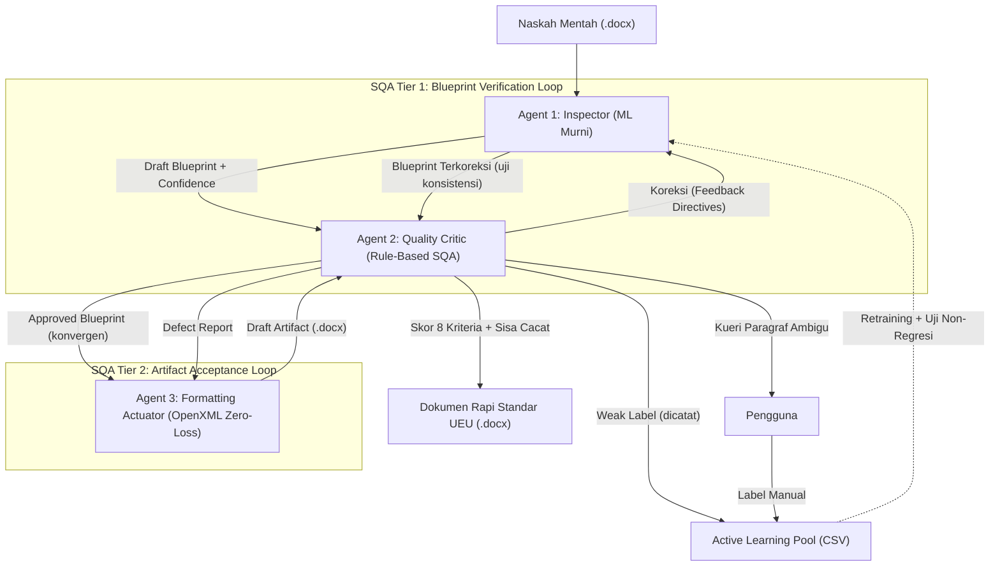
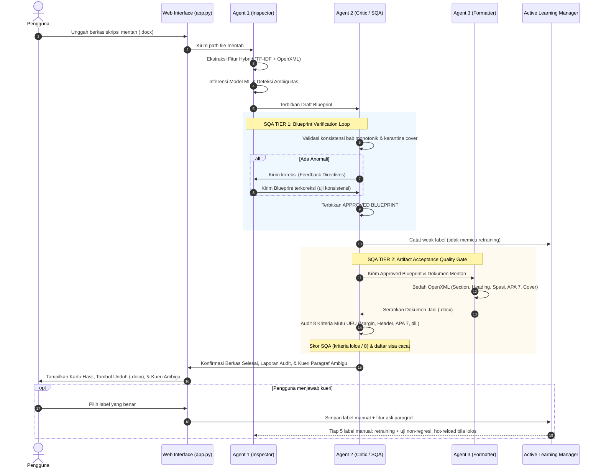

# ASDOKU (Asisten Dokumenku)
## Dokumentasi Arsitektur, Fitur, Alur Kerja Multi-Agent System, dan Status Terkini Proyek

> **Penyusun:** Tim Riset Asdoku  
> **Institusi:** Universitas Esa Unggul (UEU) — Fakultas Ilmu Komputer  
> **Standar Rujukan:** SK Rektor Universitas Esa Unggul No. 5 Tahun 2018 (Pedoman Penulisan Skripsi & Tugas Akhir)  
> **Tanggal Pembaruan:** 27 Oktober 2026  
> **Versi Dokumen:** 2.5.0 (Agent 1 ML Murni, Formatter Zero-Loss, Active Learning dengan Uji Non-Regresi)

---

## DAFTAR ISI
1. [Eksekutif & Latar Belakang Proyek](#1-eksekutif--latar-belakang-proyek)
2. [Struktur Folder & File Workspace](#2-struktur-folder--file-workspace)
3. [Arsitektur Multi-Agent System (MAS)](#3-arsitektur-multi-agent-system-mas)
   - 3.1. Agent 1: Inspector (Detection & Classification Agent)
   - 3.2. Agent 2: Quality Critic & SQA Coordinator (Validation & Gatekeeper Agent)
   - 3.3. Agent 3: Formatting Actuator (Low-Level OpenXML Engine)
   - 3.4. Active Learning & Continuous Self-Improvement Loop
4. [Mekanisme Two-Tier SQA (Software Quality Assurance)](#4-mekanisme-two-tier-sqa-software-quality-assurance)
5. [Fitur-Fitur Utama Sistem](#5-fitur-fitur-utama-sistem)
   - 5.1. Bedah OpenXML & Rekonstruksi Dokumen
   - 5.2. Penomoran Halaman Ganda (Dual Page Numbering)
   - 5.3. Otomatisasi Dynamic Table of Contents (TOC) & Navigation Pane
   - 5.4. Standarisasi Tabel APA 7 & Tipografi Akademik
   - 5.5. Antarmuka Web Interaktif (FastAPI Multi-Page Architecture)
   - 5.6. Aturan Format Tambahan (Asumsi, Tidak Diatur Pedoman 2018)
6. [Alur Kerja Sistem (End-to-End Workflow)](#6-alur-kerja-sistem-end-to-end-workflow)
7. [Metodologi Dataset & Model Machine Learning](#7-metodologi-dataset--model-machine-learning)
   - 7.1. Korpus Naskah TA
   - 7.2. Performa Model (macro-F1)
8. [Status Terkini & Hasil Pengujian Empiris](#8-status-terkini--hasil-pengujian-empiris)
   - 8.1. Uji Ablasi
   - 8.2. Uji Keutuhan Isi
   - 8.3. Uji Regresi P1–P5
   - 8.4. Temuan Active Learning: Label Lemah vs Label Manual
9. [Panduan Penggunaan & Perintah CLI/Web](#9-panduan-penggunaan--perintah-cliweb)

---

## 1. Eksekutif & Latar Belakang Proyek

**Asdoku** (*Asisten Dokumenku*) adalah sistem berbasis **Multi-Agent System (MAS)** dan **Machine Learning OpenXML** yang dirancang khusus untuk memecahkan permasalahan ketidakpatuhan format dokumen akademik (Skripsi, Tugas Akhir, Proposal, dan Laporan Kerja Praktik/Magang) di lingkungan **Universitas Esa Unggul (UEU)**.

### Permasalahan Nyata Mahasiswa & Dosen Pembimbing:
1. **Format Acak-acakan:** Mahasiswa sering menyalin-tempel teks dari berbagai sumber sehingga jenis font, spasi baris, dan margin menjadi tidak beraturan.
2. **Penomoran Manual yang Rusak:** Penomoran sub-bab (1.1, 1.2.1), penomoran caption gambar/tabel, serta penomoran halaman Romawi (*frontmatter*) vs Latin (*isi bab*) sering dibuat manual dan rusak ketika diedit.
3. **Navigation Pane & Daftar Isi Kosong:** Naskah tidak menggunakan Heading resmi Word melainkan sekadar teks tebal (*bold*), sehingga Navigation Pane kosong dan pembuatan Daftar Isi menjadi pekerjaan manual yang rentan kesalahan nomor halaman.
4. **Tabel Tidak Standar:** Tabel sering memuat garis vertikal yang melanggar pedoman APA 7th Edition.

Asdoku hadir sebagai solusi cerdas otonom: **mengubah dokumen mentah Word (.docx) menjadi dokumen rapi sesuai standar SK Rektor UEU 2018 secara non-destruktif (isi, sitasi, dan catatan kaki tetap utuh) dalam hitungan detik, disertai laporan uji mutu terhadap 8 kriteria format.**

---

## 2. Struktur Folder & File Workspace

Peta folder lengkap dan alur kerja penelitian ada di [`README.md`](../README.md) di akar repositori (diperbarui 9 November 2026).
Ringkasnya: `App/` (aplikasi), `Data/` (naskah mentah, privat), `Document/` (proposal, pedoman, logbook, review).


## 3. Arsitektur Multi-Agent System (MAS)

Asdoku tidak menggunakan pendekatan skrip monolitik sederhana, melainkan membagi tugas ke dalam **Tiga Agen Spesialis Cerdas (Tri-Agent System)** yang berkoordinasi secara otonom:



### 3.1. Agent 1: Inspector (Detection & Classification Agent)
* **File:** [`src/agents/inspector.py`](file:///root/Gammaura/Skripsi/src/agents/inspector.py)
* **Tanggung Jawab:** Membaca dokumen mentah secara non-destruktif, mengekstraksi fitur, dan mengklasifikasikan setiap paragraf **murni dengan model Machine Learning** (Random Forest, 9 kelas). Agent 1 tidak memuat aturan buatan; seluruh aturan baku UEU berada di Agent 2, sehingga kinerja ML dapat diukur terpisah dari kontribusi aturan.
* **Fitur yang Diekstraksi (Hybrid 420 Dimensi):**
  - **400 Fitur Teks NLP:** TF-IDF dengan N-Gram (1, 2) untuk mengenali kata kunci linguistik akademik.
  - **20 Dimensi Metadata OpenXML** (15 fitur numerik/biner + `align` di-*one-hot* menjadi 5 kategori):
    1. `char_len` (Panjang karakter)
    2. `word_count` (Jumlah kata)
    3. `uppercase_ratio` (Rasio huruf kapital)
    4. `font_size` (Ukuran font dalam pt)
    5. `is_bold` (Status cetak tebal)
    6. `is_italic` (Status cetak miring)
    7. `has_num` (Memiliki elemen bullet/numbering `<w:numPr>`)
    8. `has_img` (Memiliki gambar `<w:drawing>` atau `<w:pict>`)
    9. `has_pgbrk` (Memiliki jeda halaman `<w:br w:type="page">`)
    10. `space_before` (Spasi sebelum paragraf)
    11. `space_after` (Spasi setelah paragraf)
    12. `line_spacing` (Jarak baris)
    13. `first_line_indent` (Indentasi baris pertama / alinea)
    14. `left_indent` (Indentasi margin kiri)
    15. `doc_pos` (Posisi relatif paragraf dalam dokumen, $0.0 \le pos \le 1.0$)
    16. `align` (Perataan: CENTER, JUSTIFY, LEFT, RIGHT, DEFAULT)
* **Output:** *Draft Blueprint* yang memuat label kelas, nilai keyakinan (*confidence score*), dan distribusi probabilitas per paragraf. Jika *confidence* $< 0.70$, paragraf ditandai sebagai `is_ambiguous = True` dan menjadi kandidat kueri Active Learning.
* **Hot-Reload Aman:** Model dan pipeline fitur dimuat sebagai satu pasangan, sehingga pembaruan model dari retraining tidak pernah tercampur dengan pipeline lama di tengah pemrosesan dokumen.

### 3.2. Agent 2: Quality Critic & SQA Coordinator (Validation Agent)
* **File:** [`src/agents/critic.py`](file:///root/Gammaura/Skripsi/src/agents/critic.py)
* **Tanggung Jawab:** Bertindak sebagai *Auditor Kualitas* dan *Gatekeeper* berbasis aturan (*rule-based*) yang memastikan integritas logika akademik.
* **Dua Tahap Audit per Paragraf:**
  1. **Rule Prior:** aturan baku per paragraf (pola `BAB X`, judul halaman awal, nama sub-bab baku, caption bernomor, isian formulir, paragraf kosong).
  2. **Audit Konteks Dokumen:** rantai keputusan berprioritas yang melihat posisi paragraf dalam dokumen (sebelum Bab 1, di dalam Daftar Pustaka, di dalam Sistematika Penulisan, keterangan rumus, dan sebagainya).
* **Satu Sumber Kosakata:** daftar judul bab, judul halaman awal, dan nama sub-bab baku disimpan di `src/academic_rules.py` dan dipakai bersama oleh rule prior, audit konteks, dan uji SQA Tier 2.
* **Koreksi Dihitung terhadap ML Murni:** setiap perbedaan antara tebakan Agent 1 dan label akhir dicatat sebagai koreksi, sehingga jumlah koreksi mencerminkan kesalahan model.
* **Fitur Utama:**
  - **Audit Urutan Bab Monotonik:** Memastikan bab mengalir secara berurutan: $\text{Bab I} \rightarrow \text{Bab II} \rightarrow \text{Bab III} \rightarrow \text{Bab IV} \rightarrow \text{Bab V}$.
  - **Inferensi Judul Bab Kanonikal:** Mampu mengenali judul bab resmi (misal: "PENDAHULUAN", "LANDASAN TEORI", "METODOLOGI PENELITIAN") bahkan jika penulis lupa menulis kata "BAB".
  - **Karantina Halaman Awal (Frontmatter):** Memastikan tidak ada sub-bab numerik (misal 1.1) sebelum Bab 1 resmi dimulai.
  - **Isolasi Zona Sistematika Penulisan (Sub-bab 1.7):** Mencegah butir penjelasan bab pada sub-bab sistematika penulisan memicu pembagian bab palsu (*false positive chapter switch*).
  - **Filter Persamaan & Formula Matematika:** Mengamankan baris rumus dan notasi variabel agar tidak terformat menjadi sub-bab.
  - **Filter Caption Gambar & Tabel:** Memvalidasi bahwa teks caption memiliki nomor bab dan nomor urut yang valid (`Gambar 1.1`, `Tabel 2.1`).
  - **Judul Bab Dua Baris:** Format `BAB I` lalu `PENDAHULUAN` pada baris terpisah dikenali sebagai satu judul bab (bukan sub-bab 1.1).
  - **Penanda Daftar Pustaka:** Paragraf di bawah judul Daftar Pustaka ditandai agar diformat dengan *hanging indent* APA.
  - **Kueri Active Learning:** Paragraf ambigu yang tidak dapat dipastikan aturan apa pun diurutkan dari keyakinan terendah (*least-confidence*), maksimal 20 per dokumen, untuk dikonfirmasi pengguna.

### 3.3. Agent 3: Formatting Actuator (Low-Level OpenXML Engine)
* **File:** [`src/agents/formatter.py`](file:///root/Gammaura/Skripsi/src/agents/formatter.py) beserta modul pendukung `src/ooxml/`
* **Tanggung Jawab:** Mengeksekusi rekonstruksi dokumen Word secara tingkat rendah (*low-level XML manipulation*).
* **Fitur Utama:**
  - **Salin-lalu-Normalisasi (Zero-Loss):** Paragraf isi, halaman awal, dan daftar pustaka disalin utuh dari naskah sumber; yang diseragamkan hanya properti paragraf (spasi, indentasi, perataan) serta font dan ukuran run. Sitasi Mendeley (field lama maupun *content control* Mendeley Cite), catatan kaki (isinya ikut dipindahkan), hyperlink, cetak miring, dan superscript tetap utuh.
  - **Daftar Isi Native Dipertahankan di Posisi Asli:** Blok Daftar Isi bawaan Word (`w:sdt`) disalin di tempat semula, bukan ke akhir dokumen.
  - **Daftar Pustaka APA:** Entri daftar pustaka diberi *hanging indent* 1,27 cm.
  - **Sanitasi Total Template:** Membersihkan seluruh properti cacat bawaan template Word (menghapus `<w:numPr>` yang dapat memicu penomoran ganda, mereset indentasi liar).
  - **Rekonstruksi Cover Presisi:** Menyusun ulang halaman sampul sesuai spesifikasi baku Fasilkom UEU (Judul 14 pt ALL CAPS Center, Logo Resmi UEU 3 cm, Nama & NIM 12 pt Bold Center, Tahun 14 pt).
  - **Pembagian Section (2 section):**
    - Section 1: Sampul + Bagian Awal. Halaman pertama (sampul/halaman judul) memakai header/footer kosong (`w:titlePg`): tidak bernomor tetapi tetap dihitung (i), sesuai Pedoman 2018 Bab IV butir E–F. Halaman berikutnya ber-header UEU kanan atas dan bernomor Romawi kecil tengah bawah (Lembar Pengesahan = ii).
    - Section 2: Batang Tubuh / Isi Bab (Header UEU kanan atas, nomor halaman Latin tengah bawah mulai dari 1).
  - **Penetapan Heading 1, 2, 3 Resmi:** Menyuntikkan tag XML `<w:outlineLvl>` sehingga dokumen langsung terintegrasi dengan Navigation Pane MS Word.
  - **Daftar Isi/Tabel/Gambar sebagai Field Word:** Entri dibungkus field `TOC \o "1-3" \h \z \u`, `TOC \h \z \c "Tabel"`, dan `TOC \h \z \c "Gambar"`. Nomor halaman awal berupa estimasi (hasil tersimpan field); `w:updateFields` membuat Word menawarkan pembaruan saat dokumen dibuka sehingga nomor halaman menjadi tepat, dan daftar dapat diperbarui kapan pun (F9). Sebelum Sesi 30 daftar ditulis sebagai teks statis.
  - **Salinan Tabel/Blok Zero-Loss dengan Relasi Dipindahkan:** Tabel dan blok `w:sdt` disalin bersama gambar, gambar VML, hyperlink, dan catatan kaki; rujukan relasi (`r:id`) dipetakan ulang ke dokumen hasil (Sesi 30: hyperlink di dalam tabel sebelumnya menunjuk part yang salah dan membuat Word menolak membuka berkas).
  - **Format Tabel APA 7:** Menghapus seluruh border vertikal tabel dan hanya menyisakan 3 garis horizontal utama (Top, Bottom, dan Header separator).

### 3.4. Active Learning & Continuous Self-Improvement Loop
* **File:** [`src/active_learning.py`](file:///root/Gammaura/Skripsi/src/active_learning.py)
* **Dua Sumber Label di Pool Feedback** (`data/active_learning_feedback.csv`, kolom `label_source`):
  1. **Weak label (`AGENT2_RULE`):** prediksi Agent 1 yang dikoreksi aturan Agent 2. Label berasal dari aturan, bukan manusia, dan dicatat untuk analisis.
  2. **Label manual (`MANUAL`):** jawaban pengguna atas kueri Active Learning di halaman Alat. Paragraf yang ditanyakan adalah paragraf dengan keyakinan model terendah (*uncertainty sampling, least-confidence*) yang tidak dapat dipastikan aturan Agent 2. Fitur tipografi asli paragraf disimpan di server, bukan dikirim ulang oleh klien.
* **Pemicu Retraining:** Setiap 5 label manual baru, retraining dijalankan di latar belakang. Unggahan dokumen tidak memicu retraining. Hanya satu retraining yang dapat berjalan pada satu waktu.
* **Uji Non-Regresi:** Data basis (`dataset_skripsi.csv`) dibagi 80/20. Model pembanding (basis saja) dan kandidat (basis + label manual, serta basis + label manual + weak label) dilatih pada split latih yang sama, lalu diuji pada split uji data basis. Kandidat terbaik disimpan dan di-*hot-reload* ke Agent 1 **hanya bila macro-F1-nya tidak lebih rendah** dari pembanding (toleransi 0,005). Bila semua kandidat lebih buruk, model lama dipertahankan.
* **Bobot:** label manual direplikasi 3×, weak label 1×.

---

## 4. Mekanisme Two-Tier SQA (Software Quality Assurance)

Asdoku mengimplementasikan sistem penjaminan mutu dua tingkat (**Two-Tier SQA**) yang terinspirasi dari standar rekayasa perangkat lunak modern:

```
+-------------------------------------------------------------------------------+
|                       TWO-TIER SQA QUALITY CONTROL ARCHITECTURE               |
+-------------------------------------------------------------------------------+

[ TIER 1: BLUEPRINT VERIFICATION LOOP (Agent 1 <-> Agent 2) ]
1. Agent 1 menghasilkan Draft Blueprint.
2. Agent 2 mengaudit blueprint: urutan bab monotonik, isolasi cover, filter formula.
3. Jika ditemukan anomali:
   - Agent 2 mengirim 'Feedback Directives'.
   - Agent 1 menerapkan koreksi ke blueprint (model tidak dijalankan ulang).
4. Blueprint terkoreksi diaudit ulang sebagai uji konsistensi; status CONVERGED bila
   tidak ada koreksi baru (maks. 3 iterasi, selain itu MAX_ITERATIONS_REACHED).
   Laporan memuat seluruh koreksi dari semua iterasi -> Terbit APPROVED BLUEPRINT.

                                    |
                                    v

[ TIER 2: ARTIFACT ACCEPTANCE QUALITY GATE (Agent 3 <-> Agent 2) ]
1. Agent 3 membedah dan merekonstruksi OpenXML dokumen.
2. Agent 2 menguji berkas fisik .docx terhadap 8 Kriteria Mutu UEU:
   [1] Margin 4-3-3-3 cm di semua section.
   [2] Dual Page Numbering (Romawi di Frontmatter, Angka Latin di Bab 1-5).
   [3] Heading 1 Center Mutlak tanpa offset indentasi.
   [4] Heading 2 (Sub-bab) bernomor, spasi atas 12 pt & bawah 6 pt.
   [5] Paragraf isi: spasi baris maks. ~1.25, spasi bawah 6 pt, indentasi alinea
       (butir daftar, paragraf gambar, dan entri daftar pustaka dikecualikan).
   [6] Kertas A4 Standar (21.0 x 29.7 cm Portrait / Landscape).
   [7] Header Resmi "Universitas Esa Unggul" kanan atas.
   [8] Tabel Standar APA 7 (Tanpa garis vertikal).
3. Jika ditemukan cacat (defects): Agent 3 menyusun ulang dokumen (maks. 3 iterasi);
   pengulangan dihentikan bila cacat tidak berubah dari iterasi sebelumnya.
4. Skor (kriteria lolos / 8) dan daftar sisa cacat dilaporkan apa adanya kepada pengguna.
```

---

## 5. Fitur-Fitur Utama Sistem

### 5.1. Rekonstruksi Halaman Sampul (Cover) Resmi
* Mengambil data judul skripsi, nama penulis, NIM, program studi, fakultas, dan tahun dari naskah mentah secara otomatis.
* Mengganti layout sampul yang acak-acakan menjadi susunan resmi UEU lengkap dengan penempatan logo beresolusi tinggi 3 cm di posisi tengah.

### 5.2. Penomoran Halaman Ganda (Dual Page Numbering)
* **Section 1 (Bagian Awal):** Menampilkan nomor Romawi kecil (`i, ii, iii...`) di bagian tengah bawah (2 cm dari tepi bawah).
* **Section 2 (Batang Tubuh):** Menampilkan angka Latin (`1, 2, 3...`) mulai dari angka 1 di halaman pertama Bab I Pendahuluan.
* Penomoran berjalan independen berkat pemutusan tautan header/footer antar seksi (`link_to_previous = False`).

### 5.3. Otomatisasi Dynamic Table of Contents (TOC)
* Menyisipkan entri Daftar Isi, Daftar Gambar, dan Daftar Tabel dengan dot leaders rapi selebar 14 cm.
* Entri dibungkus field Word dinamis (`TOC`) dan `<w:updateFields w:val="true"/>` diaktifkan, sehingga Word menawarkan pembaruan field saat file dibuka; setelah diperbarui, nomor halaman sesuai halaman sebenarnya.
* Style `toc 1–3` dan `table of figures` pada template diseragamkan (Times New Roman 12 pt, spasi 1,15, indentasi 0,5 cm per tingkat, tab titik di 14 cm) agar tampilan tidak berubah setelah diperbarui.

### 5.4. Tabel Standar APA 7 & Tipografi Paripurna
* Semua tabel diatur rata tengah (*center*) dengan lebar kolom proporsional.
* Border vertikal dihapus total; hanya menyisakan garis atas, garis bawah header, dan garis penutup bawah sesuai kaidah internasional APA 7.
* Font di seluruh dokumen diseragamkan menjadi **Times New Roman**:
  - Judul Bab (Heading 1): 14 pt, Bold, Center.
  - Sub-bab (Heading 2) & Sub-sub-bab (Heading 3): 12 pt, Bold, Rata Kiri.
  - Paragraf Isi (Body): 12 pt, Regular, Justified (Rata Kiri-Kanan), Indentasi Alinea 1.0 cm.

### 5.5. Antarmuka Web Modern (FastAPI MPA)
* Mengusung desain bertema **Warm Minimalist / Notion Style** dengan perpaduan warna krem lembut, tipografi Plus Jakarta Sans, dan JetBrains Mono.
* Fitur antarmuka meliputi:
  - Drag-and-drop file upload (.docx).
  - Multi-step progress bar interaktif dengan indikator visual animasi.
  - Live execution terminal console yang menampilkan log deteksi real-time.
  - SQA Score Card berisi skor kriteria yang lolos dan daftar cacat yang tersisa.
  - Kartu "Konfirmasi Paragraf Ambigu" untuk menjawab kueri Active Learning.
  - Tautan unduh instan berkas hasil rapi berawalan `(Asdoku) - ...`.
  - Halaman pembahasan riset lengkap: Flowchart, Pipeline 3 Agen, Data Metodologi, Riwayat Riset, dan Glosarium Istilah Teknis.

### 5.6. Aturan Format Tambahan (Asumsi, Tidak Diatur Pedoman 2018)
SK Rektor UEU No. 5 Tahun 2018 tidak mengatur seluruh detail tata letak. Untuk kasus berikut, Asdoku menerapkan aturan yang ditetapkan peneliti agar hasil konsisten; aturan ini dicantumkan sebagai asumsi di Bab III.

| No | Kasus | Aturan Asdoku | Alasan |
| :---: | :--- | :--- | :--- |
| 1 | Nomor caption gambar/tabel | Angka Arab: `Tabel 3.1`, `Gambar 2.1` (judul bab tetap Romawi `BAB III`) | Mengikuti template resmi Fakultas Ilmu Komputer; pedoman hanya mewajibkan Romawi untuk nomor **bab** |
| 2 | Daftar bernomor (`1.`, `1)`, `(1)`, `a.`, butir) | Indentasi gantung: nomor di **1,27 cm** (sejajar alinea), teks di **1,9 cm**, baris lanjutan sejajar teks; tiap tingkat masuk 0,63 cm. Berlaku untuk numbering Word maupun nomor ketik manual (nomor tidak dihapus, pemisah dinormalkan menjadi satu Tab) | Bentuk paling umum di skripsi Indonesia; teks lanjutan tidak lagi kembali ke margin |
| 3 | Judul poin bernomor diikuti paragraf penjelasan (mis. `1. Kontribusi Teori`) | Dijadikan **sub-sub-bab** bernomor otomatis (`1.4.1`), masuk Daftar Isi & Navigation Pane. Syarat: ≤ 8 kata, tebal/berformat judul, tanpa tanda baca kalimat, berada di dalam sub-bab, dan diikuti paragraf penjelasan ≥ 8 kata | Sesuai hierarki bab > sub-bab > sub-sub-bab pada pedoman. Rumusan masalah/tujuan (`1. Apakah ...?`) tetap daftar |
| 4 | Rumusan hipotesis (`HA1:`, `H1 :`, `H0:`) | Label menggantung: label di **1,27 cm**, pernyataan di **2,54 cm**, baris lanjutan sejajar pernyataan; tebal mengikuti tulisan mahasiswa | Label hipotesis mudah dikenali; konsisten dengan gaya daftar |
| 5 | Proposal tugas akhir | Format sama dengan pedoman tugas akhir, cakupan Bab I–III | Belum ada pedoman khusus proposal |

**Validasi di Microsoft Word.** Aturan 1–4 diverifikasi langsung di Microsoft Word (otomasi COM) pada dokumen uji P2 dan P3, bukan hanya lewat pemeriksaan XML: nomor sub-bab `1.1`/`2.3.1`, caption `Tabel 1.1`, posisi daftar 1,27/1,9 cm, judul poin `1.4.1–1.4.3`, dan hipotesis 1,27/2,54 cm. Validasi ini diperlukan karena Word mengabaikan elemen OOXML yang tidak sesuai skema tanpa pesan galat (lihat Logbook Sesi 29).

---

## 6. Alur Kerja Sistem (End-to-End Workflow)

Berikut adalah tahapan pemrosesan dokumen saat pengguna mengunggah file .docx:



---

## 7. Metodologi Dataset & Model Machine Learning

> Diperbarui 9 November 2026. Dataset lama (Dataset Asdoku 1–4, `dataset_skripsi.csv`, 7 dataset spesialis) **dipensiunkan**:
> labelnya dibuat aturan (bukan manusia) dan sebagian dokumen uji ikut dilatih, sehingga angka lama (≈97%) tidak valid.

### 7.1. Korpus Naskah TA
* **Sumber:** 7 naskah Word asli dari 7 penulis FIK UEU (6 TA, 1 proposal), dengan izin. Nama dianonimkan: latih `L01–L05`, uji `U01–U02`.
* **Satuan:** paragraf, 9 label struktur. Latih 4.693 paragraf, uji 2.664 paragraf. Pembagian **per naskah**.
* **Versi heading polos:** salinan setiap naskah dengan gaya Heading/Caption/TOC diganti Normal (tampilan tetap), meniru naskah yang
  hanya ditebalkan. Ikut naskah asalnya (latih→latih, uji→uji).
* **Pelabelan:** mengikuti Pedoman Anotasi v1.1 (Lampiran 1); pra-label aturan → dikoreksi (saat ini dengan bantuan AI; verifikasi manual penulis + Cohen's kappa anotator kedua belum).
* **Fitur:** TF-IDF (400) + 20 tipografi/tata letak + 7 gaya Word + 10 pola teks.

### 7.2. Performa Model (macro-F1)
| Model | Uji silang naskah latih (LODO) | Naskah uji · asli | Naskah uji · polos |
|---|:---:|:---:|:---:|
| Logistic Regression | 88,83 ± 3,50 | 86,57 | 82,59 |
| **Random Forest (produksi)** | **94,70 ± 4,19** | **93,79** | **92,41** |
| XGBoost (pembanding) | 91,72 ± 7,57 | 71,59 | 69,69 |

Sumber: `App/output/eval_report_korpus.md`.

---

## 8. Status Terkini & Hasil Pengujian Empiris

### 8.1. Uji Ablasi (naskah uji, macro-F1) — `App/output/eval_ablasi.md`
| Konfigurasi | Asli | Polos |
|---|:---:|:---:|
| Agen 1 saja | 93,79 | 92,41 |
| Aturan Agen 2 saja | 96,79 | 94,16 |
| Sistem multi-agen | **98,90** | **96,35** |

Catatan validitas: beberapa aturan Agen 2 diperbaiki setelah melihat naskah uji (9 Nov 2026). Perlu naskah uji baru untuk konfirmasi.

### 8.2. Uji Keutuhan Isi — `App/output/eval_keutuhan.md`
Pada U01, U02, P1, P2, P3, P5: gambar, tabel, rumus, catatan kaki, sitasi Mendeley sama sebelum/sesudah; cakupan teks 100%.
Semua hasil dibuka di Microsoft Word asli setelah pembaruan field: 0 rujukan silang rusak.

### 8.3. Uji Regresi P1–P5
P4 (laporan magang) dikeluarkan karena di luar lingkup. P1, P2, P3, P5: SQA 100% (8 kriteria), struktur XML valid.

### 8.4. Temuan Active Learning: Label Lemah vs Label Manual
Weak label Agen 2 tetap hanya dicatat (tidak memicu retraining) karena terbukti menurunkan kinerja. Basis retraining sekarang
`data/corpus/dataset_latih.csv`; bila korpus tidak tersedia (deploy Vercel), retraining dilewati.

---

## 9. Panduan Penggunaan & Perintah CLI/Web

### Menjalankan Server Web (FastAPI):
```bash
python3 -m uvicorn app:app --host 0.0.0.0 --port 8000
```
Akses melalui browser di: `http://localhost:8000`

### Menjalankan Pipeline CLI Secara Mandiri:
```bash
python3 main.py [path_file_input.docx] [path_file_output.docx]
```
*Contoh:*
```bash
python3 main.py "data/dokumen_uji/P1_Template_Resmi_UEU.docx" "output/(Asdoku) - Hasil_Skripsi_Rapi.docx"
```

### Melatih Ulang Model Machine Learning:
```bash
python3 -m src.train
```

### Menjalankan Pengujian Otomatis Seluruh Dokumen:
```bash
python3 tests/test_all_documents.py
```

---

> *Dokumen ringkasan ini diperbarui secara berkala sebagai bagian dari luaran penelitian Tugas Akhir / Skripsi sistem automasi tata letak dokumen akademik Universitas Esa Unggul.*
