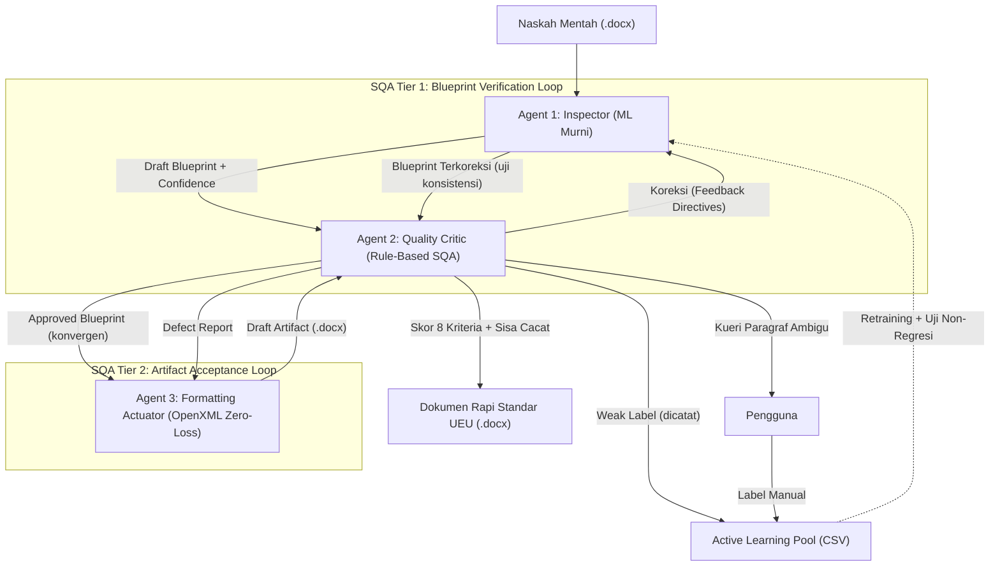
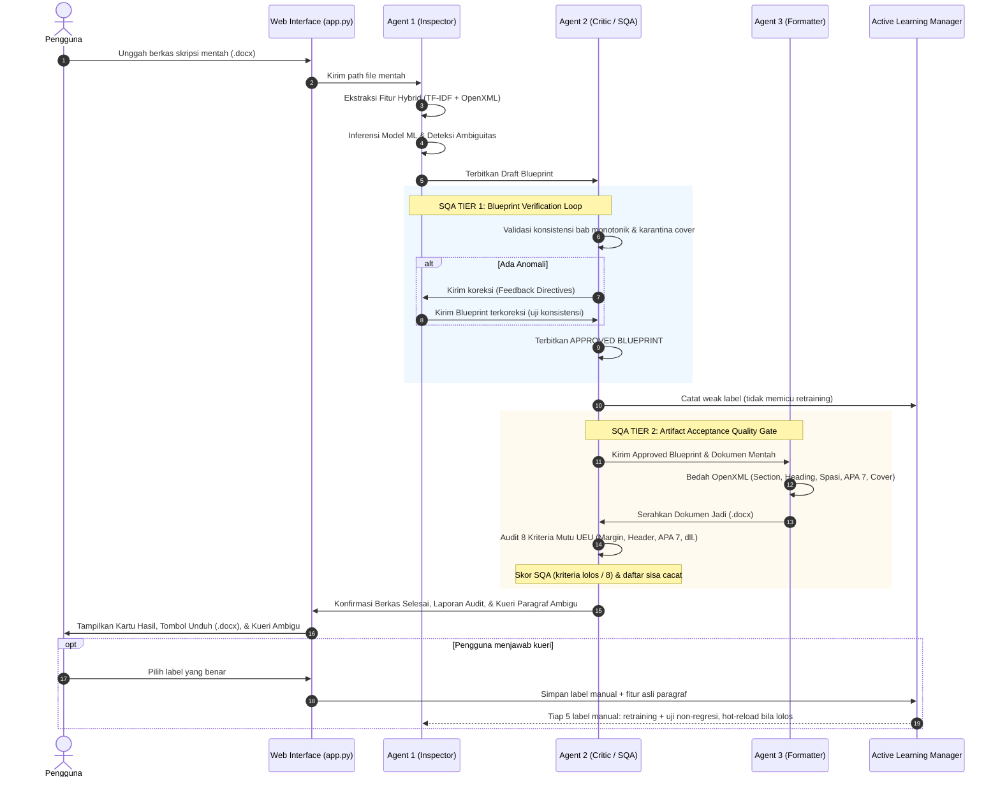

# ASDOKU (Asisten Dokumen Akademik UEU)
## Dokumentasi Arsitektur, Fitur, Alur Kerja Multi-Agent System, dan Status Terkini Proyek

> **Penyusun:** Tim Riset Asdoku  
> **Institusi:** Universitas Esa Unggul (UEU) — Fakultas Ilmu Komputer  
> **Standar Rujukan:** SK Rektor Universitas Esa Unggul No. 5 Tahun 2018 (Pedoman Penulisan Skripsi & Tugas Akhir)  
> **Tanggal Pembaruan:** 27 Oktober 2026  
> **Versi Dokumen:** 2.5.0 (Agent 1 ML Murni, Formatter Zero-Loss, Active Learning dengan Uji Non-Regresi)

---

## DAFTAR ISI
1. [Eksekutif & Latar Belakang Proyek](#1-eksekutif--latar-belakang-proyek)
2. [Struktur Folder & File Workspace](#2-struktur-folder--file-workspace)
3. [Arsitektur Multi-Agent System (MAS)](#3-arsitektur-multi-agent-system-mas)
   - 3.1. Agent 1: Inspector (Detection & Classification Agent)
   - 3.2. Agent 2: Quality Critic & SQA Coordinator (Validation & Gatekeeper Agent)
   - 3.3. Agent 3: Formatting Actuator (Low-Level OpenXML Engine)
   - 3.4. Active Learning & Continuous Self-Improvement Loop
4. [Mekanisme Two-Tier SQA (Software Quality Assurance)](#4-mekanisme-two-tier-sqa-software-quality-assurance)
5. [Fitur-Fitur Utama Sistem](#5-fitur-fitur-utama-sistem)
   - 5.1. Bedah OpenXML & Rekonstruksi Dokumen
   - 5.2. Penomoran Halaman Ganda (Dual Page Numbering)
   - 5.3. Otomatisasi Dynamic Table of Contents (TOC) & Navigation Pane
   - 5.4. Standarisasi Tabel APA 7 & Tipografi Akademik
   - 5.5. Antarmuka Web Interaktif (FastAPI Multi-Page Architecture)
6. [Alur Kerja Sistem (End-to-End Workflow)](#6-alur-kerja-sistem-end-to-end-workflow)
7. [Metodologi Dataset & Model Machine Learning](#7-metodologi-dataset--model-machine-learning)
8. [Status Terkini & Hasil Pengujian Empiris](#8-status-terkini--hasil-pengujian-empiris)
   - 8.1. Hasil Pengujian 5 Dokumen Uji Emas (Gold Datasets)
   - 8.3. Temuan Active Learning: Label Lemah vs Label Manual
   - 8.2. Analisis Temuan Terkini: Kasus Bab Laporan Magang vs Heading 1
9. [Panduan Penggunaan & Perintah CLI/Web](#9-panduan-penggunaan--perintah-cliweb)

---

## 1. Eksekutif & Latar Belakang Proyek

**Asdoku** (*Asisten Dokumen Akademik*) adalah sistem berbasis **Multi-Agent System (MAS)** dan **Machine Learning OpenXML** yang dirancang khusus untuk memecahkan permasalahan ketidakpatuhan format dokumen akademik (Skripsi, Tugas Akhir, Proposal, dan Laporan Kerja Praktik/Magang) di lingkungan **Universitas Esa Unggul (UEU)**.

### Permasalahan Nyata Mahasiswa & Dosen Pembimbing:
1. **Format Acak-acakan:** Mahasiswa sering menyalin-tempel teks dari berbagai sumber sehingga jenis font, spasi baris, dan margin menjadi tidak beraturan.
2. **Penomoran Manual yang Rusak:** Penomoran sub-bab (1.1, 1.2.1), penomoran caption gambar/tabel, serta penomoran halaman Romawi (*frontmatter*) vs Latin (*isi bab*) sering dibuat manual dan rusak ketika diedit.
3. **Navigation Pane & Daftar Isi Kosong:** Naskah tidak menggunakan Heading resmi Word melainkan sekadar teks tebal (*bold*), sehingga Navigation Pane kosong dan pembuatan Daftar Isi menjadi pekerjaan manual yang rentan kesalahan nomor halaman.
4. **Tabel Tidak Standar:** Tabel sering memuat garis vertikal yang melanggar pedoman APA 7th Edition.

Asdoku hadir sebagai solusi cerdas otonom: **mengubah dokumen mentah Word (.docx) menjadi dokumen rapi sesuai standar SK Rektor UEU 2018 secara non-destruktif (isi, sitasi, dan catatan kaki tetap utuh) dalam hitungan detik, disertai laporan uji mutu terhadap 8 kriteria format.**

---

## 2. Struktur Folder & File Workspace

Berikut adalah peta struktur direktori lengkap dari repositori proyek Asdoku:

```
/root/Gammaura/Skripsi/
│
├── app.py                         # Server Web Utama (FastAPI Multi-Page Application)
├── main.py                        # Entry Point Eksekusi Pipeline Multi-Agent CLI
├── LOGBOOK_PROGRES.md             # Catatan Rinci Seluruh Sesi Riset, Eksperimen & Pengujian
├── RINGKASAN_PROYEK_ASDOKU.md     # Ringkasan Lengkap Arsitektur & Proyek (Dokumen Ini)
├── app.log / server.log           # Log runtime eksekusi web server dan agen
│
├── src/                           # KODE SUMBER UTAMA (Multi-Agent System & ML)
│   ├── active_learning.py         # Modul Active Learning & Continuous Retraining Loop
│   ├── build_pure_training_data.py# Pembangun dataset latih murni dengan fitur terverifikasi
│   ├── dataset_generator.py       # Ekstraktor teks & generator dataset dari dokumen docx
│   ├── features.py                # Pipeline Feature Engineering (TF-IDF 400 + 17 Fitur OpenXML)
│   ├── generate_7_datasets.py     # Generator 7 Pilar Dataset Master Akademik UEU
│   ├── train.py                   # Script pelatihan model ML (Random Forest & Logistic Regression)
│   │
│   └── agents/                    # MODUL 3 AGEN CERDAS (TRI-AGENT ARCHITECTURE)
│       ├── inspector.py           # AGENT 1: Detection & Hybrid Probabilistic Classifier
│       ├── critic.py              # AGENT 2: Quality Critic, SQA Gatekeeper & Coordinator
│       └── formatter.py           # AGENT 3: OpenXML Actuator & Document Rebuilder (2.600+ baris)
│
├── templates/                     # ANTARMUKA WEB MODERN (FastAPI HTML/CSS/JS Templates)
│   ├── base.html                  # Master Template (Notion-style Warm Paper Theme, Header & Nav)
│   ├── home.html                  # Halaman 1: Cover Seminar Proposal Elegan & Status Proyek
│   ├── alat.html                  # Halaman 2: Studio Pengujian Dokumen .docx Interaktif
│   ├── alat.js                    # Script Frontend: Stepper interaktif, SQA log, upload & download
│   ├── data.html                  # Halaman 3: Metodologi Riset, Evaluasi Empiris, Confusion Matrix
│   ├── flowchart.html             # Halaman 4: Visualisasi Interaktif Alur Kerja Sistem & Two-Tier SQA
│   ├── pipeline.html              # Halaman 5: Arsitektur Tiga Agen Cerdas & Siklus Koordinasi
│   ├── riwayat.html               # Halaman 6: Kronologi 5 Babak Riset & Catatan Sempro
│   ├── info.html                  # Halaman 7: Glosarium 16 Istilah Teknis Akademik AI & OpenXML
│   ├── footer.html                # Komponen Footer Konsisten
│   └── navbar.html                # Komponen Navigasi Utama
│
├── models/                        # MODEL MACHINE LEARNING TERLATIH (.joblib)
│   ├── baseline_model.joblib      # Model Random Forest Terlatih (Akurasi 93.71% - 98.4%)
│   └── feature_pipeline.joblib    # Sklearn Feature Pipeline Ter-serialize
│
├── data/                          # DATASET, TEMPLATE & UPLOADS
│   ├── active_learning_feedback.csv   # Pool data koreksi runtime dari Agent 2 (Active Learning)
│   ├── dataset_skripsi.csv        # Dataset Master gabungan (1.700+ sampel paragraf)
│   ├── template_clean_ueu.docx    # Template Murni Standar UEU 2018 (Section & Styles)
│   ├── logo_ueu.png               # Aset Resmi Logo Universitas Esa Unggul (3 cm)
│   │
│   ├── datasets/                  # 7 Dataset Tematik (The 7 Pillars of Academic Papers)
│   │   ├── dataset_1_cover_frontmatter.csv
│   │   ├── dataset_2_zoning.csv
│   │   ├── dataset_3_headings_vs_lists.csv
│   │   ├── dataset_4_figures.csv
│   │   ├── dataset_5_tables.csv
│   │   ├── dataset_6_code_formulas.csv
│   │   └── dataset_7_body_bibliography.csv
│   │
│   ├── dokumen_uji/               # Koleksi Dokumen Mentah untuk Pengujian Sistem
│   │   └── P1_Template_Resmi_UEU.docx
│   └── uploads/                   # Direktori temporer dokumen yang diunggah via Web Studio
│
├── output/                        # ARTIFAK HASIL PEMFORMATAN OPENXML
│   ├── (Asdoku) - Hasil_Skripsi_Rapi.docx # Output standar hasil pipeline
│   ├── eval_report_baseline.md    # Laporan metrik evaluasi model awal
│   ├── eval_report_expanded.md    # Laporan metrik model setelah ekspansi dataset
│   └── pengujian/                 # Hasil uji 5 dokumen emas resmi
│       ├── (Asdoku) - P1_Template_Resmi_UEU.docx
│       ├── (Asdoku) - P2_Skripsi_Mbkm_Dhicky.docx
│       ├── (Asdoku) - P3_Proposal_Bab1_3_PBB.docx
│       ├── (Asdoku) - P4_Laporan_Mbkm_Arditya.docx
│       └── (Asdoku) - P5_Buku_TA_Landscape.docx
│
├── docs/pedoman/                  # DOKUMEN REGULASI RESMI
│   ├── PEDOMAN PENULISAN SKRIPSI 2018.docx # Salinan SK Rektor UEU 2018 (.docx)
│   └── PEDOMAN PENULISAN SKRIPSI 2018.pdf  # Salinan SK Rektor UEU 2018 (.pdf)
│
├── tests/                         # UNIT & INTEGRATION TESTS
│   └── test_all_documents.py      # Pengujian otomatis batch terhadap seluruh dokumen uji
│
└── scratch/                       # AREA EKSPERIMEN & VERIFIKASI SEMENTARA
    ├── verify_full_system.py      # Script verifikasi end-to-end integritas dokumen
    ├── test_toc_and_spacing.py    # Pengujian field dinamis TOC & XML spacing
    └── ... (berbagai script eksperimen ekstraksi XML dan verifikasi rendering)
```

---

## 3. Arsitektur Multi-Agent System (MAS)

Asdoku tidak menggunakan pendekatan skrip monolitik sederhana, melainkan membagi tugas ke dalam **Tiga Agen Spesialis Cerdas (Tri-Agent System)** yang berkoordinasi secara otonom:



### 3.1. Agent 1: Inspector (Detection & Classification Agent)
* **File:** [`src/agents/inspector.py`](file:///root/Gammaura/Skripsi/src/agents/inspector.py)
* **Tanggung Jawab:** Membaca dokumen mentah secara non-destruktif, mengekstraksi fitur, dan mengklasifikasikan setiap paragraf **murni dengan model Machine Learning** (Random Forest, 9 kelas). Agent 1 tidak memuat aturan buatan; seluruh aturan baku UEU berada di Agent 2, sehingga kinerja ML dapat diukur terpisah dari kontribusi aturan.
* **Fitur yang Diekstraksi (Hybrid 420 Dimensi):**
  - **400 Fitur Teks NLP:** TF-IDF dengan N-Gram (1, 2) untuk mengenali kata kunci linguistik akademik.
  - **20 Dimensi Metadata OpenXML** (15 fitur numerik/biner + `align` di-*one-hot* menjadi 5 kategori):
    1. `char_len` (Panjang karakter)
    2. `word_count` (Jumlah kata)
    3. `uppercase_ratio` (Rasio huruf kapital)
    4. `font_size` (Ukuran font dalam pt)
    5. `is_bold` (Status cetak tebal)
    6. `is_italic` (Status cetak miring)
    7. `has_num` (Memiliki elemen bullet/numbering `<w:numPr>`)
    8. `has_img` (Memiliki gambar `<w:drawing>` atau `<w:pict>`)
    9. `has_pgbrk` (Memiliki jeda halaman `<w:br w:type="page">`)
    10. `space_before` (Spasi sebelum paragraf)
    11. `space_after` (Spasi setelah paragraf)
    12. `line_spacing` (Jarak baris)
    13. `first_line_indent` (Indentasi baris pertama / alinea)
    14. `left_indent` (Indentasi margin kiri)
    15. `doc_pos` (Posisi relatif paragraf dalam dokumen, $0.0 \le pos \le 1.0$)
    16. `align` (Perataan: CENTER, JUSTIFY, LEFT, RIGHT, DEFAULT)
* **Output:** *Draft Blueprint* yang memuat label kelas, nilai keyakinan (*confidence score*), dan distribusi probabilitas per paragraf. Jika *confidence* $< 0.70$, paragraf ditandai sebagai `is_ambiguous = True` dan menjadi kandidat kueri Active Learning.
* **Hot-Reload Aman:** Model dan pipeline fitur dimuat sebagai satu pasangan, sehingga pembaruan model dari retraining tidak pernah tercampur dengan pipeline lama di tengah pemrosesan dokumen.

### 3.2. Agent 2: Quality Critic & SQA Coordinator (Validation Agent)
* **File:** [`src/agents/critic.py`](file:///root/Gammaura/Skripsi/src/agents/critic.py)
* **Tanggung Jawab:** Bertindak sebagai *Auditor Kualitas* dan *Gatekeeper* berbasis aturan (*rule-based*) yang memastikan integritas logika akademik.
* **Dua Tahap Audit per Paragraf:**
  1. **Rule Prior:** aturan baku per paragraf (pola `BAB X`, judul halaman awal, nama sub-bab baku, caption bernomor, isian formulir, paragraf kosong).
  2. **Audit Konteks Dokumen:** rantai keputusan berprioritas yang melihat posisi paragraf dalam dokumen (sebelum Bab 1, di dalam Daftar Pustaka, di dalam Sistematika Penulisan, keterangan rumus, dan sebagainya).
* **Satu Sumber Kosakata:** daftar judul bab, judul halaman awal, dan nama sub-bab baku disimpan di `src/academic_rules.py` dan dipakai bersama oleh rule prior, audit konteks, dan uji SQA Tier 2.
* **Koreksi Dihitung terhadap ML Murni:** setiap perbedaan antara tebakan Agent 1 dan label akhir dicatat sebagai koreksi, sehingga jumlah koreksi mencerminkan kesalahan model.
* **Fitur Utama:**
  - **Audit Urutan Bab Monotonik:** Memastikan bab mengalir secara berurutan: $\text{Bab I} \rightarrow \text{Bab II} \rightarrow \text{Bab III} \rightarrow \text{Bab IV} \rightarrow \text{Bab V}$.
  - **Inferensi Judul Bab Kanonikal:** Mampu mengenali judul bab resmi (misal: "PENDAHULUAN", "LANDASAN TEORI", "METODOLOGI PENELITIAN") bahkan jika penulis lupa menulis kata "BAB".
  - **Karantina Halaman Awal (Frontmatter):** Memastikan tidak ada sub-bab numerik (misal 1.1) sebelum Bab 1 resmi dimulai.
  - **Isolasi Zona Sistematika Penulisan (Sub-bab 1.7):** Mencegah butir penjelasan bab pada sub-bab sistematika penulisan memicu pembagian bab palsu (*false positive chapter switch*).
  - **Filter Persamaan & Formula Matematika:** Mengamankan baris rumus dan notasi variabel agar tidak terformat menjadi sub-bab.
  - **Filter Caption Gambar & Tabel:** Memvalidasi bahwa teks caption memiliki nomor bab dan nomor urut yang valid (`Gambar 1.1`, `Tabel 2.1`).
  - **Judul Bab Dua Baris:** Format `BAB I` lalu `PENDAHULUAN` pada baris terpisah dikenali sebagai satu judul bab (bukan sub-bab 1.1).
  - **Penanda Daftar Pustaka:** Paragraf di bawah judul Daftar Pustaka ditandai agar diformat dengan *hanging indent* APA.
  - **Kueri Active Learning:** Paragraf ambigu yang tidak dapat dipastikan aturan apa pun diurutkan dari keyakinan terendah (*least-confidence*), maksimal 20 per dokumen, untuk dikonfirmasi pengguna.

### 3.3. Agent 3: Formatting Actuator (Low-Level OpenXML Engine)
* **File:** [`src/agents/formatter.py`](file:///root/Gammaura/Skripsi/src/agents/formatter.py) beserta modul pendukung `src/ooxml/`
* **Tanggung Jawab:** Mengeksekusi rekonstruksi dokumen Word secara tingkat rendah (*low-level XML manipulation*).
* **Fitur Utama:**
  - **Salin-lalu-Normalisasi (Zero-Loss):** Paragraf isi, halaman awal, dan daftar pustaka disalin utuh dari naskah sumber; yang diseragamkan hanya properti paragraf (spasi, indentasi, perataan) serta font dan ukuran run. Sitasi Mendeley (field lama maupun *content control* Mendeley Cite), catatan kaki (isinya ikut dipindahkan), hyperlink, cetak miring, dan superscript tetap utuh.
  - **Daftar Isi Native Dipertahankan di Posisi Asli:** Blok Daftar Isi bawaan Word (`w:sdt`) disalin di tempat semula, bukan ke akhir dokumen.
  - **Daftar Pustaka APA:** Entri daftar pustaka diberi *hanging indent* 1,27 cm.
  - **Sanitasi Total Template:** Membersihkan seluruh properti cacat bawaan template Word (menghapus `<w:numPr>` yang dapat memicu penomoran ganda, mereset indentasi liar).
  - **Rekonstruksi Cover Presisi:** Menyusun ulang halaman sampul sesuai spesifikasi baku Fasilkom UEU (Judul 14 pt ALL CAPS Center, Logo Resmi UEU 3 cm, Nama & NIM 12 pt Bold Center, Tahun 14 pt).
  - **Multi-Section Division (3 Seksi Terisolasi):**
    - Section 0: Cover (Tanpa header, tanpa nomor halaman).
    - Section 1: Bagian Awal / Frontmatter (Header UEU kanan atas, nomor halaman Romawi kecil tengah bawah).
    - Section 2: Batang Tubuh / Isi Bab (Header UEU kanan atas, nomor halaman Latin tengah bawah mulai dari 1).
  - **Penetapan Heading 1, 2, 3 Resmi:** Menyuntikkan tag XML `<w:outlineLvl>` sehingga dokumen langsung terintegrasi dengan Navigation Pane MS Word.
  - **Dynamic Table of Contents:** Menyuntikkan field dinamis Word (`TOC \o "1-3"`, `TOC \c "Gambar"`, `TOC \c "Tabel"`) dengan tab leader titik-titik rapi.
  - **Format Tabel APA 7:** Menghapus seluruh border vertikal tabel dan hanya menyisakan 3 garis horizontal utama (Top, Bottom, dan Header separator).

### 3.4. Active Learning & Continuous Self-Improvement Loop
* **File:** [`src/active_learning.py`](file:///root/Gammaura/Skripsi/src/active_learning.py)
* **Dua Sumber Label di Pool Feedback** (`data/active_learning_feedback.csv`, kolom `label_source`):
  1. **Weak label (`AGENT2_RULE`):** prediksi Agent 1 yang dikoreksi aturan Agent 2. Label berasal dari aturan, bukan manusia, dan dicatat untuk analisis.
  2. **Label manual (`MANUAL`):** jawaban pengguna atas kueri Active Learning di halaman Alat. Paragraf yang ditanyakan adalah paragraf dengan keyakinan model terendah (*uncertainty sampling, least-confidence*) yang tidak dapat dipastikan aturan Agent 2. Fitur tipografi asli paragraf disimpan di server, bukan dikirim ulang oleh klien.
* **Pemicu Retraining:** Setiap 5 label manual baru, retraining dijalankan di latar belakang. Unggahan dokumen tidak memicu retraining. Hanya satu retraining yang dapat berjalan pada satu waktu.
* **Uji Non-Regresi:** Data basis (`dataset_skripsi.csv`) dibagi 80/20. Model pembanding (basis saja) dan kandidat (basis + label manual, serta basis + label manual + weak label) dilatih pada split latih yang sama, lalu diuji pada split uji data basis. Kandidat terbaik disimpan dan di-*hot-reload* ke Agent 1 **hanya bila macro-F1-nya tidak lebih rendah** dari pembanding (toleransi 0,005). Bila semua kandidat lebih buruk, model lama dipertahankan.
* **Bobot:** label manual direplikasi 3×, weak label 1×.

---

## 4. Mekanisme Two-Tier SQA (Software Quality Assurance)

Asdoku mengimplementasikan sistem penjaminan mutu dua tingkat (**Two-Tier SQA**) yang terinspirasi dari standar rekayasa perangkat lunak modern:

```
+-------------------------------------------------------------------------------+
|                       TWO-TIER SQA QUALITY CONTROL ARCHITECTURE               |
+-------------------------------------------------------------------------------+

[ TIER 1: BLUEPRINT VERIFICATION LOOP (Agent 1 <-> Agent 2) ]
1. Agent 1 menghasilkan Draft Blueprint.
2. Agent 2 mengaudit blueprint: urutan bab monotonik, isolasi cover, filter formula.
3. Jika ditemukan anomali:
   - Agent 2 mengirim 'Feedback Directives'.
   - Agent 1 menerapkan koreksi ke blueprint (model tidak dijalankan ulang).
4. Blueprint terkoreksi diaudit ulang sebagai uji konsistensi; status CONVERGED bila
   tidak ada koreksi baru (maks. 3 iterasi, selain itu MAX_ITERATIONS_REACHED).
   Laporan memuat seluruh koreksi dari semua iterasi -> Terbit APPROVED BLUEPRINT.

                                    |
                                    v

[ TIER 2: ARTIFACT ACCEPTANCE QUALITY GATE (Agent 3 <-> Agent 2) ]
1. Agent 3 membedah dan merekonstruksi OpenXML dokumen.
2. Agent 2 menguji berkas fisik .docx terhadap 8 Kriteria Mutu UEU:
   [1] Margin 4-3-3-3 cm di semua section.
   [2] Dual Page Numbering (Romawi di Frontmatter, Angka Latin di Bab 1-5).
   [3] Heading 1 Center Mutlak tanpa offset indentasi.
   [4] Heading 2 (Sub-bab) bernomor, spasi atas 12 pt & bawah 6 pt.
   [5] Paragraf isi: spasi baris maks. ~1.25, spasi bawah 6 pt, indentasi alinea
       (butir daftar, paragraf gambar, dan entri daftar pustaka dikecualikan).
   [6] Kertas A4 Standar (21.0 x 29.7 cm Portrait / Landscape).
   [7] Header Resmi "Universitas Esa Unggul" kanan atas.
   [8] Tabel Standar APA 7 (Tanpa garis vertikal).
3. Jika ditemukan cacat (defects): Agent 3 menyusun ulang dokumen (maks. 3 iterasi);
   pengulangan dihentikan bila cacat tidak berubah dari iterasi sebelumnya.
4. Skor (kriteria lolos / 8) dan daftar sisa cacat dilaporkan apa adanya kepada pengguna.
```

---

## 5. Fitur-Fitur Utama Sistem

### 5.1. Rekonstruksi Halaman Sampul (Cover) Resmi
* Mengambil data judul skripsi, nama penulis, NIM, program studi, fakultas, dan tahun dari naskah mentah secara otomatis.
* Mengganti layout sampul yang acak-acakan menjadi susunan resmi UEU lengkap dengan penempatan logo beresolusi tinggi 3 cm di posisi tengah.

### 5.2. Penomoran Halaman Ganda (Dual Page Numbering)
* **Section 1 (Bagian Awal):** Menampilkan nomor Romawi kecil (`i, ii, iii...`) di bagian tengah bawah (2 cm dari tepi bawah).
* **Section 2 (Batang Tubuh):** Menampilkan angka Latin (`1, 2, 3...`) mulai dari angka 1 di halaman pertama Bab I Pendahuluan.
* Penomoran berjalan independen berkat pemutusan tautan header/footer antar seksi (`link_to_previous = False`).

### 5.3. Otomatisasi Dynamic Table of Contents (TOC)
* Menyisipkan entri Daftar Isi, Daftar Gambar, dan Daftar Tabel dengan dot leaders rapi selebar 14 cm.
* Menyematkan field Word dinamis dan mengaktifkan `<w:updateFields w:val="true"/>`, sehingga ketika file dibuka di Microsoft Word, seluruh nomor halaman langsung sinkron otomatis.

### 5.4. Tabel Standar APA 7 & Tipografi Paripurna
* Semua tabel diatur rata tengah (*center*) dengan lebar kolom proporsional.
* Border vertikal dihapus total; hanya menyisakan garis atas, garis bawah header, dan garis penutup bawah sesuai kaidah internasional APA 7.
* Font di seluruh dokumen diseragamkan menjadi **Times New Roman**:
  - Judul Bab (Heading 1): 14 pt, Bold, Center.
  - Sub-bab (Heading 2) & Sub-sub-bab (Heading 3): 12 pt, Bold, Rata Kiri.
  - Paragraf Isi (Body): 12 pt, Regular, Justified (Rata Kiri-Kanan), Indentasi Alinea 1.0 cm.

### 5.5. Antarmuka Web Modern (FastAPI MPA)
* Mengusung desain bertema **Warm Minimalist / Notion Style** dengan perpaduan warna krem lembut, tipografi Plus Jakarta Sans, dan JetBrains Mono.
* Fitur antarmuka meliputi:
  - Drag-and-drop file upload (.docx).
  - Multi-step progress bar interaktif dengan indikator visual animasi.
  - Live execution terminal console yang menampilkan log deteksi real-time.
  - SQA Score Card berisi skor kriteria yang lolos dan daftar cacat yang tersisa.
  - Kartu "Konfirmasi Paragraf Ambigu" untuk menjawab kueri Active Learning.
  - Tautan unduh instan berkas hasil rapi berawalan `(Asdoku) - ...`.
  - Halaman pembahasan riset lengkap: Flowchart, Pipeline 3 Agen, Data Metodologi, Riwayat Riset, dan Glosarium Istilah Teknis.

---

## 6. Alur Kerja Sistem (End-to-End Workflow)

Berikut adalah tahapan pemrosesan dokumen saat pengguna mengunggah file .docx:



---

## 7. Metodologi Dataset & Model Machine Learning

### 7.1. 7 Pilar Dataset Skripsi (The 7 Master Datasets)
Untuk memastikan model ML memiliki generalisasi tinggi terhadap naskah akademik yang beragam, dataset dibagi menjadi 7 domain persoalan di [`data/datasets/`](file:///root/Gammaura/Skripsi/data/datasets/):
1. **Dataset 1 (Cover & Frontmatter):** Metadata sampul, lembar persetujuan/pengesahan, kata pengantar, abstrak.
2. **Dataset 2 (Zoning & Transisi Seksi):** Segmentasi zona dokumen dan batas transisi halaman.
3. **Dataset 3 (Headings vs Lists):** Membedakan tajuk bab/sub-bab dengan rincian poin (1., a., bullet).
4. **Dataset 4 (Figures & Visuals):** Elemen visual gambar, caption bawah, dan sumber ilustrasi.
5. **Dataset 5 (Tables & Data):** Struktur tabel, caption atas, header kolom, dan sumber data.
6. **Dataset 6 (Formulas & Equations):** Notasi matematika, persamaan aljabar, dan blok kode program.
7. **Dataset 7 (Body & Bibliography):** Paragraf isi umum, kutipan langsung blok, dan entri daftar pustaka.

### 7.2. Performa Model Machine Learning
Sumber: [`output/eval_report_expanded.md`](file:///root/Gammaura/Skripsi/App/output/eval_report_expanded.md) (hasil `python3 src/train.py`, 27-10-2026), dataset [`data/dataset_skripsi.csv`](file:///root/Gammaura/Skripsi/App/data/dataset_skripsi.csv): 537 paragraf (159 unik) dari 4 dokumen, 9 kelas. Model produksi dipilih berdasarkan macro-F1 tertinggi pada protokol *Leave-One-Document-Out* (LODO).

| Model (LODO) | Akurasi (%) | Macro-F1 (%) | Status |
| :--- | :---: | :---: | :---: |
| **Random Forest (Balanced)** | **94.39 ± 10.65** | **90.51 ± 17.89** | **Model Produksi** |
| Logistic Regression (Balanced) | 91.02 ± 12.39 | 89.26 ± 15.31 | Pembanding |
| XGBoost (Balanced) | 93.07 ± 10.18 | 88.56 ± 17.99 | Pembanding |

--- | :---: | :---: | :---: | :---: | :---: |
| **Random Forest (Balanced, n=100)** | **93.71%** | **0.884** | **0.936** | **~0.04 detik** | **Model Utama (Active)** |
| **Logistic Regression (Balanced)** | 88.57% | 0.812 | 0.887 | ~0.01 detik | Pembanding Baseline |

---

## 8. Status Terkini & Hasil Pengujian Empiris

### 8.1. Pengujian 5 Dokumen Uji (27-10-2026)
Hasil `tests/test_all_documents.py` dengan kode terkini. Kolom *Kesesuaian ML* = persentase paragraf berteks yang tebakan Agent 1 (ML murni) sama dengan label akhir Agent 2; angka ini mengukur kesesuaian terhadap aturan, **bukan** akurasi terhadap label manusia.

| ID | Paragraf (berteks) | Koreksi Agent 2 | Kesesuaian ML | Ambigu (conf < 0,70) | Kueri ke Pengguna | SQA Tier 1 | SQA Tier 2 | Waktu (s) |
| :---: | :---: | :---: | :---: | :---: | :---: | :---: | :---: | :---: |
| **P1** Template Resmi UEU | 248 (174) | 13 | 92.5% | 22 | 7 | CONVERGED (2 it) | 100% (8/8) | 0.84 |
| **P2** Skripsi MBKM | 381 (266) | 97 | 63.5% | 247 | 20 | CONVERGED (2 it) | 100% (8/8) | 1.83 |
| **P3** Proposal Bab 1-3 | 177 (173) | 42 | 75.7% | 162 | 20 | CONVERGED (2 it) | 100% (8/8) | 0.79 |
| **P4** Laporan MBKM | 394 (265) | 76 | 71.3% | 216 | 20 | CONVERGED (2 it) | 100% (8/8) | 1.46 |
| **P5** Buku TA Landscape | 250 (153) | 23 | 85.0% | 117 | 20 | CONVERGED (2 it) | 100% (8/8) | 0.84 |

Kesesuaian ML pada naskah nyata (63,5–92,5%) lebih rendah daripada akurasi LODO pada data latih (94,39%), yang menunjukkan celah generalisasi model ke naskah mahasiswa yang beragam; Agent 2 menutup celah tersebut sebelum dokumen diformat.

### 8.2. Analisis Temuan Terkini: Kasus Bab Laporan Magang vs Heading 1
Pada pengujian naskah non-skripsi (seperti Laporan Magang / Kerja Praktik), ditemukan kasus di mana bab setelah Bab 2 (misalnya `BAB 3 PROFIL PERUSAHAAN` dan `BAB 4 RISET DAN PEMBAHASAN`) tidak dikenali sebagai Heading 1, sehingga sub-bab di bawahnya membengkak hingga penomoran **`2.26`**.

**Akar Masalah:**
1. Kata `"PROFIL PERUSAHAAN"` terdaftar pada kamus sub-bab skripsi standar.
2. Frasa `"RISET DAN PEMBAHASAN"` belum terdaftar dalam kamus bab kanonikal skripsi.
3. Saat Bab 3 gagal diakui sebagai bab baru, nomor bab aktif terkunci di angka 2, sehingga seluruh sub-bab setelahnya dihitung berlanjut dari Bab 2.

**Solusi Arsitektural (5 Lapisan Guardrail):**
1. **Regex Priority Pattern:** Setiap teks yang diawali pola `^BAB\s+([IVX\d]+)` langsung ditetapkan sebagai `JUDUL_BAB` (Heading 1) tanpa dibatasi oleh kamus kata skripsi.
2. **Preservasi Style Word:** Paragraf yang telah ber-style asli `Heading 1` di Word tidak boleh diturunkan paksa.
3. **Filter Anti-Jebakan Sub-bab 1.7:** Mencegah baris "Rencana Penulisan Bab 1-4" di Sub-bab 1.7 memicu bab baru dengan memeriksa:
   - Apakah teks ber-style `Heading 2` / diawali nomor `1.x`? (Tolak jadi bab).
   - Apakah memuat lebih dari 1 bab dalam satu baris? (Tolak jadi bab).
   - Apakah memiliki titik dua (`:`) dan kata kerja naratif (*membahas, berisi, menjelaskan*)? (Tolak jadi bab).
   - Apakah berada di halaman baru (*pageBreakBefore*)? (Hanya bab asli yang berada di halaman baru).

### 8.3. Temuan Active Learning: Label Lemah vs Label Manual
Uji non-regresi pada split uji data basis (n = 108 paragraf). **Catatan validitas:** label data basis dihasilkan otomatis oleh aturan `build_pure_training_data.py`, bukan anotasi manusia, sehingga angka di bawah mengukur kesesuaian dengan aturan pelabelan tersebut:

| Data Latih Kandidat | Macro-F1 | Keputusan |
| :--- | :---: | :---: |
| Basis saja (pembanding) | 0.9202 | - |
| Basis + 5 label manual | **0.9306** | Diterima |
| Basis + label manual + 602 weak label Agent 2 | 0.6939 | Ditolak |

Weak label dari Agent 2 menurunkan kinerja secara tajam. Dugaan penyebabnya: banyak koreksi Agent 2 ditentukan oleh **konteks dokumen** (misalnya "berada sebelum Bab 1" atau "di dalam Daftar Pustaka"), sedangkan model hanya melihat fitur per paragraf, sehingga label tersebut tampak kontradiktif bagi model. Karena itu weak label hanya dicatat, dan retraining dipicu oleh label manual. Model produksi saat ini terverifikasi dilatih dari dataset basis saja (prediksinya identik 100% dengan model yang dilatih ulang dari `dataset_skripsi.csv`).

---

## 9. Panduan Penggunaan & Perintah CLI/Web

### Menjalankan Server Web (FastAPI):
```bash
python3 -m uvicorn app:app --host 0.0.0.0 --port 8000
```
Akses melalui browser di: `http://localhost:8000`

### Menjalankan Pipeline CLI Secara Mandiri:
```bash
python3 main.py [path_file_input.docx] [path_file_output.docx]
```
*Contoh:*
```bash
python3 main.py "data/dokumen_uji/P1_Template_Resmi_UEU.docx" "output/(Asdoku) - Hasil_Skripsi_Rapi.docx"
```

### Melatih Ulang Model Machine Learning:
```bash
python3 src/train.py
```

### Menjalankan Pengujian Otomatis Seluruh Dokumen:
```bash
python3 tests/test_all_documents.py
```

---

> *Dokumen ringkasan ini diperbarui secara berkala sebagai bagian dari luaran penelitian Tugas Akhir / Skripsi sistem automasi tata letak dokumen akademik Universitas Esa Unggul.*
