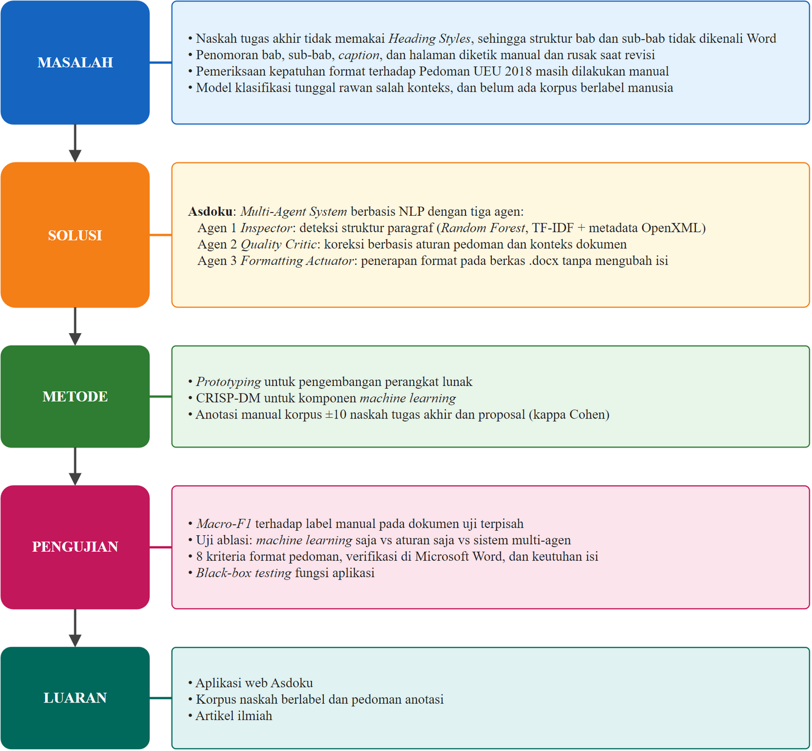

# BAB I PENDAHULUAN

## Latar Belakang

Penyusunan tugas akhir di perguruan tinggi tidak hanya menuntut kualitas substansi, tetapi juga kepatuhan terhadap ketentuan tata tulis institusi. Di Universitas Esa Unggul, ketentuan tersebut diatur dalam Pedoman Penulisan Skripsi yang ditetapkan melalui Surat Keputusan Rektor Nomor 5 Tahun 2018. Pedoman ini mengatur ukuran kertas dan margin, jenis serta ukuran huruf, penomoran bab dan sub-bab, penomoran halaman bagian awal dan bagian isi, format judul tabel dan gambar, hingga penulisan daftar referensi (Universitas Esa Unggul, 2018). Ketentuan tata tulis yang seragam memudahkan pembaca dan penguji menelusuri naskah, dan sekaligus menjadi salah satu syarat administratif sebelum naskah dapat diujikan.

Dalam praktiknya, sebagian besar mahasiswa menyusun naskah di Microsoft Word tanpa memanfaatkan fitur struktural yang tersedia, seperti *Heading Styles*, *multilevel list*, *section break*, dan *field* penomoran otomatis. Judul bab dan sub-bab sering hanya ditebalkan secara manual, nomor sub-bab dan nomor *caption* diketik langsung, dan pemisahan penomoran halaman Romawi untuk bagian awal dengan penomoran Arab untuk bagian isi dilakukan dengan cara yang tidak konsisten. Akibatnya, *Navigation Pane* Word kosong, Daftar Isi harus disusun secara manual, dan penomoran rusak setiap kali naskah direvisi. Masalah ini tidak selalu tertangkap dalam proses bimbingan. Putra et al. (2026) menemukan pelanggaran format pada 15,9% pasangan dokumen–aturan di 17 skripsi yang telah disetujui pembimbing dan penguji. [ISI: hasil kuesioner studi pendahuluan, misalnya "Studi pendahuluan terhadap N mahasiswa Fakultas Ilmu Komputer UEU pada bulan … menunjukkan X% responden mengetik nomor sub-bab secara manual dan Y% menghabiskan lebih dari 3 jam untuk merapikan format naskah."]

Pemeriksaan kepatuhan format hingga kini masih dilakukan secara manual oleh mahasiswa dan dosen pembimbing. Templat Word resmi hanya membantu apabila digunakan sejak awal penulisan dan tidak dapat memperbaiki naskah yang telah ditulis dengan format bebas. Penelitian terdahulu di Indonesia telah membangun pemeriksa format otomatis berbasis aturan dan pencocokan teks (Castrena et al., 2021; Kolinu et al., 2025; Aulia & Haviana, 2026; Putra et al., 2026). Sistem tersebut melaporkan kesalahan, tetapi perbaikannya tetap dikerjakan manual oleh penulis. Untuk memperbaiki naskah secara otomatis, sebuah sistem harus terlebih dahulu memahami struktur naskah, yaitu menentukan apakah suatu paragraf merupakan judul bab, sub-bab, paragraf isi, *caption*, atau entri daftar pustaka, lalu menerapkan format yang sesuai tanpa mengubah isi tulisan.

Penentuan struktur dari teks yang tidak terstruktur merupakan persoalan *Natural Language Processing* (NLP). Kajian sistematis menunjukkan bahwa teknik NLP dan model klasifikasi efektif untuk mengekstraksi struktur dari teks tidak terstruktur (Roldan-Baluis et al., 2022), dan algoritma *machine learning* klasik tetap kompetitif sebagai pendekatan yang ringan serta dapat dijelaskan, terutama pada data berukuran terbatas (Ali et al., 2024). Namun, klasifikasi per paragraf saja tidak cukup, karena peran struktural sebuah paragraf sering bergantung pada konteks dokumen. Baris "BAB I PENDAHULUAN" dapat berupa judul bab, entri Daftar Isi, atau butir di sub-bab Sistematika Penulisan, tergantung letaknya. Baris "1. Latar Belakang" dapat berupa judul sub-bab atau sekadar butir daftar. Literatur sistem multi-agen terkini menunjukkan bahwa model tunggal yang monolitik rentan gagal pada kasus seperti ini, dan merekomendasikan arsitektur hibrida yang memadukan model berbasis data dengan kontrol simbolik serta pembagian peran yang jelas antar-agen (La Malfa et al., 2025; Petridis et al., 2025; Gabauer, 2026; Muwa et al., 2026).

Di sisi lain, korpus naskah ilmiah terstruktur yang tersedia untuk riset NLP sebagian besar berbahasa Inggris atau Mandarin (Li et al., 2022; Saier et al., 2023). Belum tersedia korpus naskah tugas akhir berbahasa Indonesia yang struktur paragrafnya dilabeli oleh manusia, sehingga kinerja sistem deteksi struktur untuk naskah tugas akhir di Indonesia belum dapat diukur secara valid. Evaluasi sistem sejenis juga umumnya berhenti pada metrik klasifikasi dan belum memeriksa apakah berkas akhir benar-benar patuh dan utuh ketika dibuka di aplikasi pengolah kata yang sebenarnya.

Berdasarkan uraian tersebut, penelitian ini merancang bangun sebuah *Multi-Agent System* bernama Asdoku (Asisten Dokumenku) yang terdiri atas tiga agen. Agen pertama mendeteksi struktur setiap paragraf menggunakan model *machine learning* dengan fitur teks NLP dan fitur tampilan dari Office Open XML (OOXML). Agen kedua mengendalikan mutu dengan memeriksa hasil deteksi terhadap aturan pedoman UEU dan konteks dokumen, serta menguji berkas hasil. Agen ketiga menyusun ulang berkas .docx sesuai pedoman tanpa menghilangkan isi. Kinerja sistem dievaluasi pada korpus naskah tugas akhir dan proposal mahasiswa Fakultas Ilmu Komputer Universitas Esa Unggul yang dilabeli mengikuti pedoman anotasi tertulis, dengan pembagian data per naskah agar hasilnya mencerminkan kinerja pada naskah yang belum pernah dilihat sistem.

## Identifikasi Masalah

Berdasarkan latar belakang di atas, masalah yang diidentifikasi dalam penelitian ini adalah sebagai berikut.

1. Naskah tugas akhir mahasiswa umumnya tidak menggunakan *Heading Styles* Microsoft Word, sehingga struktur bab dan sub-bab tidak dikenali Word dan Daftar Isi harus dibuat secara manual.
2. Penomoran sub-bab, *caption* tabel dan gambar, serta halaman Romawi dan Arab sering diketik manual sehingga rusak ketika naskah direvisi.
3. Pemeriksaan kepatuhan format terhadap Pedoman Penulisan Skripsi UEU 2018 masih dilakukan secara manual oleh mahasiswa dan dosen pembimbing.
4. Templat Word resmi dan pemeriksa format yang ada tidak dapat memperbaiki naskah yang telah ditulis dengan format bebas; perbaikan tetap dikerjakan manual.
5. Klasifikasi struktur per paragraf dengan satu model tunggal rentan salah karena tidak mempertimbangkan konteks dokumen.
6. Belum tersedia korpus naskah tugas akhir berbahasa Indonesia dengan label struktur yang mengikuti pedoman anotasi tertulis untuk mengukur kinerja deteksi struktur secara valid.

## Rumusan Masalah

Berdasarkan identifikasi masalah, rumusan masalah penelitian ini adalah sebagai berikut.

1. Bagaimana merancang representasi fitur berbasis *Natural Language Processing* yang dipadukan dengan metadata OpenXML untuk mengklasifikasikan elemen struktur dokumen tugas akhir?
2. Bagaimana merancang bangun arsitektur *Multi-Agent System* yang terdiri atas agen deteksi, agen pengendali mutu, dan agen *formatting* untuk mengotomatisasi deteksi struktur dan *formatting* dokumen tugas akhir sesuai Pedoman Penulisan Skripsi UEU 2018?
3. Bagaimana kinerja deteksi struktur sistem, diukur dengan macro-F1 terhadap label manual pada naskah yang tidak digunakan dalam pelatihan, dan apakah kolaborasi agen meningkatkan kinerja dibandingkan model *machine learning* saja?
4. Bagaimana tingkat kepatuhan format dan keutuhan isi dokumen hasil sistem terhadap kriteria Pedoman Penulisan Skripsi UEU 2018 ketika diperiksa di Microsoft Word?

## Tujuan Penelitian

Tujuan penelitian ini adalah sebagai berikut.

1. Merancang representasi fitur hibrida, yaitu fitur teks TF-IDF yang dipadukan dengan fitur tipografi, gaya, dan pola teks dari OpenXML, untuk klasifikasi elemen struktur dokumen tugas akhir.
2. Merancang dan membangun *Multi-Agent System* Asdoku yang mengotomatisasi deteksi struktur dan *formatting* dokumen tugas akhir.
3. Mengukur kinerja deteksi struktur pada naskah yang terpisah dari data latih serta membandingkan kinerja model *machine learning* saja dengan kinerja sistem multi-agen.
4. Mengukur tingkat kepatuhan format dan keutuhan isi dokumen hasil sistem terhadap kriteria pedoman.

## Batasan Masalah

Agar penelitian terarah, ditetapkan batasan masalah sebagai berikut.

1. Dokumen yang diproses adalah naskah tugas akhir dan proposal tugas akhir mahasiswa Fakultas Ilmu Komputer Universitas Esa Unggul dalam format Microsoft Word (.docx) berbahasa Indonesia. Laporan magang/MBKM, berkas PDF, dan hasil pindaian tidak termasuk.
2. Acuan format adalah Pedoman Penulisan Skripsi UEU 2018 (SK Rektor Nomor 5 Tahun 2018) dan panduan penulisan Fakultas Ilmu Komputer. Ketentuan yang tidak diatur pedoman ditetapkan sebagai asumsi tertulis dan dicantumkan pada Lampiran.
3. Struktur dokumen diklasifikasikan ke dalam sembilan kelas: metadata sampul, judul halaman awal, judul bab, sub-bab, paragraf isi, *caption* gambar, *caption* tabel, entri daftar pustaka, dan lainnya.
4. Sistem memeriksa dan memperbaiki format, bukan substansi isi, tata bahasa, kebenaran sitasi, maupun plagiarisme.
5. Agen deteksi menggunakan algoritma *machine learning* klasik, yaitu Random Forest sebagai model utama dengan Logistic Regression dan XGBoost sebagai pembanding. Model bahasa besar (LLM) tidak digunakan.
6. Korpus penelitian terdiri atas naskah dari penulis yang berbeda yang diperoleh dengan izin tertulis. Pada saat penulisan bab ini, korpus berisi tujuh naskah (enam naskah tugas akhir dan satu proposal) ditambah [ISI: jumlah] naskah uji akhir.
7. Isi sel tabel, *header*, *footer*, catatan kaki, dan kotak teks tidak diklasifikasikan strukturnya, tetapi tetap dipertahankan dan diformat oleh sistem.
8. Verifikasi tampilan hasil dilakukan pada Microsoft Word versi desktop untuk Windows.
9. Sistem dibangun sebagai aplikasi web berbasis FastAPI yang dapat dijalankan secara lokal maupun pada layanan *serverless* Vercel. Integrasi dengan sistem informasi akademik kampus tidak termasuk.

## Manfaat Penelitian

### Manfaat Teoretis

1. Memberikan bukti empiris mengenai kontribusi kolaborasi agen hibrida, yaitu model statistik dan kontrol aturan, dibandingkan model tunggal pada tugas deteksi struktur dokumen.
2. Menghasilkan korpus naskah tugas akhir berbahasa Indonesia berlabel struktur beserta pedoman anotasinya, yang dapat menjadi acuan bagi penelitian sejenis.
3. Menunjukkan cara mengevaluasi sistem *formatting* dokumen tidak hanya dari ketepatan klasifikasi, tetapi juga dari kepatuhan dan keutuhan berkas akhir di aplikasi pengolah kata yang sebenarnya.

### Manfaat Praktis

1. Bagi mahasiswa: mengurangi waktu yang dihabiskan untuk merapikan format naskah secara manual, sehingga waktu dapat dialihkan ke substansi penelitian.
2. Bagi dosen pembimbing: memungkinkan waktu bimbingan lebih terfokus pada substansi, karena pemeriksaan format dibantu sistem.
3. Bagi Fakultas Ilmu Komputer: menyediakan alat bantu pemeriksaan dan perbaikan format yang selaras dengan pedoman institusi.

## Kerangka Berpikir

Kerangka berpikir penelitian ini disajikan pada Gambar 1.1. Penelitian berangkat dari masalah bahwa naskah ditulis dengan format bebas dan pemeriksaan format masih manual. Masalah tersebut dijawab dengan sistem multi-agen yang mendeteksi struktur, mengoreksinya dengan aturan pedoman, dan menyusun ulang berkas. Hasilnya diukur dari dua sisi: ketepatan deteksi struktur terhadap label manual, dan kepatuhan serta keutuhan berkas akhir.

Gambar 1.1 Kerangka Berpikir

## Sistematika Penulisan

Tugas akhir ini disusun dalam lima bab dengan sistematika sebagai berikut.

BAB I PENDAHULUAN berisi latar belakang, identifikasi masalah, rumusan masalah, tujuan, batasan masalah, manfaat penelitian, kerangka berpikir, dan sistematika penulisan.

BAB II STUDI TEORITIS berisi penelitian terdahulu, landasan teori yang mendasari penelitian, kerangka pemikiran, dan hipotesis.

BAB III METODOLOGI PENELITIAN berisi pendekatan penelitian, lokasi dan waktu, data dan korpus penelitian, kebutuhan sistem, rancangan sistem, teknik pengumpulan data, instrumen, teknik analisis data, validitas dan reliabilitas, serta etika penelitian.

BAB IV HASIL DAN PEMBAHASAN berisi hasil analisis kebutuhan, perancangan dan implementasi sistem, hasil pengujian deteksi struktur, uji ablasi, uji kepatuhan format dan keutuhan isi, *black-box testing*, serta pembahasannya.

BAB V KESIMPULAN DAN SARAN berisi kesimpulan yang menjawab rumusan masalah dan saran untuk penelitian selanjutnya.
