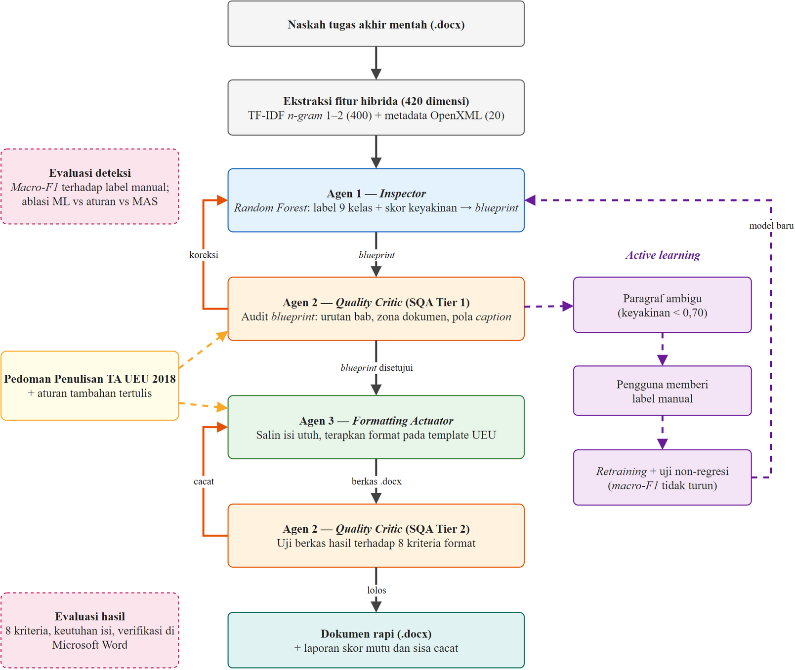

# BAB II STUDI TEORITIS

## Penelitian Terdahulu

Penelitian terdahulu ditelusuri dari dua arah. Arah pertama adalah penelitian internasional mengenai sistem multi-agen, arsitektur hibrida, klasifikasi teks, korpus ilmiah, dan metrik evaluasi, yang diperoleh melalui tinjauan literatur sistematis pada basis data Scopus tahun 2021–2026 dengan protokol PRISMA 2020. Arah kedua adalah penelitian di Indonesia yang secara khusus membahas pemeriksaan format skripsi. Ringkasan keduanya disajikan pada Tabel 2.1.

Tabel 2.1 Penelitian Terdahulu

| No | Peneliti (Tahun) | Judul | Metode | Hasil | Perbedaan dengan Penelitian Ini |
|---|---|---|---|---|---|
| 1 | La Malfa et al. (2025) | Large Language Models Miss the Multi-Agent Mark | Kajian kritis sistem multi-agen berbasis LLM | Banyak sistem "multi-agen" berbasis LLM tidak memenuhi karakteristik multi-agen sejati karena desain statis dan terlalu disederhanakan | Penelitian ini membangun agen dengan peran dan kewenangan terpisah tanpa LLM |
| 2 | Gabauer (2026) | LLM-based agent systems: a systematic literature review and position on hybrid architectures and evaluation frameworks | Systematic literature review | Merekomendasikan arsitektur hibrida (model + kontrol simbolik) dan kerangka evaluasi terpadu | Penelitian ini menerapkan arsitektur hibrida pada domain format dokumen akademik |
| 3 | Petridis et al. (2025) | Assessing Agentic AI & AI Agents Concepts and Platforms Through the Lens of Traditional Multi-Agent Systems Principles | Evaluasi konseptual | Prinsip otonomi, pembagian peran, dan koordinasi tetap relevan untuk sistem agen modern | Penelitian ini menerapkan pembagian peran deteksi, pengendalian mutu, dan eksekusi |
| 4 | Muwa et al. (2026) | Hybrid Neuro-Symbolic Planning Frameworks: A Systematic Review (2023–2025) | Systematic review | Kombinasi model berbasis data dan penalaran simbolik menghasilkan keputusan lebih andal dan dapat dijelaskan | Penelitian ini menggabungkan klasifikasi Random Forest dengan aturan pedoman UEU |
| 5 | Ali et al. (2024) | An Exhaustive Comparative Study of Machine Learning Algorithms for NLP Applications | Studi komparatif algoritma ML | Algoritma ML klasik efektif sebagai baseline dan untuk lingkungan sumber daya terbatas | Penelitian ini membandingkan Random Forest, Logistic Regression, dan XGBoost untuk klasifikasi struktur paragraf |
| 6 | Roldan-Baluis et al. (2022) | The Effect of NLP on the Analysis of Unstructured Text: A Systematic Review | Systematic review | NLP efektif untuk mengekstraksi struktur dari teks tidak terstruktur | Penelitian ini menambahkan fitur metadata OpenXML ke fitur teks |
| 7 | Saier et al. (2023) | unarXive 2022: All arXiv Publications Pre-Processed for NLP | Pembangunan korpus | Korpus teks ilmiah terstruktur skala besar berbahasa Inggris | Penelitian ini membangun korpus naskah tugas akhir berbahasa Indonesia berlabel struktur |
| 8 | Li et al. (2022) | CSL: A Large-scale Chinese Scientific Literature Dataset | Pembangunan korpus | Korpus literatur ilmiah bahasa non-Inggris untuk tugas NLP | Sama seperti di atas, untuk bahasa Indonesia dan domain format |
| 9 | Blagec et al. (2022) | A global analysis of metrics used for measuring performance in NLP | Analisis metrik | Pemetaan metrik evaluasi NLP dan keterbatasannya | Penelitian ini memakai macro-F1 karena distribusi kelas tidak seimbang |
| 10 | Chou (2026) | AI-as-a-Judge for software quality assessment | Eksperimen penilai berbasis AI | Penilai berbasis LLM tidak konsisten | Penelitian ini memakai pengendali mutu berbasis aturan yang deterministik |
| 11 | Liu et al. (2026) | Mosaic: A Multi-Level Framework for Observing and Evaluating Performance of Multi-Agent Systems | Kerangka evaluasi | Evaluasi MAS perlu bertingkat dan berorientasi proses | Penelitian ini mengevaluasi per agen (deteksi) dan per artefak (berkas .docx) |
| 12 | Putro (2019) | Pendeteksi Kesesuaian Format Laporan Skripsi dengan Panduan Penulisan menggunakan Machine Learning | Machine learning | Machine learning dapat dipakai untuk mendeteksi kesesuaian format laporan skripsi terhadap panduan | Penelitian ini mengklasifikasikan struktur per paragraf dan memperbaiki format secara otomatis |
| 13 | Castrena et al. (2021) | Pengembangan Perangkat Lunak untuk Otomatisasi Pengecekan Format Penulisan Dokumen Jurnal Skripsi menggunakan Fitur Tag pada XML | String matching pada XML dokumen terhadap aturan templat | Kesalahan font, ukuran, gaya huruf, dan margin dilaporkan dalam ringkasan PDF; perbaikan dilakukan manual | Penelitian ini memperbaiki dokumen secara otomatis dan menangani struktur (bab, sub-bab, caption) |
| 14 | Kolinu et al. (2025) | Rancang Bangun Aplikasi Pendeteksi Kesalahan Struktur, Format dan Ejaan Kata Naskah Skripsi | Prototype; exact string matching, Flask, python-docx, regex | Aplikasi web CekNulis mendeteksi kesalahan struktur, format, dan ejaan pada naskah .docx | Penelitian ini mengenali struktur dengan model machine learning dan memperbaiki format |
| 15 | Aulia & Haviana (2026) | Sistem Pengecekan Format Tugas Akhir Menggunakan Rule-Based System dan Similarity Judul | Rule-based system; TF-IDF dan cosine similarity judul bab terhadap templat | Akurasi 92,86%, precision 100%, recall 92,65%; memberi rekomendasi perbaikan | Penelitian ini memakai TF-IDF sebagai ciri model klasifikasi per paragraf dan menerapkan perbaikan langsung |
| 16 | Putra et al. (2026) | Resolver Properti Efektif untuk Pemeriksaan Format Skripsi Berbasis Aturan dengan Evaluasi Injeksi Kesalahan | Rule-based, 44 aturan dalam 9 kategori, resolver pewarisan format OOXML; evaluasi injeksi kesalahan | F1 0,985 pada injeksi kesalahan; pelanggaran tersisa pada 15,9% pasangan dokumen–aturan di skripsi yang sudah lolos pembimbing dan penguji | Penelitian ini memperbaiki, bukan hanya memeriksa, dan menambahkan deteksi struktur berbasis machine learning |

[ISI: Pembanding terdekat yang belum masuk tabel adalah skripsi "DocuForge" Universitas Muhammadiyah Makassar (FastAPI + python-docx, rule-based IF-THEN, mendeteksi 150 masalah format dan mengoreksi otomatis). Lengkapi nama penulis dan tahun dari repositori UNISMUH, lalu tambahkan sebagai baris 17.]

Penelitian terdahulu di Indonesia tentang format skripsi (Tabel 2.1 nomor 12–16) sebagian besar berupa pemeriksa berbasis aturan atau pencocokan teks. Sistem tersebut melaporkan kesalahan, sedangkan perbaikannya tetap dilakukan manual oleh penulis (Castrena et al., 2021; Kolinu et al., 2025; Aulia & Haviana, 2026; Putra et al., 2026). Pendekatan berbasis aturan murni juga mengandalkan *style* atau pola teks tertentu untuk mengenali bab dan sub-bab, sehingga kesulitan pada naskah yang judulnya hanya ditebalkan secara manual. Putra et al. (2026) menunjukkan bahwa masalah ini nyata: pelanggaran format masih ditemukan pada 15,9% pasangan dokumen–aturan di skripsi yang telah lolos pembimbing dan penguji. Satu-satunya penelitian yang memakai *machine learning* (Putro, 2019) baru sebatas mendeteksi kesesuaian format, belum memperbaikinya.

Penelitian internasional (Tabel 2.1 nomor 1–11) memberi tiga pelajaran. Pertama, sistem yang disebut multi-agen harus memiliki pembagian peran dan kewenangan yang nyata, bukan sekadar rangkaian langkah (La Malfa et al., 2025; Petridis et al., 2025). Kedua, menggabungkan model berbasis data dengan kontrol simbolik menghasilkan keputusan yang lebih andal dan dapat dijelaskan (Gabauer, 2026; Muwa et al., 2026), dan penilai berbasis aturan lebih konsisten daripada penilai berbasis model generatif (Chou, 2026). Ketiga, evaluasi perlu memakai metrik yang sesuai dengan sebaran data (Blagec et al., 2022) dan dilakukan bertingkat, yaitu per komponen dan per artefak akhir (Liu et al., 2026).

Dengan demikian, penelitian terdahulu menunjukkan tiga celah. Pertama, belum ada penerapan arsitektur multi-agen hibrida yang sekaligus mendeteksi struktur dan menyusun ulang berkas .docx tanpa menghilangkan isi. Kedua, belum tersedia korpus naskah tugas akhir berbahasa Indonesia dengan label struktur yang mengikuti pedoman anotasi tertulis. Ketiga, evaluasi sistem sejenis umumnya berhenti pada metrik klasifikasi dan belum memeriksa kepatuhan serta keutuhan berkas akhir di aplikasi pengolah kata yang sebenarnya. Penelitian ini dirancang untuk mengisi ketiga celah tersebut.

## Landasan Teori

### Pedoman Penulisan Tugas Akhir Universitas Esa Unggul

Pedoman Penulisan Tugas Akhir Universitas Esa Unggul ditetapkan melalui Surat Keputusan Rektor Nomor 5 Tahun 2018 sebagai acuan bagi seluruh mahasiswa dan dosen pembimbing dalam menyusun tugas akhir (Universitas Esa Unggul, 2018). Pedoman ini mengatur dua hal, yaitu susunan naskah (bagian awal, bagian isi, dan bagian akhir) dan tata tulis naskah (kertas, margin, huruf, spasi, dan penomoran). Ketentuan tata tulis inilah yang diotomatisasi dalam penelitian ini. Ringkasannya disajikan pada Tabel 2.2.

Tabel 2.2 Ketentuan Tata Tulis Pedoman Penulisan Tugas Akhir UEU 2018

| Aspek | Ketentuan | Rujukan Pedoman |
|---|---|---|
| Kertas | A4 (21 × 29,7 cm), HVS 70 gram, dicetak satu sisi | Bab IV butir A, hlm. 9 |
| Margin | Kiri 4 cm (termasuk 1 cm penjilidan), kanan 3 cm, atas 3 cm, bawah 3 cm | Bab IV butir D, hlm. 10 |
| Huruf dan spasi naskah | Times New Roman 12 pt, spasi 1,15 dengan spasi sebelum dan sesudah 0 pt, rata kiri-kanan | Bab IV butir E, hlm. 10 |
| Header | Tulisan "Universitas Esa Unggul", Arial 10 pt tebal, kanan atas, mulai abstrak sampai daftar referensi | Bab IV butir E, hlm. 10 |
| Nomor halaman | Halaman judul tidak bernomor tetapi dihitung; bagian awal angka Romawi kecil; bagian isi dan akhir angka Arab; tengah bawah, 2 cm dari tepi kertas | Bab IV butir F, hlm. 10 |
| Judul bab | Setiap bab dimulai di halaman baru; huruf kapital, tebal, rata tengah; penomoran Romawi besar (BAB I, BAB II) | Bab III butir B, hlm. 7 |
| Sub-bab | Penomoran angka Arab (1.1, 1.1.1, 1.1.1.1), paling dalam sampai derajat ketiga | Bab III butir A.7, hlm. 7 |
| Tabel, gambar, rumus | Penomoran angka Arab (1.1, 1.2) dan dimuat dalam daftar tabel/gambar/rumus | Bab III butir A.8, hlm. 7 |
| Daftar referensi | Format APA, MLA, Vancouver, atau sesuai arahan fakultas, konsisten dalam satu fakultas | Bab III butir C.1, hlm. 8 |

Pedoman tidak mengatur sejumlah detail yang tetap dibutuhkan untuk menghasilkan dokumen yang konsisten, misalnya posisi *caption* tabel dan gambar, jarak antara judul sub-bab dan paragraf, indentasi daftar bernomor, jarak antarbutir daftar, dan bentuk garis tabel. Untuk detail tersebut, penelitian ini menetapkan aturan tambahan yang dicantumkan secara terbuka pada Lampiran, sehingga ketentuan pedoman dapat dibedakan dari asumsi peneliti. Contohnya, tabel memakai garis horizontal di setiap baris tanpa garis vertikal, dan butir daftar diberi jarak 3 pt antarbutir. [KONFIRMASI DOSPEM: pedoman 2018 menetapkan spasi sebelum/sesudah 0 pt, sedangkan Asdoku memakai 6 pt sesudah paragraf isi dan 12/6 pt pada sub-bab. Sesuaikan tabel ini dan Lampiran setelah ada jawaban fakultas.]

Pedoman membagi bagian isi tugas akhir menjadi enam bab (pendahuluan, tinjauan pustaka, metode, hasil, pembahasan, dan penutup), sedangkan panduan Fakultas Ilmu Komputer menggunakan lima bab dengan hasil dan pembahasan digabung, dan proposal memakai nama bab tersendiri seperti "Studi Teoritis" dan "Rencana Hasil dan Pembahasan". Oleh karena itu, sistem tidak mengunci jumlah dan nama bab. Judul bab dikenali dari pola penomoran ("BAB I", "BAB 1"), daftar nama bab yang lazim, prediksi model, dan urutannya dalam dokumen.

### Struktur Dokumen Office Open XML (OOXML)

Berkas .docx merupakan paket ZIP yang berisi sekumpulan berkas XML sesuai standar Office Open XML (ECMA-376) (Ecma International, 2021). Berbeda dengan teks biasa, isi dokumen Word tersimpan sebagai pohon elemen yang memisahkan isi dari format. Bagian-bagian yang relevan bagi penelitian ini adalah sebagai berikut.

1. word/document.xml memuat isi dokumen. Setiap paragraf disimpan sebagai elemen w:p yang terdiri atas satu atau lebih *run* (w:r), yaitu potongan teks dengan format karakter yang sama. Format paragraf (perataan, spasi, indentasi, tab) disimpan pada w:pPr, sedangkan format karakter (jenis huruf, ukuran, tebal, miring) pada w:rPr.
2. word/styles.xml memuat definisi *style*. *Heading Styles* (Heading 1, 2, 3) memiliki tingkat kerangka (w:outlineLvl) yang membuat Word mengenali paragraf sebagai judul, sehingga paragraf tersebut muncul di *Navigation Pane* dan dapat dihimpun oleh Daftar Isi otomatis.
3. word/numbering.xml memuat definisi penomoran bertingkat (*multilevel list*). Satu definisi abstrak (w:abstractNum) berisi pengaturan setiap tingkat (w:lvl), misalnya format "BAB %1" dengan angka Romawi besar untuk tingkat pertama dan "%1.%2" untuk tingkat kedua. Dengan cara ini nomor bab dan sub-bab dihitung oleh Word, bukan diketik manual.
4. Properti *section* (w:sectPr) mengatur ukuran kertas (w:pgSz), margin (w:pgMar), format nomor halaman (w:pgNumType, misalnya Romawi kecil atau desimal), serta rujukan *header* dan *footer*. Dokumen yang memerlukan nomor halaman Romawi dan Arab harus dibagi menjadi beberapa *section*.
5. *Field* adalah instruksi yang hasilnya dihitung Word, seperti TOC (daftar isi), SEQ (nomor urut *caption*), REF (rujukan silang seperti "lihat Tabel 4.1"), dan PAGE (nomor halaman). Rujukan silang menunjuk ke *bookmark* (w:bookmarkStart dan w:bookmarkEnd) yang dipasang pada paragraf tujuan.
6. *Content control* (w:sdt) adalah blok terlindung yang antara lain dipakai Mendeley Cite untuk menyimpan sitasi dan daftar pustaka, serta oleh Word untuk menyimpan Daftar Isi otomatis.

Struktur ini memiliki tiga konsekuensi bagi sistem. Pertama, *formatting* yang benar berarti mengubah properti w:pPr, w:rPr, *style*, dan *section* tanpa menyentuh teks pada w:r, sehingga isi naskah tetap utuh. Kedua, unsur yang tidak tampak sebagai teks, yaitu gambar, sitasi, catatan kaki, dan *bookmark*, terikat pada paragraf tempatnya berada; jika paragraf tersebut dibangun ulang dari teksnya saja, unsur-unsur tersebut ikut hilang. Ketiga, Microsoft Word dapat mengabaikan elemen yang urutan atau nilainya tidak sesuai skema tanpa menampilkan pesan galat. Hal ini ditemukan selama pengembangan, misalnya nomor sub-bab yang tidak tampil di Word padahal berkas XML-nya tampak benar. Karena itu, hasil sistem harus diverifikasi di Microsoft Word, tidak cukup dengan memeriksa XML.

### Natural Language Processing dan Representasi TF-IDF

*Natural Language Processing* (NLP) adalah bidang ilmu komputer yang mempelajari pemrosesan bahasa manusia oleh komputer. Salah satu tugasnya adalah klasifikasi teks, yaitu menetapkan kategori pada suatu potongan teks berdasarkan isinya. Kajian sistematis Roldan-Baluis et al. (2022) menunjukkan bahwa teknik NLP efektif untuk mengekstraksi struktur dan informasi dari teks tidak terstruktur. Dalam penelitian ini, potongan teks yang diklasifikasikan adalah paragraf, dan kategorinya adalah peran struktural paragraf tersebut.

Agar dapat diproses algoritma *machine learning*, teks harus diubah menjadi vektor angka. Penelitian ini menggunakan pembobotan *Term Frequency–Inverse Document Frequency* (TF-IDF), yang memberi bobot tinggi pada kata yang sering muncul di suatu paragraf tetapi jarang muncul di paragraf lain (Salton & Buckley, 1988; Manning et al., 2008). Bobot *term* t pada paragraf d dihitung sebagai berikut.

tfidf(t, d) = tf(t, d) × idf(t) … (2.1)

idf(t) = ln[(1 + n) / (1 + df(t))] + 1 … (2.2)

Pada persamaan tersebut, tf(t, d) adalah frekuensi *term* t pada paragraf d, n adalah jumlah paragraf, dan df(t) adalah jumlah paragraf yang memuat *term* t. Persamaan (2.2) merupakan bentuk IDF dengan penghalusan yang digunakan pustaka scikit-learn (Pedregosa et al., 2011). Vektor setiap paragraf kemudian dinormalisasi dengan norma L2. *Term* yang digunakan berupa unigram dan bigram (n-gram 1–2), sehingga frasa khas seperti "latar belakang", "daftar pustaka", atau "tabel 2" tertangkap sebagai satu ciri. Jumlah ciri dibatasi pada 400 *term* dengan frekuensi tertinggi pada data latih.

### Representasi Fitur Hibrida

Teks saja tidak cukup untuk membedakan beberapa kelas. Kalimat "Rumusan Masalah" dapat berupa judul sub-bab atau kalimat biasa di dalam paragraf, dan "Tabel 2.1 Studi Literatur" dapat berupa *caption* atau entri di Daftar Tabel. Pembedanya ada pada tampilan dan konteks: judul cenderung pendek, tebal, dan memakai *style* tertentu, sedangkan entri Daftar Tabel diakhiri nomor halaman. Karena itu, vektor TF-IDF digabungkan dengan 37 ciri yang dibaca dari OOXML dan pola teks. Ciri-ciri tersebut dikelompokkan pada Tabel 2.3.

Tabel 2.3 Kelompok Ciri Representasi Hibrida

| Kelompok | Jumlah | Ciri |
|---|---|---|
| Teks (TF-IDF) | 400 | Unigram dan bigram dengan frekuensi tertinggi |
| Tipografi dan tata letak | 20 | Panjang karakter, jumlah kata, rasio huruf kapital, ukuran huruf, tebal, miring, penomoran otomatis, gambar, pemisah halaman, spasi sebelum, spasi sesudah, jarak baris, indentasi baris pertama, indentasi kiri, posisi relatif dalam dokumen, dan perataan (lima kategori) |
| Gaya Word | 7 | Heading 1, Heading 2, Heading 3 ke bawah, gaya daftar isi (TOC/Table of Figures), Caption, List, Title/Subtitle |
| Pola teks | 10 | Diawali "BAB" + nomor; diawali nomor sub-bab (2.1, 2.1.3); diawali "Gambar" + nomor; diawali "Tabel" + nomor; diakhiri nomor halaman; format entri pustaka "Nama, A. (Tahun)"; memuat tahun dalam kurung; isian formulir "Label : …"; diawali nomor poin ("1.", "a)"); diakhiri tanda baca |

Gabungan ini menghasilkan representasi berdimensi 437. Ciri numerik dinormalisasi dengan membaginya terhadap nilai acuan (misalnya ukuran huruf dibagi 14), sedangkan ciri biner bernilai 0 atau 1. Ciri gaya Word sangat informatif pada naskah yang memakai *Heading Styles*, tetapi tidak tersedia pada naskah yang judulnya hanya ditebalkan. Untuk mencegah model bergantung pada ciri ini, pelatihan juga memakai versi naskah yang gaya judulnya dihapus (Subbab 3.3.4).

### Klasifikasi dengan Random Forest

Random Forest adalah metode ensembel yang membangun banyak pohon keputusan dan menggabungkan hasilnya (Breiman, 2001). Setiap pohon dilatih pada sampel *bootstrap* dari data latih, dan pada setiap percabangan hanya sebagian ciri yang dipilih secara acak sebagai kandidat pemisah. Kedua sumber keacakan ini membuat pohon-pohon saling berbeda, sehingga kesalahan individual saling meniadakan dan model lebih tahan terhadap *overfitting* dibandingkan satu pohon keputusan. Untuk paragraf x, setiap pohon menghasilkan estimasi probabilitas kelas, dan Random Forest merata-ratakannya:

P(c | x) = (1 / T) Σt=1..T Pt(c | x) … (2.3)

Pada persamaan tersebut, T adalah jumlah pohon. Kelas prediksi adalah kelas dengan probabilitas tertinggi, dan nilai probabilitas tersebut dipakai sebagai skor keyakinan. Paragraf dengan skor keyakinan di bawah 0,70 ditandai sebagai ambigu.

Distribusi kelas pada naskah akademik sangat tidak seimbang: paragraf isi jauh lebih banyak daripada judul bab atau entri daftar pustaka. Untuk mengimbanginya, setiap kelas c diberi bobot:

wc = n / (k × nc) … (2.4)

Pada persamaan tersebut, n adalah jumlah sampel, k adalah jumlah kelas, dan nc adalah jumlah sampel kelas c (Pedregosa et al., 2011). Dengan bobot ini, kesalahan pada kelas langka dihitung lebih berat selama pelatihan. Pada Random Forest, bobot dihitung ulang untuk setiap sampel *bootstrap* (*balanced subsample*).

Random Forest dipilih sebagai model utama karena (1) bekerja baik pada data tabular yang memadukan ciri teks dan ciri numerik, (2) tidak memerlukan penyamaan skala ciri, dan (3) menghasilkan probabilitas yang dibutuhkan sebagai skor keyakinan. Sebagai pembanding, digunakan dua algoritma lain.

1. Logistic Regression, model linear yang memodelkan probabilitas kelas dengan fungsi *softmax*, sebagai baseline yang sederhana dan cepat.
2. XGBoost, metode *gradient boosting* yang membangun pohon secara berurutan, setiap pohon memperbaiki kesalahan pohon sebelumnya (Chen & Guestrin, 2016).

Pemilihan algoritma klasik ini sejalan dengan temuan Ali et al. (2024) bahwa algoritma *machine learning* tradisional tetap efektif untuk aplikasi NLP, khususnya pada data berukuran terbatas.

### Multi-Agent System

Agen adalah sistem komputer yang berada dalam suatu lingkungan dan mampu bertindak secara otonom untuk mencapai tujuannya (Wooldridge, 2009). Wooldridge dan Jennings (1995) mencirikan agen dengan empat sifat: otonomi (bertindak tanpa campur tangan langsung manusia), reaktivitas (menanggapi perubahan lingkungan), proaktivitas (berinisiatif mencapai tujuan), dan kemampuan sosial (berinteraksi dengan agen lain). *Multi-Agent System* (MAS) adalah sistem yang terdiri atas beberapa agen yang berinteraksi untuk menyelesaikan persoalan yang sulit diselesaikan oleh satu agen.

Literatur terkini menekankan dua prinsip perancangan MAS yang relevan dengan penelitian ini.

1. Spesialisasi peran. Membagi tugas ke agen dengan peran berbeda, misalnya pelaksana dan peninjau, meningkatkan kualitas hasil dibandingkan satu agen yang mengerjakan semuanya (Zhang et al., 2024). Prinsip klasik MAS tentang otonomi dan koordinasi tetap menjadi tolok ukur, termasuk untuk sistem agen modern (Petridis et al., 2025). Sebaliknya, banyak sistem yang disebut multi-agen ternyata hanya rangkaian langkah statis tanpa pembagian kewenangan yang jelas (La Malfa et al., 2025).
2. Arsitektur hibrida. Menggabungkan komponen berbasis data (statistik) dengan komponen simbolik (aturan) menghasilkan keputusan yang lebih andal dan dapat dijelaskan dibandingkan komponen berbasis data saja (Gabauer, 2026; Muwa et al., 2026). Komponen simbolik juga lebih konsisten sebagai penilai mutu dibandingkan penilai berbasis model generatif (Chou, 2026).

Kedua prinsip tersebut diterapkan pada tiga agen dalam penelitian ini, seperti ditunjukkan Tabel 2.4.

Tabel 2.4 Peran Agen dalam Sistem Asdoku

| Agen | Peran | Jenis | Masukan → Keluaran |
|---|---|---|---|
| Agen 1 — Inspector | Mendeteksi peran struktural setiap paragraf | Berbasis data (Random Forest) | Naskah .docx → rancangan struktur (*blueprint*) dan skor keyakinan |
| Agen 2 — Quality Critic | Memeriksa rancangan struktur terhadap aturan pedoman dan konteks dokumen, lalu menguji berkas hasil | Simbolik (aturan) | *Blueprint* → koreksi; berkas hasil → laporan 8 kriteria |
| Agen 3 — Formatting Actuator | Menyusun ulang naskah ke templat UEU tanpa mengubah isi | Prosedural (manipulasi OOXML) | *Blueprint* disetujui → berkas .docx hasil |

Interaksi antar-agen berlangsung dalam dua putaran umpan balik. Pada putaran pertama, Agen 2 mengoreksi *blueprint* Agen 1 hingga tidak ada koreksi baru. Koreksi Agen 2 memakai konteks yang tidak dimiliki Agen 1, misalnya urutan bab (Bab II harus muncul setelah Bab I), zona dokumen (halaman awal, isi bab, daftar pustaka), dan pola khas seperti baris Daftar Isi yang diakhiri nomor halaman. Pada putaran kedua, Agen 2 menguji berkas keluaran Agen 3 terhadap 8 kriteria pedoman dan meminta perbaikan bila ditemukan cacat. Evaluasi bertingkat seperti ini, yaitu per agen dan per artefak akhir, sejalan dengan kerangka evaluasi MAS yang diusulkan Liu et al. (2026).

### Active Learning

*Active learning* adalah pendekatan *machine learning* di mana model memilih sendiri data yang perlu dilabeli manusia, dengan tujuan mencapai kinerja yang baik menggunakan sesedikit mungkin label (Settles, 2009). Pendekatan ini sesuai untuk penelitian ini karena pelabelan paragraf secara manual memakan waktu. Strategi pemilihan yang digunakan adalah *uncertainty sampling* dengan ukuran *least confidence*, yaitu memilih paragraf yang prediksinya paling tidak yakin:

x* = argmaxx [1 − P(ŷ | x)] … (2.5)

Pada persamaan tersebut, ŷ adalah kelas yang diprediksi model untuk paragraf x (Settles, 2009).

Dalam sistem Asdoku, paragraf ambigu yang tidak dapat dipastikan oleh aturan Agen 2 diurutkan dari keyakinan terendah dan ditanyakan kepada pengguna, paling banyak 20 paragraf per dokumen. Setiap lima label manual baru, model dilatih ulang. Model baru hanya menggantikan model lama apabila macro-F1-nya pada data pembanding tidak lebih rendah. Mekanisme ini disebut uji non-regresi, yang mencegah label yang keliru menurunkan kinerja sistem.

### Metrik Evaluasi Klasifikasi

Kinerja klasifikasi dievaluasi dengan *confusion matrix*, yaitu tabel yang membandingkan kelas sebenarnya (label manual) dengan kelas prediksi. Untuk setiap kelas c dihitung jumlah *true positive* (TPc), *false positive* (FPc), dan *false negative* (FNc), lalu diturunkan tiga metrik berikut.

Precisionc = TPc / (TPc + FPc) … (2.6)

Recallc = TPc / (TPc + FNc) … (2.7)

F1c = 2 × Precisionc × Recallc / (Precisionc + Recallc) … (2.8)

Metrik utama penelitian ini adalah macro-F1, yaitu rata-rata F1 seluruh kelas tanpa pembobotan:

Macro-F1 = (1 / k) Σc=1..k F1c … (2.9)

Akurasi tidak dipakai sebagai metrik utama karena menyesatkan pada data yang tidak seimbang. Pada korpus penelitian ini, paragraf isi mencakup lebih dari separuh data, sehingga model yang menebak semua paragraf sebagai paragraf isi sudah memperoleh akurasi tinggi, padahal tidak menemukan satu pun judul bab atau sub-bab yang justru paling penting untuk *formatting*. Macro-F1 memberi bobot yang sama pada setiap kelas sehingga kegagalan pada kelas langka tetap terlihat. Pemilihan metrik ini mengikuti analisis Blagec et al. (2022) yang menunjukkan bahwa metrik evaluasi NLP perlu disesuaikan dengan karakteristik tugas dan data.

Agar hasil evaluasi tidak bias, pembagian data latih dan data uji dilakukan per dokumen. Paragraf dari dokumen yang sama memiliki gaya penulisan yang mirip, sehingga apabila tersebar di data latih dan data uji, kinerja model akan tampak lebih tinggi daripada kinerja sebenarnya pada naskah baru. Untuk memilih model pada data latih, digunakan validasi silang *leave-one-document-out* (LODO): pada setiap putaran, model dilatih dengan semua naskah kecuali satu, lalu diuji pada naskah yang ditinggalkan, hingga setiap naskah pernah menjadi naskah uji.

Karena data uji berukuran kecil, nilai macro-F1 tunggal dapat menyesatkan. Penelitian ini melengkapinya dengan interval kepercayaan 95% yang dihitung dengan metode *bootstrap*, yaitu mengambil ulang sampel data uji secara acak dengan pengembalian berkali-kali, menghitung macro-F1 pada setiap sampel ulang, lalu mengambil persentil ke-2,5 dan ke-97,5 dari sebaran nilai tersebut (Efron & Tibshirani, 1993).

Untuk menguji apakah dua konfigurasi sistem berbeda secara nyata pada data uji yang sama, digunakan uji McNemar (McNemar, 1947), yang dianjurkan untuk membandingkan dua pengklasifikasi pada satu himpunan uji (Dietterich, 1998). Uji ini hanya memakai paragraf yang hasilnya berbeda di antara kedua konfigurasi: b adalah jumlah paragraf yang benar pada konfigurasi pertama tetapi salah pada konfigurasi kedua, dan c adalah kebalikannya. Statistik ujinya dengan koreksi kontinuitas adalah:

χ² = (|b − c| − 1)² / (b + c) … (2.10)

Statistik ini mengikuti sebaran *chi-square* dengan derajat bebas 1, sehingga perbedaan dinyatakan signifikan pada taraf 5% bila χ² > 3,841.

Keandalan label manual diukur dengan koefisien kappa Cohen (Cohen, 1960), yang menghitung kesepakatan dua anotator setelah dikoreksi oleh kesepakatan yang terjadi secara kebetulan:

κ = (po − pe) / (1 − pe) … (2.11)

Pada persamaan tersebut, po adalah proporsi kesepakatan teramati dan pe adalah proporsi kesepakatan yang diharapkan secara kebetulan. Nilai κ di atas 0,80 umumnya ditafsirkan sebagai kesepakatan hampir sempurna (Landis & Koch, 1977).

### Teknologi yang Digunakan

Teknologi yang digunakan untuk membangun dan mengevaluasi sistem disajikan pada Tabel 2.5.

Tabel 2.5 Teknologi yang Digunakan

| Teknologi | Kegunaan dalam Penelitian |
|---|---|
| Python 3.10 | Bahasa pemrograman utama seluruh komponen sistem |
| python-docx dan lxml | Membaca dan memanipulasi elemen OOXML berkas .docx (Agen 1 dan Agen 3) |
| scikit-learn 1.7 | Ekstraksi TF-IDF, Random Forest, Logistic Regression, dan metrik evaluasi (Pedregosa et al., 2011) |
| XGBoost | Model pembanding berbasis *gradient boosting* (Chen & Guestrin, 2016) |
| pandas dan openpyxl | Pengolahan korpus dan lembar kerja pelabelan Excel |
| FastAPI dan Uvicorn | Kerangka dan server aplikasi web untuk unggah, proses, dan unduh dokumen |
| Vercel | Layanan *serverless* untuk menjalankan aplikasi web secara daring |
| Microsoft Word (desktop, Windows) | Verifikasi tampilan dokumen hasil |

[ISI: tambahkan rujukan dokumentasi resmi python-docx, lxml, FastAPI, dan Vercel dengan tanggal akses bila diminta dosen.]

## Kerangka Pemikiran

Kerangka pemikiran penelitian ini disajikan pada Gambar 2.1. Naskah .docx mentah diekstraksi menjadi representasi hibrida per paragraf. Agen 1 mengklasifikasikan setiap paragraf dan menghasilkan *blueprint* beserta skor keyakinan. Agen 2 memeriksa *blueprint* terhadap aturan pedoman dan konteks dokumen, lalu mengembalikan koreksi hingga rancangan stabil. Agen 3 menyusun ulang naskah ke templat UEU. Agen 2 kemudian menguji berkas hasil terhadap 8 kriteria pedoman dan meminta perbaikan bila ditemukan cacat. Paragraf yang tetap ambigu ditanyakan kepada pengguna, dan jawabannya dipakai untuk melatih ulang Agen 1. Kinerja diukur pada dua tingkat, yaitu ketepatan deteksi struktur terhadap label manual (rumusan masalah 1 dan 3) serta kepatuhan dan keutuhan berkas akhir (rumusan masalah 4).

Gambar 2.1 Kerangka Pemikiran

## Hipotesis

Penelitian ini merupakan penelitian rancang bangun, sehingga hipotesis hanya dirumuskan untuk rumusan masalah 3, yaitu dugaan bahwa kolaborasi agen meningkatkan ketepatan deteksi struktur dibandingkan model *machine learning* saja. Hipotesis diuji dengan uji McNemar pada naskah uji akhir.

H0: Proporsi paragraf yang diklasifikasikan benar oleh sistem multi-agen (Agen 1 dan Agen 2) sama dengan proporsi pada Agen 1 saja.

H1: Proporsi paragraf yang diklasifikasikan benar oleh sistem multi-agen lebih tinggi daripada Agen 1 saja.

H0 ditolak apabila statistik McNemar melebihi 3,841 (taraf signifikansi 5%) dan paragraf yang diperbaiki oleh Agen 2 lebih banyak daripada paragraf yang dirusaknya (c > b). Selain itu, perbandingan macro-F1 kedua konfigurasi dilaporkan beserta interval kepercayaan *bootstrap*. [KONFIRMASI DOSPEM: apakah perumusan H0/H1 ini sudah sesuai.]
