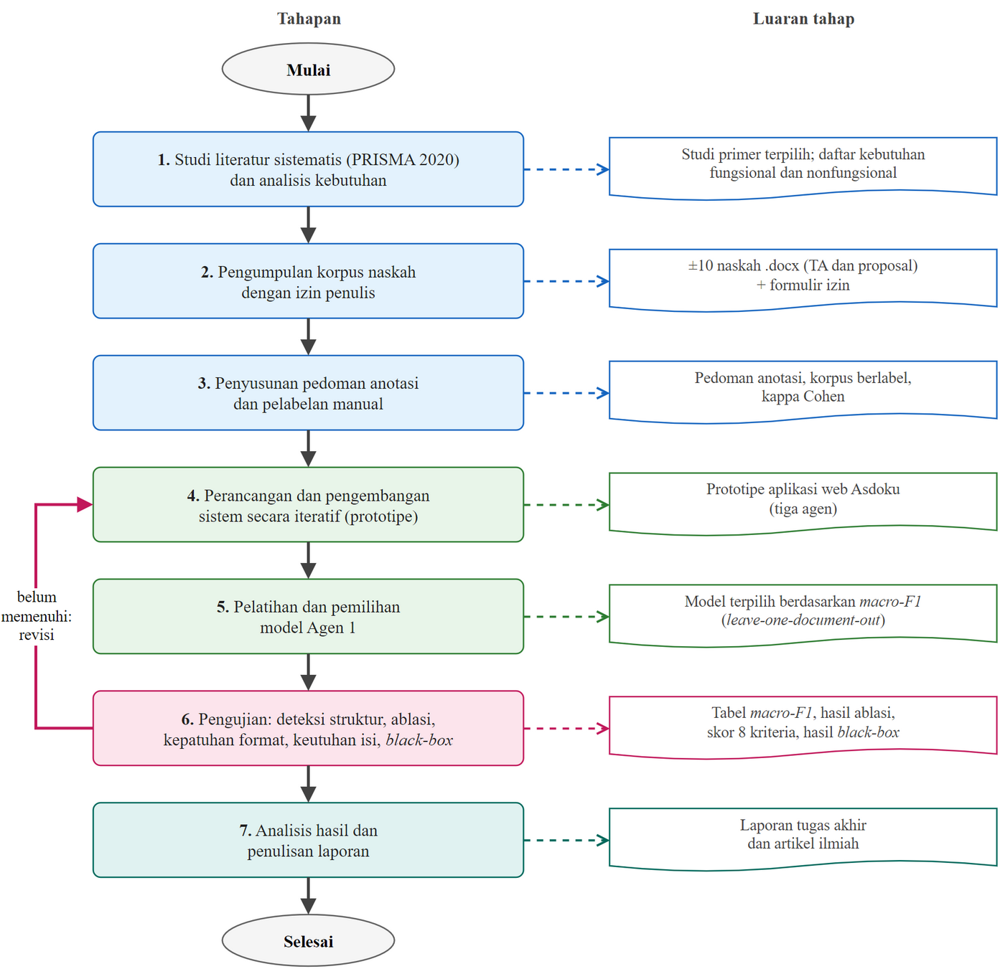

# BAB III METODOLOGI PENELITIAN

## Pendekatan dan Jenis Penelitian

Penelitian ini merupakan penelitian rancang bangun (*research and development*) yang menghasilkan artefak perangkat lunak, yaitu sistem Asdoku, lalu mengevaluasinya secara kuantitatif melalui eksperimen. Pengembangan perangkat lunak menggunakan model *Prototyping*, karena sebagian kebutuhan format baru dapat dipastikan setelah prototipe diuji pada naskah nyata dan hasilnya dilihat di Microsoft Word. Setiap iterasi prototipe terdiri atas pengujian pada naskah, identifikasi cacat, perbaikan, dan uji regresi. Komponen *machine learning* mengikuti tahapan CRISP-DM (Wirth & Hipp, 2000), yaitu pemahaman masalah, pemahaman data, persiapan data, pemodelan, evaluasi, dan penerapan.

Prototipe awal Asdoku dikembangkan pada mata kuliah Kapita Selekta dan diuji secara internal pada lima dokumen. Pengujian tersebut menunjukkan dua keterbatasan yang menjadi dasar penelitian ini. Pertama, label data latih dihasilkan oleh aturan, bukan oleh manusia, sehingga sistem dinilai dengan kunci jawaban yang disusun dari cara pandangnya sendiri. Kedua, sebagian dokumen uji ikut digunakan dalam pelatihan, sehingga nilai evaluasi tampak lebih tinggi daripada kenyataan. Oleh karena itu, data lama tidak digunakan. Evaluasi dilakukan ulang dengan korpus baru yang dilabeli mengikuti pedoman anotasi tertulis dan dibagi per naskah.

Tahapan penelitian disajikan pada Gambar 3.1 dan diuraikan sebagai berikut.

1. Studi literatur dan analisis kebutuhan: tinjauan literatur sistematis, telaah pedoman UEU 2018, dan penyusunan kebutuhan fungsional serta nonfungsional.
2. Pengumpulan korpus dan perizinan: pengumpulan naskah .docx dari mahasiswa beserta formulir izin.
3. Penyusunan pedoman anotasi dan pelabelan: pelabelan setiap paragraf ke dalam sembilan kelas.
4. Pengembangan prototipe: perancangan dan implementasi ketiga agen serta aplikasi web secara iteratif.
5. Pelatihan dan pemilihan model: pembentukan fitur, validasi silang per naskah, dan pemilihan model terbaik.
6. Pengujian sistem: uji deteksi struktur, uji ablasi, uji kepatuhan format, uji keutuhan isi, dan *black-box testing* pada naskah uji.
7. Analisis dan penulisan laporan.

Gambar 3.1 Tahapan Penelitian

## Lokasi dan Waktu Penelitian

Penelitian dilaksanakan di Fakultas Ilmu Komputer Universitas Esa Unggul pada bulan Oktober 2026 sampai Maret 2027. Jadwal kegiatan disajikan pada Tabel 3.1.

Tabel 3.1 Jadwal Penelitian

| Kegiatan | Okt | Nov | Des | Jan | Feb | Mar |
|---|---|---|---|---|---|---|
| Studi literatur dan analisis kebutuhan | ✓ | ✓ | | | | |
| Pengumpulan korpus dan perizinan | ✓ | ✓ | ✓ | | | |
| Penyusunan pedoman dan pelabelan | | ✓ | ✓ | | | |
| Pengembangan dan iterasi prototipe | ✓ | ✓ | ✓ | ✓ | | |
| Pelatihan dan evaluasi model | | ✓ | ✓ | ✓ | | |
| Pengujian sistem | | | | ✓ | ✓ | |
| Analisis dan penulisan laporan | | | | | ✓ | ✓ |

[ISI: sesuaikan tanda ✓ dengan jadwal yang disepakati bersama dosen pembimbing.]

## Data dan Korpus Penelitian

### Populasi dan Sampel

Populasi penelitian ini adalah naskah tugas akhir dan proposal tugas akhir mahasiswa Fakultas Ilmu Komputer Universitas Esa Unggul dalam format .docx. Sampel dipilih secara *purposive* dengan kriteria sebagai berikut.

1. Berformat .docx asli, bukan hasil konversi dari PDF.
2. Berupa naskah lengkap, bukan formulir, lembar revisi, atau halaman pengesahan saja.
3. Ditulis oleh penulis yang berbeda, satu naskah per penulis.
4. Penulisnya memberikan izin tertulis.
5. Bukan hasil templat yang sama persis, agar variasi format terwakili.

Dari 38 berkas yang terkumpul dari 15 penulis, tujuh naskah memenuhi seluruh kriteria. Sebagian berkas lain berupa formulir, lembar revisi, atau halaman pengesahan, dan sembilan naskah hanya tersedia dalam format PDF. Naskah PDF tidak digunakan karena uji konversi PDF ke .docx pada satu naskah menunjukkan bahwa gaya judul hilang (seluruh paragraf menjadi gaya Normal), paragraf terpotong di batas halaman, dan *header* serta nomor halaman masuk ke dalam teks. Berkas hasil konversi seperti itu tidak mewakili naskah yang benar-benar akan diunggah pengguna.

Unit analisis penelitian ini adalah paragraf Word, yaitu teks di antara dua penekanan tombol Enter. Isi sel tabel, *header*, *footer*, catatan kaki, kotak teks, dan isi *content control* (misalnya daftar pustaka Mendeley) tidak menjadi unit analisis.

### Pembagian Data

Pembagian data dilakukan per naskah, bukan per paragraf, sehingga seluruh paragraf satu naskah hanya berada di satu bagian. Naskah dibagi menjadi tiga bagian dengan kegunaan yang berbeda, seperti disajikan pada Tabel 3.2.

Tabel 3.2 Pembagian Korpus Penelitian

| Bagian | Kode Naskah | Jenis | Jumlah Paragraf | Kegunaan |
|---|---|---|---|---|
| Data latih | L01 | Proposal | 684 | Melatih model dan memilih model melalui validasi silang per naskah |
| Data latih | L02, L03, L04, L05 | Tugas akhir | 854; 1.300; 658; 1.197 | Sama seperti di atas |
| Data pengembangan | U01, U02 | Tugas akhir | 742; 1.922 | Mengukur kinerja selama pengembangan dan menemukan kesalahan sistem |
| Data uji akhir | [ISI: T01–T0n] | [ISI] | [ISI] | Diuji satu kali setelah sistem dibekukan |

Pemisahan data pengembangan dan data uji akhir diperlukan karena selama pengembangan, kesalahan yang ditemukan pada naskah U01 dan U02 dipakai untuk memperbaiki aturan Agen 2 dan Agen 3. Akibatnya, kinerja pada kedua naskah tersebut tidak lagi mencerminkan kinerja pada naskah yang benar-benar baru. Naskah uji akhir diperoleh setelah pengembangan selesai, tidak dibuka sebelum sistem dibekukan, dan diuji tepat satu kali. Sesuai rencana proposal, naskah uji akhir diupayakan terdiri atas tugas akhir dan proposal dari penulis yang belum terwakili dalam korpus.

Proposal dan tugas akhir tidak dipisahkan menjadi dua kelompok terpisah, karena keduanya mengikuti aturan format yang sama dan memiliki jenis elemen struktur yang sama. Perbedaannya terletak pada isi, misalnya Bab IV proposal berisi rencana hasil.

Lima dokumen uji internal dari tahap prototipe tidak dipakai sebagai data evaluasi. Empat di antaranya (P1, P2, P3, dan P5) dipertahankan sebagai uji regresi, yaitu memastikan setiap perubahan kode tidak merusak hasil *formatting* yang sebelumnya sudah benar. Dokumen P4 berupa laporan magang dan dikeluarkan karena berada di luar batasan masalah.

### Pelabelan

Setiap paragraf diberi satu dari sembilan label struktur yang didefinisikan pada Pedoman Anotasi (Lampiran 1). Definisi ringkas kelas disajikan pada Tabel 3.3.

Tabel 3.3 Kelas Label Struktur Paragraf

| Label | Definisi |
|---|---|
| COVER_METADATA | Teks identitas di halaman sampul dan halaman judul: jenis naskah, judul, nama, NIM, program studi, fakultas, universitas, tahun |
| FRONTMATTER_TITLE | Judul halaman tanpa nomor bab: halaman awal, Daftar Pustaka/Referensi, dan Lampiran |
| JUDUL_BAB | Judul bab utama, baik "BAB I PENDAHULUAN", "PENDAHULUAN", maupun dua baris "BAB I" dan "PENDAHULUAN" |
| SUB_BAB | Judul bagian di dalam bab pada derajat berapa pun, termasuk judul poin bernomor yang diikuti penjelasan |
| BODY_PARAGRAPH | Seluruh isi tulisan: paragraf, butir daftar, rumus, kode, paragraf gambar, isian formulir "Nama : …", dan baris "Sumber: …" |
| CAPTION_GAMBAR | Judul bernomor yang menamai gambar ("Gambar 2.1 …") |
| CAPTION_TABEL | Judul bernomor yang menamai tabel ("Tabel 3.2 …") |
| DAFTAR_PUSTAKA_ITEM | Satu entri rujukan di bawah judul Daftar Pustaka/Referensi |
| LAINNYA | Paragraf kosong, sisa petunjuk templat, dan baris Daftar Isi/Tabel/Gambar |

Pedoman anotasi juga memuat urutan keputusan untuk kasus yang meragukan dan lima belas kasus batas (K1–K15). Contohnya, baris "BAB II Studi Teoritis, berisi …" di sub-bab Sistematika Penulisan diberi label BODY_PARAGRAPH karena menjelaskan bab, bukan membuka bab (K4). Kalimat "Gambar 2.1 menunjukkan bahwa …" diberi label BODY_PARAGRAPH karena merujuk gambar, bukan menamainya (K5). Pedoman diperbarui ke versi 1.1 sebelum pelabelan manual dimulai, yaitu menetapkan baris Daftar Isi/Tabel/Gambar sebagai LAINNYA (K10), karena sistem tidak memformat baris tersebut sebagai paragraf isi melainkan menggantinya dengan daftar otomatis. Setiap perubahan pedoman dicatat pada tabel riwayat versi di dalam pedoman.

Prosedur pelabelan adalah sebagai berikut.

1. Lembar kerja dibuat otomatis untuk setiap naskah dalam format Excel, berisi satu baris per paragraf dengan kolom teks, ringkasan tampilan (gaya Word, ukuran huruf, tebal, perataan), Label Awal, Label, dan Catatan. Kolom Label dibatasi pada sembilan pilihan melalui *dropdown*.
2. Kolom Label Awal diisi pra-label dari aturan sederhana sebagai titik awal, lalu disalin ke kolom Label. Paragraf kosong tanpa gambar tidak ditampilkan dan otomatis berlabel LAINNYA.
3. Anotator memeriksa setiap baris dengan membuka naskah asli di Microsoft Word secara berdampingan, lalu mengubah Label yang tidak sesuai pedoman. Baris yang meragukan diberi catatan.
4. Lembar kerja diimpor kembali dengan pemeriksaan otomatis: label di luar sembilan kelas atau paragraf yang hilang membuat impor ditolak. Persentase label yang diubah dari Label Awal dicatat sebagai ukuran seberapa jauh label akhir menyimpang dari aturan pra-label.
5. Sebanyak minimal 20% paragraf, dipilih per naskah, dilabeli ulang oleh anotator kedua [ISI: nama/peran anotator kedua] tanpa melihat Label Awal maupun label anotator pertama. Kesepakatan diukur dengan kappa Cohen dengan target κ ≥ 0,80. Ketidaksepakatan dibahas untuk memperbaiki pedoman, dan hasil diskusi menjadi label final.

Sebaran label pada data latih dan data pengembangan disajikan pada Tabel 3.4. Sebaran ini menunjukkan ketidakseimbangan kelas yang kuat: paragraf isi mencakup 54% data latih dan 68% data pengembangan, sedangkan judul bab hanya 23 dan 9 paragraf.

Tabel 3.4 Sebaran Label pada Korpus

| Label | Data Latih | Data Pengembangan |
|---|---|---|
| COVER_METADATA | 40 | 16 |
| FRONTMATTER_TITLE | 54 | 29 |
| JUDUL_BAB | 23 | 9 |
| SUB_BAB | 332 | 166 |
| BODY_PARAGRAPH | 2.545 | 1.806 |
| CAPTION_GAMBAR | 66 | 50 |
| CAPTION_TABEL | 46 | 49 |
| DAFTAR_PUSTAKA_ITEM | 132 | 16 |
| LAINNYA | 1.455 | 523 |
| Jumlah | 4.693 | 2.664 |

[ISI: perbarui Tabel 3.2 dan Tabel 3.4 setelah verifikasi label selesai dan naskah uji akhir ditambahkan.]

### Versi Naskah Tanpa Gaya Judul

Seluruh naskah dalam korpus kebetulan memakai *Heading Styles*, padahal banyak mahasiswa hanya menebalkan judul secara manual. Model yang hanya dilatih dengan naskah bergaya rapi berisiko terlalu bergantung pada ciri gaya Word. Untuk itu, dari setiap naskah dibuat salinan "heading polos": setiap paragraf bergaya Heading, Title, Caption, TOC, atau Table of Figures diubah ke gaya Normal, sedangkan tampilannya (tebal, miring, ukuran huruf, dan perataan) dipertahankan sebagai format langsung. Nomor otomatis dari gaya judul ikut hilang, sehingga salinan ini mewakili kasus yang paling sulit. Karena urutan paragraf tidak berubah, label salinan diambil dari label naskah asalnya.

Salinan heading polos digunakan dengan dua aturan. Pertama, salinan selalu berada di bagian yang sama dengan naskah asalnya: salinan naskah latih masuk data latih, dan salinan naskah uji masuk data uji. Kedua, pada validasi silang per naskah, naskah asli dan salinannya selalu ditinggalkan bersama, sehingga model tidak pernah dilatih dengan salah satu versi dari naskah yang sedang diuji. Salinan ini adalah data simulasi dan tidak menggantikan naskah nyata yang tidak memakai gaya judul.

### Anonimisasi

Setiap naskah diberi kode (L untuk data latih, U untuk data pengembangan, T untuk data uji akhir) yang dipakai pada seluruh berkas korpus, lembar kerja, dan laporan evaluasi. Kunci yang memetakan kode ke nama penulis hanya disimpan pada folder data mentah yang tidak ikut ke repositori kode. Folder data mentah dan folder korpus dikecualikan dari sistem kendali versi (git), sehingga naskah tidak ikut tersebar ketika kode dibagikan atau di-*deploy*.

## Kebutuhan Sistem

### Kebutuhan Fungsional

Kebutuhan fungsional sistem disajikan pada Tabel 3.5.

Tabel 3.5 Kebutuhan Fungsional

| Kode | Kebutuhan |
|---|---|
| KF-01 | Pengguna dapat mengunggah naskah .docx melalui aplikasi web. |
| KF-02 | Sistem mengklasifikasikan setiap paragraf ke dalam 9 kelas struktur beserta skor keyakinan. |
| KF-03 | Sistem mengoreksi hasil klasifikasi berdasarkan aturan pedoman dan konteks dokumen. |
| KF-04 | Sistem menerapkan format sesuai pedoman: margin, huruf, spasi, *Heading Styles* bernomor, penomoran halaman Romawi/Arab, *caption*, tabel, dan daftar pustaka. |
| KF-05 | Sistem membuat Daftar Isi, Daftar Tabel, dan Daftar Gambar otomatis. |
| KF-06 | Sistem menguji berkas hasil terhadap 8 kriteria format dan melaporkan skor serta sisa cacat. |
| KF-07 | Sistem menanyakan paragraf ambigu kepada pengguna dan menyimpan label manual. |
| KF-08 | Sistem melatih ulang model setelah label manual terkumpul dan hanya memakai model baru bila kinerjanya tidak menurun. |
| KF-09 | Pengguna dapat mengunduh dokumen hasil. |

### Kebutuhan Nonfungsional

Kebutuhan nonfungsional sistem disajikan pada Tabel 3.6.

Tabel 3.6 Kebutuhan Nonfungsional

| Kode | Kebutuhan |
|---|---|
| KNF-01 | Keutuhan isi: teks, sitasi Mendeley, catatan kaki, gambar, tabel, rumus, dan rujukan silang tidak hilang atau berubah urutannya. |
| KNF-02 | Dokumen hasil terbuka tanpa galat di Microsoft Word, dan seluruh rujukan silang tetap valid setelah *field* diperbarui. |
| KNF-03 | Waktu proses satu naskah hingga 2.000 paragraf tidak lebih dari 30 detik pada layanan *serverless* yang digunakan. |
| KNF-04 | Berkas naskah yang diunggah dihapus dari server setelah diproses; hanya berkas hasil yang disediakan untuk diunduh. |
| KNF-05 | Model produksi dapat dijalankan dalam batas ukuran paket layanan *serverless* yang digunakan. |

## Rancangan Eksperimen

### Konfigurasi Model

Tiga algoritma dibandingkan dengan representasi fitur yang sama (Subbab 2.2.4). Konfigurasi setiap algoritma disajikan pada Tabel 3.7. Seluruh percobaan memakai *random state* 42 agar hasilnya dapat diulang.

Tabel 3.7 Konfigurasi Model

| Algoritma | Konfigurasi |
|---|---|
| Random Forest | 300 pohon, kedalaman tidak dibatasi, bobot kelas seimbang per sampel *bootstrap* |
| Logistic Regression | Regularisasi L2 dengan C = 1,0, maksimum 1.000 iterasi, bobot kelas seimbang |
| XGBoost | 300 pohon, kedalaman maksimum 6, *learning rate* 0,1, *subsample* 0,9, *colsample* 0,8, bobot sampel seimbang |

### Pemilihan Model

Model dipilih dengan validasi silang *leave-one-document-out* pada data latih. Setiap naskah latih bergiliran ditinggalkan bersama salinan heading polosnya, model dilatih pada naskah lain, lalu diuji pada naskah yang ditinggalkan. TF-IDF dilatih ulang pada setiap putaran hanya dari data latih putaran tersebut, agar kosakata naskah uji tidak bocor ke model. Model dengan rata-rata macro-F1 tertinggi dipilih, lalu dilatih ulang pada seluruh data latih dan dipakai sebagai Agen 1. Data pengembangan dan data uji akhir tidak dipakai dalam pemilihan ini.

### Konfigurasi Uji Ablasi

Untuk menjawab rumusan masalah 3, tiga konfigurasi dibandingkan pada naskah yang sama.

1. Agen 1 saja: label diambil langsung dari prediksi Random Forest tanpa koreksi.
2. Aturan Agen 2 saja: Agen 2 dijalankan tanpa masukan model, yaitu prediksi Agen 1 diganti dengan label netral (paragraf isi) dan skor keyakinan nol, sehingga seluruh keputusan berasal dari aturan.
3. Sistem multi-agen: alur lengkap seperti yang digunakan aplikasi, yaitu Agen 1 diikuti putaran umpan balik Agen 2.

Label keluaran Agen 2 dipetakan ke sembilan kelas yang sama dengan label manual sebelum dibandingkan. Selama pengujian, penyimpanan koreksi ke kumpulan data *Active Learning* dimatikan agar naskah uji tidak ikut masuk ke data pelatihan ulang.

### Pembekuan Sistem

Sebelum naskah uji akhir dibuka, seluruh kode, model, dan aturan dibekukan dengan menandai versinya di sistem kendali versi (*git tag*). Naskah uji akhir kemudian diproses satu kali dengan versi tersebut. Apabila setelahnya sistem diperbaiki, versi baru dilaporkan terpisah dan dievaluasi pada naskah uji yang berbeda.

## Teknik Pengumpulan Data

Data penelitian dikumpulkan dengan empat teknik.

1. Studi literatur: tinjauan literatur sistematis dengan protokol PRISMA 2020 pada basis data Scopus tahun 2021–2026, yang dilaksanakan pada tahap Kapita Selekta, ditambah penelusuran penelitian sejenis di Indonesia.
2. Dokumentasi: pengumpulan naskah .docx dari mahasiswa beserta formulir izin tertulis.
3. Anotasi: pelabelan setiap paragraf ke dalam sembilan kelas mengikuti pedoman anotasi.
4. Eksperimen: menjalankan sistem pada naskah uji dan merekam hasil deteksi, berkas keluaran, laporan pengujian, serta waktu proses.

## Instrumen Penelitian

Instrumen yang digunakan dalam penelitian ini adalah sebagai berikut.

1. Pedoman anotasi sembilan kelas struktur beserta urutan keputusan dan kasus batas (Lampiran 1).
2. Lembar kerja anotasi Excel per naskah dengan pilihan label tertutup.
3. Daftar periksa 8 kriteria format pedoman UEU, yang diperiksa otomatis oleh Agen 2 dan diverifikasi manual di Microsoft Word. Kriteria tersebut disajikan pada Tabel 3.8.
4. Alat evaluasi otomatis: pembuat dan pengimpor lembar kerja anotasi, pelatihan dan pemilihan model, uji ablasi, uji keutuhan isi, dan uji regresi.
5. Skenario *black-box testing* untuk KF-01 sampai KF-09 (Lampiran 3).
6. Formulir izin penggunaan naskah (Lampiran 4).

Tabel 3.8 Kriteria Kepatuhan Format

| No | Kriteria | Yang Diperiksa |
|---|---|---|
| 1 | Margin | Kiri 4 cm, atas, kanan, dan bawah 3 cm di seluruh *section* |
| 2 | Penomoran halaman | Romawi kecil pada bagian awal dan angka Arab pada bagian isi; halaman judul tidak bernomor |
| 3 | Judul bab | Huruf kapital, tebal, rata tengah, bernomor "BAB" dengan angka Romawi |
| 4 | Sub-bab | Bernomor bertingkat dengan spasi sebelum dan sesudah sesuai aturan |
| 5 | Paragraf isi | Jenis dan ukuran huruf, jarak baris, spasi, dan indentasi alinea |
| 6 | Ukuran kertas | A4 tegak (21,0 × 29,7 cm) |
| 7 | *Header* | Tulisan "Universitas Esa Unggul" di kanan atas |
| 8 | Tabel | Tanpa garis vertikal pada tabel data |

## Teknik Analisis Data

Teknik analisis disusun mengikuti rumusan masalah.

1. Rumusan masalah 1 (representasi fitur): perbandingan macro-F1 validasi silang per naskah untuk beberapa susunan fitur, yaitu fitur dasar, ditambah ciri gaya Word, ditambah ciri pola teks, keduanya, dan keduanya dengan pelatihan versi heading polos. Analisis ini menunjukkan kontribusi setiap kelompok ciri.
2. Rumusan masalah 2 (rancang bangun sistem): analisis kebutuhan, perancangan arsitektur dan alur, implementasi, serta *black-box testing* terhadap KF-01 sampai KF-09, dengan hasil berupa tabel skenario, hasil yang diharapkan, hasil aktual, dan status.
3. Rumusan masalah 3 (kinerja deteksi struktur):
   a. perbandingan Random Forest, Logistic Regression, dan XGBoost dengan validasi silang per naskah pada data latih;
   b. *confusion matrix* serta *precision*, *recall*, dan F1 per kelas pada naskah uji, dilaporkan terpisah untuk naskah asli dan versi heading polos;
   c. uji ablasi tiga konfigurasi, dengan macro-F1 dan interval kepercayaan *bootstrap* 95% untuk setiap konfigurasi;
   d. uji McNemar antara sistem multi-agen dan Agen 1 saja untuk menguji hipotesis (Subbab 2.4);
   e. analisis kesalahan per kelas, yaitu paragraf mana yang diperbaiki Agen 2, mana yang justru dirusak, dan apa penyebabnya.
4. Rumusan masalah 4 (kepatuhan dan keutuhan):
   a. kepatuhan format: persentase kriteria yang terpenuhi dari 8 kriteria per dokumen, diperiksa otomatis oleh Agen 2 dan diverifikasi manual di Microsoft Word dengan daftar periksa;
   b. keutuhan isi: perbandingan jumlah gambar, tabel, rumus, catatan kaki, dan sitasi Mendeley sebelum dan sesudah diproses, serta persentase paragraf sumber yang teksnya ditemukan di dokumen hasil. Baris Daftar Isi lama tidak dihitung karena memang diganti daftar otomatis. Targetnya adalah tidak ada selisih;
   c. keabsahan rujukan silang: jumlah *field* yang menampilkan galat setelah dokumen hasil dibuka di Microsoft Word dan seluruh *field* diperbarui. Targetnya adalah nol.

## Validitas dan Reliabilitas

Validitas dan reliabilitas penelitian dijaga dengan langkah-langkah berikut.

1. Reliabilitas anotasi: minimal 20% paragraf dilabeli ulang oleh anotator kedua secara buta, dan kesepakatannya diukur dengan kappa Cohen.
2. Validitas label: seluruh label diperiksa terhadap pedoman anotasi tertulis. Persentase label yang diubah dari pra-label dilaporkan untuk menunjukkan seberapa besar pengaruh aturan pra-label terhadap label akhir, karena aturan pra-label memiliki kemiripan dengan aturan Agen 2.
3. Validitas evaluasi: data dibagi per naskah; data pengembangan dipisahkan dari data uji akhir; sistem dibekukan sebelum naskah uji akhir dibuka; dan naskah uji akhir tidak digunakan dalam pelatihan, pemilihan model, maupun penyusunan aturan.
4. Validitas hasil format: setiap dokumen hasil diperiksa di Microsoft Word asli, karena pengujian struktur XML saja terbukti tidak menangkap elemen yang dibuang Word saat dokumen dibuka.
5. Reprodusibilitas: versi pustaka dikunci, *random state* ditetapkan, dan seluruh tabel hasil dapat dibuat ulang dari kode dan korpus pada versi yang ditandai.

## Etika Penelitian

Penelitian ini menggunakan naskah milik mahasiswa lain, sehingga ditetapkan ketentuan etika sebagai berikut.

1. Naskah hanya digunakan setelah penulis memberikan izin tertulis (Lampiran 4).
2. Nama, NIM, dan identitas lain dalam naskah tidak dicantumkan dalam laporan; naskah dirujuk dengan kode.
3. Korpus tidak dipublikasikan dan hanya dapat diakses oleh peneliti, dosen pembimbing, dan anotator kedua. Yang dipublikasikan hanya statistik agregat dan pedoman anotasi.
4. Berkas naskah asli dihapus setelah sidang. Lembar label yang telah dianonimkan disimpan paling lama dua tahun setelah sidang untuk penelitian lanjutan dan publikasi, hanya bagi naskah yang penulisnya menyetujui penyimpanan tersebut pada formulir izin.
5. Naskah yang diunggah pengguna ke aplikasi web dihapus dari server setelah diproses.
